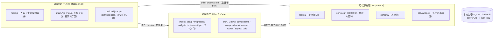

# 班集 · 开发文档

本文档集按源码整理「班集」桌面应用的结构与实现，目标是：每个文件、组件、接口都能查到其**定位与职责、对外接口、内部实现、调用方与注意事项**。

- 项目简介、功能列表、快速开始、构建打包：见仓库根目录 [README.md](../../README.md)
- 代码与文档数量统计：见 [code-stats.md](./code-stats.md)
- 设计过程、历史评审、优化计划等过程性材料在 `doc/开发文档/`（**不入库**，不属于本套文档）
---
## 一、主要内容

1. **主进程**：Electron 侧的窗口、托盘、自定义协议、后端 fork 与心跳、IPC 白名单、打包精简。
2. **后端**：Express 服务的启动时序、逐文件清单、每个 HTTP 接口的处理方式、抽出来的公共能力、加密数据库与表结构。
3. **前端**：Vue 3 应用的入口与构建、15 个页面、29 个组合式函数（根目录 22 + `ai/` 7）、81 个组件（逐个说明用途、Props/Emits/Slots/Expose 与内部函数）、主题与工具。
4. **专题**：AI（前端组件与后端工具链如何配合）、性能（启动流程、内存口径、前后端优化及结论）、打包与分支（打包流程、剔除规则、Vue 3.6 / 3.5 双分支如何兼容）、界面设计与交互（三套主题、日夜模式、图标、排版、弹窗与动效）。
5. **依赖**：依赖清单、各依赖的用途、使用位置与许可证原文。
6. **测试**：`testjs/` 下单元 / 行为 / 冒烟 / 探针 / 工具五类脚本的测试范围、运行方式与判据。
7. **小组件**：工具箱浮窗与桌面小组件的前端入口、主进程侧实现与数据接口。
---
## 二、文档目录

### 2.1 总览与工具

| 文档 | 主要内容 |
| --- | --- |
| [README.md](./README.md) | 本文件：主要内容、全量文档目录、三层架构、关键机制、常用使用方法 |
| [dev-doc-verification.md](dev-doc-verification.md) | 文档写作、更新与校验：子文档 / 子模块 / 专题模板，词语与图表规则，更新流程与映射表，可信度、30 类校验、不足与维护记录 |
| [user-doc-verification.md](user-doc-verification.md) | 用户手册（`doc/user/`）的写法标准、维护标准与两套文档的边界 |
| [code-stats.md](./code-stats.md) | 代码与文档的行数 / 字符数统计：代码按模块与后缀汇总，文档单独成板块（由 `testjs/tools/code_stats.ps1` 生成） |

### 2.2 主进程

| 文档 | 主要内容 |
| --- | --- |
| [main-process/README.md](./main-process/README.md) | `electron/` 全部模块：整体机制（协议、窗口、后端 fork/心跳、托盘、启动计时、打包精简）、目录树与主进程标准 |
| [main-process/entry.md](./main-process/entry.md) | 入口 `main.js`：加载期顺序、主窗口、`whenReady` 编排、引导/低版本提示、迁移与加密流程、入口 IPC、退出收尾 |
| [main-process/modules.md](./main-process/modules.md) | 24 个 `main.*.js` 模块清单：职责、关键导出 / IPC 通道、依赖与被依赖 |
| [main-process/root-files.md](./main-process/root-files.md) | `electron/` 根文件（`preload.js`、`startup.html`、图标、`afterPack.js`、IPC 清单）与 `inno/`、`installer-assets/` 安装器素材 |

### 2.3 后端

| 文档 | 主要内容 |
| --- | --- |
| [backend/README.md](./backend/README.md) | 后端整体：职责与运行方式、目录结构、逐文件清单、启动与初始化时序、鉴权、安全通道、路由前缀 ↔ 页面映射 |
| [`backend/routes.md`](./backend/routes.md) | 每个路由文件、每个 HTTP 接口：入参/出参、涉及的表、是否记撤销、事务与校验要点 |
| [`backend/services.md`](./backend/services.md) | 抽出来的公共能力：表格服务、历史快照工厂、数据清洗、槽位映射、媒体处理、相册扫描等 |
| [`backend/data-layer.md`](./backend/data-layer.md) | 数据层：加密 SQLite、多库管理、`schema/` 表结构、连接 LRU、主密钥与迁移 |

### 2.4 前端

| 文档 | 主要内容 |
| --- | --- |
| [frontend/README.md](./frontend/README.md) | 定位与职责、技术栈、5 个窗口入口与构建、目录树、路由表、主题系统、关键机制 |
| [frontend/entry.md](./frontend/entry.md) | 5 个 HTML 入口、入口脚本关键动作、构建配置 |
| [frontend/views.md](./frontend/views.md) | 15 个页面：路由、职责与 Tab、关键状态与数据流、调用的后端接口、依赖组件 |
| [frontend/composables.md](./frontend/composables.md) | 29 个组合式函数（根目录 22 + `ai/` 7）：签名、返回字段、时序与副作用、调用方、注意事项 |
| [frontend/misc.md](./frontend/misc.md) | stores / router / styles / utils（49 个）/ 指令 / 独立窗口 / 静态资源 |
| [frontend/components/README.md](./frontend/components/README.md) | 组件标准、全局注册、81 个组件索引 |

组件子文档：

| 文档 | 主要内容 |
| --- | --- |
| [`frontend/components/layout.md`](./frontend/components/layout.md) | `Sidebar` 导航：分组、乐观高亮、路由预取 |
| [`frontend/components/base.md`](./frontend/components/base.md) | 22 个基础件：下拉、开关、对话框壳、确认框、右键菜单、图标、空态、通知、搜索、标签页、周切换等 |
| [`frontend/components/tables.md`](./frontend/components/tables.md) | 表格与网格：`DynamicTable`（动态列 CRUD）、`GridView`（座位/课表/值日）、AI 表格预览与提案表 |
| [`frontend/components/dialogs.md`](./frontend/components/dialogs.md) | 31 个业务弹窗：新增/编辑记录、设置、编排、回填、权重算法、相册任务等 |
| [`frontend/components/import-export.md`](./frontend/components/import-export.md) | 导入导出：Excel 导出、相册索引导出、Excel 导入、视频缩略图 |
| [`frontend/components/ai.md`](./frontend/components/ai.md) | AI 对话界面：消息列表、会话面板、链接/变更面板、流式尾巴、输入器 |
| [`frontend/components/album.md`](./frontend/components/album.md) | 相册年份尺 |
| [`frontend/components/data-manage.md`](./frontend/components/data-manage.md) | 数据管理：Markdown/对话导出、Markdown 编辑、数据目录 |
| [`frontend/components/root.md`](./frontend/components/root.md) | 根级组件：动画时钟、班干部管理与树、截断文本、AI 图表 |

### 2.5 专题

| 文档 | 主要内容 |
| --- | --- |
| [`topics/README.md`](./topics/README.md) | 专题索引：各专题的定位与类型、阅读路径、写作结构与边界 |
| [`topics/ai.md`](./topics/ai.md) | AI 全链路：前端组件逐个、SSE 流式与工具调用、`query` 只读 + `propose_write` 提案确认、后端 `routes/ai/*` 与 `ai.tools/*`、记忆/技能/子代理、局限与验证 |
| [`topics/performance.md`](./topics/performance.md) | 性能：启动全链路与计时口径、内存口径（PDH 专用工作集）与采样、前端优化清单、后端优化清单、打包体积、测量方法与结论表 |
| [`topics/build-and-branches.md`](./topics/build-and-branches.md) | 打包与分支：`electron:build` 全流程、`afterPack` 剔除/保留清单、Inno Setup 产物、Vue 3.6 与 3.5 双分支的目录与开关、验证方式 |
| [`topics/design-and-interaction.md`](./topics/design-and-interaction.md) | 界面设计与交互：桌面感基线、主题令牌与按需加载、base / glass / glass2 三套主题、日夜模式与切换时序、动画时长/缓动/场景清单、图标体系、界面与弹窗排版、交互规范与红线 |
| [`topics/security.md`](./topics/security.md) | 安全：架构分层与威胁局限、账号等级（plain/nopass/password/privacy）、回环 HTTP 加密握手、后端鉴权与清洗、网页隔离、AI 权限隔离、本地/账号/缓存文件结构、npm 风险与替换、更新完整性 |

### 2.6 依赖

| 文档 | 主要内容 |
| --- | --- |
| [`dependencies/README.md`](./dependencies/README.md) | 依赖全景与总表：名称、版本、类型、许可证、打包去向、是否随安装包分发 |
| [`dependencies/frontend.md`](./dependencies/frontend.md) | 前端 15 个运行时依赖 + 4 个开发期依赖，逐个写用途、使用位置、打包去向、许可证 |
| [`dependencies/backend.md`](./dependencies/backend.md) | 后端 12 个运行时依赖（含原生模块），逐个同上 |
| [`dependencies/desktop.md`](./dependencies/desktop.md) | 根 `package.json`、Electron 构建/打包工具链、随包资源（FFmpeg、NotoSansSC 字体、安装器素材） |
| [`dependencies/licenses.md`](./dependencies/licenses.md) | 许可证原文：按类型收全文（MIT / ISC / Apache-2.0 / BSD-3-Clause / LGPL-2.1 / SIL OFL）+ 每个依赖的版权行 |

### 2.7 测试

| 文档 | 主要内容 |
| --- | --- |
| [`testing/README.md`](./testing/README.md) | testjs 目录分工与入库规则、入口命令矩阵、runner 与旗标、结论台账、新增脚本流程 |
| [`testing/units.md`](./testing/units.md) | 92 个单元测试：逐个写覆盖范围、前置依赖、运行方式 |
| [`testing/behavior.md`](./testing/behavior.md) | 10 个行为层测试：暴露面、失败语义、架构标准、登录态、串行保存等 |
| [`testing/smoke.md`](./testing/smoke.md) | 17 个链路冒烟脚本：前置环境、产物顺序、退出码判据 |
| [`testing/probe.md`](./testing/probe.md) | 53 个探针：启动/性能、渲染绘制、相册查看器、表格拖拽、Vapor、其他 |
| [`testing/tools.md`](./testing/tools.md) | 18 个工具脚本：种子数据、代码统计、边界检查、审计、图标生成、文档一致性校验等 |

### 2.8 小组件

| 文档 | 主要内容 |
| --- | --- |
| [widgets.md](./widgets.md) | 工具箱浮窗与桌面小组件：前端入口、组件、主进程 `main.widget.js`、数据接口、标准 |

---
## 三、文档使用帮助
### 1.应用的三层架构介绍

应用由三个进程/上下文组成，前端与后端之间只走本机回环 HTTP，主进程与渲染进程之间只走白名单 IPC：

上图即三层结构：主进程用 `child_process.fork`（创建子进程）拉起后端，渲染进程只通过 `IPC`（进程间通信，走 `preload.js`（预加载脚本）白名单）与主进程通信，与后端之间只走本机回环 `HTTP`（超文本传输协议）；数据落在本地加密 SQLite。

### 2.关键机制汇总

| 机制 | 说明 | 详见 |
| --- | --- | --- |
| 进程模型 | 后端由主进程 fork，仅监听环回地址；端口取 `BACKEND_PORT`（默认 3000） | `main-process/README.md`、`backend/README.md` |
| IPC 白名单 | 渲染进程只能调用 `preload.js` 中显式登记的通道（invoke / send / on 三类） | `main-process/README.md` |
| 前端加载 | 打包后用自定义 `app://` 协议加载，而非 `file://`，以获得可持久化的 origin | `main-process/README.md` |
| 通信安全 | axios + JWT；请求/响应体经安全通道加密（ECDH P-256 + HKDF + AES-256-GCM） | `backend/README.md`、`frontend/misc.md` |
| 数据 | 本地加密 SQLite；`index.db` 登记账号与库，每位班主任一个自含加密库，`db.js` 用 `AsyncLocalStorage` 把调用转发到当前请求绑定的库 | `backend/data-layer.md` |
| 启动与可靠性 | 启动计时采集「后端就绪 + 首屏可见」；后端心跳与看门狗；界面就绪后后台暖机 | `topics/performance.md` |
| 撤销/重做 | 写操作同步登记到 `/api/undo`，前端 `Ctrl+Z` / `Ctrl+Shift+Z` / `Ctrl+Y` | `frontend/composables.md` |
| AI | 模型只读表（`query`），写操作走 `propose_write` 生成提案，用户确认后由既有 CRUD 执行 | `topics/ai.md` |
| 主题 | `data-theme` 驱动 CSS 变量，预设 `base` / `glass` / `glass2` | `frontend/README.md`、`frontend/misc.md` |

### 3.常用的使用方法

| 目的 | 建议顺序 |
| --- | --- |
| 先跑起来 | 根 `README.md` → `backend/README.md` → `frontend/README.md` |
| 改界面/加页面 | `frontend/README.md` → `frontend/views.md` → `frontend/components/README.md` → 对应组件子文档 |
| 改接口/加字段 | `backend/routes.md` → `backend/services.md` → `backend/data-layer.md` → `frontend/composables.md` |
| 改窗口/托盘/打包 | `main-process/README.md` → `widgets.md` |
| 排查 AI 问题 | `topics/ai.md` |
| 排查启动慢/内存高 | `topics/performance.md` |
| 加依赖/查许可证 | `dependencies/README.md` → 对应子文档 → `dependencies/licenses.md` |
| 加测试/查测试覆盖 | `testing/README.md` → 对应子文档 |

---

## 四、文档维护

文档写作标准（模板与规则）、更新流程与映射、校验项与记录统一在 [dev-doc-verification.md](dev-doc-verification.md)：写作前按其中的「文档写作标准」执行，改完代码按「文档更新」查表，提交前跑 `npm run docs:verify`。

---
