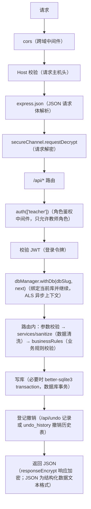

# 后端路由与接口处理（`student-backend/routes/`）

<!-- doc-tree:start -->
## 本篇涉及的文件

只展示本篇会讲到的代码文件；模块内其余文件见同级 README。

```text
classnest/
└── student-backend/
    ├── routes/
    │   ├── ai/
    │   │   ├── ai.tools/
    │   │   │   ├── tools.executors/
    │   │   │   │   ├── executors.checks.js  # 数据体检、冲突检测与权重评分
    │   │   │   │   ├── executors.common.js  # 通用小工具：日期解析、JSON 解析、姓名映射、拼音匹配、值日模式解包
    │   │   │   │   ├── executors.image.js  # export_image（导出排布图规格）：课表 / 座位表 / 值日表 → 排布图参数
    │   │   │   │   ├── executors.impact.js  # delete_impact（删除前影响预估）：只读统计引用情况
    │   │   │   │   ├── executors.js  # 执行器门面：装配各域执行器、过程块文案与展示类工具
    │   │   │   │   ├── executors.proposal.js  # 写入提案（propose_*（提案类工具）与批量操作）
    │   │   │   │   ├── executors.query.js  # 查询、聚合、找人（姓名 / 拼音）与跨表检索
    │   │   │   │   └── executors.snapshot.js  # 整库快照（snapshot_create（创建）/ snapshot_list（列表）/ s…
    │   │   │   ├── tools.js  # 工具注册表与 runTool 分发（query / propose_* / 图表 / 体检 …
    │   │   │   ├── tools.schema.js  # 各工具的 JSON schema（入参 / 出参定义）与枚举（CHART_TYPES（图表类…
    │   │   │   └── tools.subagent.js  # 子代理（子模型）执行入口：复用只读白名单并在执行前校验
    │   │   ├── ai.budget.js  # AI 调用预算闸门：主对话与子助手共用的用量记账与限额
    │   │   ├── ai.config.js  # GET/PUT /config（读取/保存配置）、GET /models（模型列表）、POS…
    │   │   ├── ai.constants.js  # 读写表白名单
    │   │   ├── ai.conversations.js  # POST /chat/stream（流式对话，SSE（服务器推送））、POST /conve…
    │   │   ├── ai.dataRoutes.js  # GET /records/:table（读表）、POST /doc（生成文档）、POST /…
    │   │   ├── ai.helpers.js  # 列元数据归一
    │   │   ├── ai.js  # AI 接口聚合
    │   │   ├── ai.llm.js  # LLM 调用与工具集
    │   │   ├── ai.memory.js  # GET/PUT /memory（读取/保存长期记忆）
    │   │   ├── ai.skills.js  # GET /skills（技能列表）、GET /skills/:name（技能详情）、POST…
    │   │   ├── ai.subagent-tools.js  # 子代理只读白名单
    │   │   └── ai.upload.js  # POST /upload（文本/PDF/Word/PPT/Excel 解析，临时文件用完即删…
    │   ├── undo/
    │   │   ├── undo.executors.js
    │   │   ├── undo.helpers.js  # 记录构造/方向切换辅助
    │   │   ├── undo.js
    │   │   └── undo.records.js  # undo_history 读写、裁剪与 redo 侧失效
    │   ├── account.js  # 挂载 /api/account
    │   ├── activities.js
    │   ├── album.js
    │   ├── auth.js  # 挂载 /api
    │   ├── cadres.js  # /api/cadres
    │   ├── countdowns.js  # 活动路由
    │   ├── dashboard.js  # /api/dashboard
    │   ├── dataExport.js
    │   ├── duty.js  # /api/duty
    │   ├── dynamicTable.js  # 工厂
    │   ├── groupManage.js  # /api/group-manage
    │   ├── historyRoutes.js
    │   ├── leaves.js  # /api/leaves
    │   ├── schedule.js  # /api/schedule
    │   ├── scores.js  # /api/scores
    │   ├── search.js  # /api/search
    │   ├── seats.js  # /api/seats
    │   └── widgetSettings.js  # /api/widget-settings
    └── scanWorker.js
```
<!-- doc-tree:end -->

本文件说明两部分内容：每个路由文件的挂载位置与接口清单；每个接口的处理流程。跨层机制（安全通道、AI 提案、撤销执行器细节）见 [README.md](./README.md)、[topics/ai.md](../topics/ai.md)。

接口路径和方法保留英文：`GET`（查询）、`POST`（新增/提交）、`PUT`（整体更新）、`PATCH`（局部更新）、`DELETE`（删除）；`router`（路由实例）注册处理函数，`req` / `res` / `next` 分别是请求对象 / 响应对象 / 下一个中间件，`req.params` / `req.query` / `req.body` 是路径参数 / 查询参数 / 请求体，`res.status(...)` 设置 HTTP 状态码（`HTTP` 即超文本传输协议）。

---

## 综合概述

- **定位**：后端 HTTP 路由层（`student-backend/routes/`），负责挂载点、接口清单与每个接口的处理链。
- **公共逻辑**：所有业务接口经 `auth(['teacher'])`（鉴权中间件，只允许教师角色）→ `JWT`（登录令牌）校验 → `dbManager.withDb`（按当前库执行回调的包装函数）绑定当前库；路由内做参数校验、`sanitize`（数据清洗）清洗、事务写库、撤销登记与统一 JSON 响应。
- **局限**：不展开数据层加密/多库细节、安全通道握手、AI 提案与撤销执行器内部实现；这些见 [data-layer.md](./data-layer.md)、[topics/security.md](../topics/security.md)、[topics/ai.md](../topics/ai.md)。
- **规模**：共 229 条路由（`METHOD path`，含 `historyRoutes` 工厂），由 `docs-verify` 从路由源码现算。


### 处理标准的写法

- 简单查询 / CRUD：表格一行写方法 / 路径 / 职责；写操作尽量补「涉及的表 / 是否登记撤销」。
- 复杂接口（注册登录、导出恢复、加密转换、AI 流式、撤销执行器）：在表格下按「入参校验 → 写库与事务 → 撤销 → 副作用 → 失败与局限」展开。
- 跨层机制（安全通道、AI 提案、撤销执行器细节）只给链接，不在本文重复源码。
- 示范：第 2 节的 `POST /register`。

---

## 详细说明

### 1. 所有接口的公共处理链



少数例外：`/api/secure/handshake`（公开）、`/api` 下登录/注册（无需 JWT）、`/uploads` 与 `/api/background`（`authStatic()` 只校验 token 不校验角色）。

### 2. 认证与账号

#### [`routes/auth.js`](../../../student-backend/routes/auth.js)（挂载 `/api`）

| 方法 | 路径 | 处理要点 |
| --- | --- | --- |
| GET | `/accounts` | 返回可登录账号列表（登录页下拉），不返回密钥信息 |
| GET | `/me` | 校验 token 后返回当前用户与库标识 |
| GET | `/media-token` | 签发/回填静态资源用的短时媒体 token（`` / CSS `url()` 无法带头部） |
| POST | `/logout` | 清 Cookie 并失效当前会话 |
| POST | `/db-login` | 选择账号库并校验（隐私模式下走口令包裹） |
| POST | `/db-recover` | 凭本机登记库 + 主密钥恢复登录；`password` 档只发 recover 态（仅授权改密），`plain` / `nopass` 直接发常规 token |
| POST | `/login` | bcrypt 异步比对 → 签发 7 天 JWT → 写 httpOnly Cookie |
| POST | `/register` | 注册；`defer=1` 时任何等级都只存草稿（首次引导用），否则非隐私等级立即建库 |
| POST | `/register/confirm` | 用草稿创建账号与加密库（`encrypted` 跟着草稿走，缺省按加密） |
| POST | `/recover-password` | 恢复密钥哈希比对 → 重置密码 |

#### 处理标准示范：`POST /register`（挂载 `/api`）

- **入参**：`username`（账号名）、`role`（必须为 `teacher`）、`level`（`plain` / `nopass` / `password` / `privacy`）、`password`（目标为 `password` / `privacy` 时必填）；旧参数 `encrypted` / `privacy` 作为兼容回退。
- **校验**：账号名走 `normalizeUsername` + `usernameError`；明文模式不允许带密码；超级隐私必须加密且必须带密码；密码少于 6 位拒绝；账号名跨所有库唯一（重复返回 `409`）。
- **写库与事务**：非隐私等级直接 `createTeacher`（建 `<slug>.db`、写 `users`、登记 `registry`），随后签发会话；隐私等级只把待确认信息写入内存草稿 `pendingRegs`，不落库。
- **撤销**：不登记（账号创建不参与 `Ctrl+Z`）。
- **副作用**：隐私等级生成 12 词恢复词，响应返回 `draftId` 与 `recovery`；草稿有 TTL，确认失败后需重新注册。
- **失败与局限**：只有 `/register/confirm` 才会真正建库；草稿过期返回 `400`；非 `teacher` 角色返回 `403`。

#### [`routes/account.js`](../../../student-backend/routes/account.js)（挂载 `/api/account`）

| 方法 | 路径 | 处理要点 |
| --- | --- | --- |
| GET | `/recovery-key` | 重新生成并返回恢复密钥（需登录） |
| POST | `/export` | 导出备份包（v2：加密库 + 登记信息，整包 base64 一次返回） |
| POST | `/export-zip` | 导出备份包 v3（流式 ZIP：库三件套 + `memory.md` + `uploads` / `ai-skills` / `album-trash` / `receipt-trash` / `snapshots` + 清单）。**无 `Content-Length`**，收据原件不读进内存；`bundle.json` 是第一个条目（前端只读 64KB 判断要不要口令）。写响应体阶段出错只能 `res.destroy()`，让客户端看到「下载不完整」 |
| POST | `/restore` | 从备份包恢复（v2） |
| POST | `/restore-zip` | 登录中从 v3 包恢复。顺序即全部重点：① 解到临时目录并逐项校验（此时一个现有文件都没动）→ ② 换库（复用 v2 的 `restoreBundle`）→ ③ 替换各目录，旧目录改名 `.bak-<时间戳>` 不删。超级隐私模式直接拒；落盘公共部分在 `services/bundleRestore.js` |
| POST | `/restore-zip-offline` | 登录页离线恢复 v3 包（无鉴权，slug 直接从包内 `bundle.json` 取） |
| GET / POST | `/db-encryption` | 查询/切换加密状态；POST 用 NDJSON 流逐步上报进度 |
| POST | `/restore-offline` | 离线恢复（v2，登录页使用） |
| PUT | `/username` / `/password` | 改名（同步学生档案引用）/ 改密。`plain` / `nopass` 档 `users.password` 为空：改名**不校验密码**，改密即「设首个密码」；前端在这两档隐藏密码框与「修改密码」按钮，设密码只能走 `/security-level` |
| GET / POST | `/security-level` | 读取/切换账号安全等级（`plain` / `nopass` / `password` / `privacy`） |
| GET | `/privacy` | 查询超级隐私状态 |
| POST | `/privacy/enable` / `/privacy/disable` | 开启（需密码 + 恢复词）/ 关闭超级隐私 |
| DELETE | `/` | 删除账号（不清理共享目录） |

### 3. 表格类（动态列）

#### [`routes/dynamicTable.js`](../../../student-backend/routes/dynamicTable.js) · 工厂

- **签名**：`createDynamicTableRouter(tableName, { minCount, protectedColumns, fieldTypeOverrides, extraRoutes })`。
- 挂载：`/api/students`（`students`，保护 `学号/姓名`）、`/api/fee-records`（`fee_records`）。
- 学生表未设置 `minCount`（可删空）；班费记录仍保留最少一条。

| 方法 | 路径 | 处理要点 |
| --- | --- | --- |
| GET | `/` | `tableService.queryAll`：按 position 排序，缺失字段元数据时降级用结果键 |
| POST | `/` | 插入行；`atPosition` 指定插入点；`minCount` 保持最少行数 |
| PUT | `/:id` | 更新整行或单元格；先 sanitize 再写 |
| DELETE | `/:id` | 删行；受 `minCount` 限制 |
| POST | `/batch-delete` | 批量删行（`{ ids: [] }`）：`tableService.deleteRows` 整批一个事务，任一 id 不存在 / 受保护关系 / 低于 `minCount` 都整批回滚 |
| POST | `/move-row` | 行移动（重排 position） |
| POST | `/move` | 批量移动/重排 |
| POST | `/add-column` | 新增列（写 `table_meta` 与 ALTER TABLE） |
| POST | `/rename-column` | 重命名列（同步元数据） |
| DELETE | `/columns/:columnName` | 删列（至少保留一个数据字段；保护列拒绝） |
| POST | `/move-column` | 列顺序调整（`sort_order`） |
| POST | `/reorder` | 行顺序整体重排 |
| POST | `/import` | 批量导入（自动补建缺失列、事务插入） |
| POST | `/upload-receipt` | 班费收据上传（仅 fee-records）：10MB、图片扩展名 + MIME + 魔数校验 |

列名白名单正则 `^[a-zA-Z0-9_\u4e00-\u9fa5]+$`，保留字段 `id/position/atPosition` 禁止直接操作。

### 4. 网格与业务

#### [`routes/schedule.js`](../../../student-backend/routes/schedule.js)（`/api/schedule`） · 课程表路由
`GET /`、`PUT /`（实行课表）、`GET/PUT /master`（模板）、`POST /apply-master`、`GET/PUT /settings`；学期：`GET /semesters`、`GET /semesters/prefill`（推荐/当前学期，供首次引导预填）、`POST /semesters`、`PUT /semesters/current`、`PUT /semesters/:id`、`DELETE /semesters/:id`；历史四组由 [`historyRoutes.js`](../../../student-backend/routes/historyRoutes.js) 注册（`GET /history`、`GET /history/:weekStart`、`POST /snapshot`、`DELETE /history/:weekStart`）。

#### [`routes/seats.js`](../../../student-backend/routes/seats.js)（`/api/seats`） · 座位路由
`GET /`、`PUT /`、`PATCH /cell`、`PATCH /master/cell`、`GET/PUT /master`、`POST /apply-master`、`GET/PUT /settings`、`GET/PUT /weight`（权重表）、`GET/PUT/DELETE /draft`（排表草稿）、`GET /daily`（当日视图）、历史：`GET /history`、`GET /history/:weekStart`、`POST /snapshot`、`POST /snapshot/backfill`、`DELETE /history/:weekStart`、`POST /history/week`。**不复用** `historyRoutes`：`seat_history` 多出 mode/rows/cols/seats/aisle_cols/groups_config 等列。

#### [`routes/duty.js`](../../../student-backend/routes/duty.js)（`/api/duty`） · 值日路由
`GET/PUT /settings`、`GET/PUT /`、`PUT /save`、`GET/PUT /template`、`POST /apply-master`、`GET/PUT /weight`、`GET/PUT/DELETE /draft`、`GET /daily`、`GET /big-dates`（大扫除命中日：按 `cycle` + `weekday` 在学期内算出日期列表与「下一次」，非 `big` 模式返回空）；历史：`GET /history`、`GET /history/:weekStart`、`POST /snapshot`、`POST /snapshot/backfill`、`DELETE /history/:weekStart`、`POST /history/week`。模式 `daily` / `big` 由 `services/dutyMode.js` 解包，命中日算法在 `services/dutyCycle.js`。

#### [`routes/leaves.js`](../../../student-backend/routes/leaves.js)（`/api/leaves`） · 请假路由
`GET /`、`POST /`、`PUT /:id`、`POST /reorder`（记录排序）、`GET/POST /today-columns`（今日列配置）、`POST /import`（Excel 导入，按 `学号`/唯一 `姓名` 匹配学生）、`DELETE /:id`、`POST /:id/return`（销假）、`POST /:id/unreturn`（撤销销假）、`POST /:id/cancel`（取消请假）。

#### [`routes/scores.js`](../../../student-backend/routes/scores.js)（`/api/scores`） · 加减分路由
`GET /`、`POST /`、`PUT /:id`、`POST /import`（Excel 导入，`mode` 为 `personal` / `group`，避免个人与小组加错类型）、`DELETE /:id`；个人/小组目标由 `source`（`personal` / `group`）区分。

#### [`routes/groupManage.js`](../../../student-backend/routes/groupManage.js)（`/api/group-manage`） · 分组管理路由
`GET /bootstrap`（维度+小组+成员一次取回）、`GET /:dimId`、维度 CRUD（`POST /dimensions`、`PUT/DELETE /dimensions/:id`、`POST /dimensions/move`）、小组 CRUD（`POST /dimensions/:dimId/groups`、`PUT/DELETE /groups/:id`）、成员（`POST /groups/:groupId/members`、`PUT/DELETE /group-members/:id`、`POST /group-members/move`）、智能分组写回 `POST /dimensions/:dimId/apply-grouping`、Excel 导入 `POST /dimensions/:dimId/import`（`小组` + `姓名` + `备注`，同名小组复用、重复姓名跳过）。

#### [`routes/activities.js`](../../../student-backend/routes/activities.js) / [`routes/countdowns.js`](../../../student-backend/routes/countdowns.js) · 活动路由
各五条：`GET /`、`POST /`、`PUT /:id`、`DELETE /:id`、`POST /import`（Excel 导入；活动必填 `主题`，倒计时必填 `名称` + `截止日`）。

#### [`routes/cadres.js`](../../../student-backend/routes/cadres.js)（`/api/cadres`） · 班干部路由
班干部职务与成员：`GET /`（查询）、`POST /`（新增）、`PUT /:id`（更新）、`DELETE /:id`（删除）、`POST /:id/members`（新增成员）、`DELETE /members/:id`（删除成员）、`POST /:id/move`（移动职务）、`POST /members/:id/move`（移动成员）、`POST /import`（Excel 导入；`职务` 必填，`上级职务` 按名称匹配，`担任学生` 支持多人分隔）。

#### [`routes/widgetSettings.js`](../../../student-backend/routes/widgetSettings.js)（`/api/widget-settings`） · 小组件设置路由
`GET/PUT /`（整体覆盖写，前端必须整包 PUT）、`GET/PUT /apps`、`GET/PUT /class-info`。

#### [`routes/search.js`](../../../student-backend/routes/search.js)（`/api/search`） · 全局搜索路由
跨表关键字检索，返回分组结果（学生、记录、活动等），仅供全局搜索弹窗。

#### [`routes/dashboard.js`](../../../student-backend/routes/dashboard.js)（`/api/dashboard`） · 看板聚合路由
看板聚合只读接口（部分数据与 `widget-settings/class-info` 共用）。

- **响应（v6 · 2-1 起摘要化）**：`{ schedule, duty, countdowns, leaves, students:[{id,姓名}], activities, album, summary }`。
- **不再下发**：全量 `scores` / `fees`；`students` 只保留 `id + 姓名`（值日卡片按 id 显示姓名用）。
- **`summary`**：`studentCount / scoreCount / feeCount / topScores(今日 Top4，扣分为负、小组行用 group_name) / feeBalance / monthIncome / monthExpense`，口径与改造前 `DashboardView` 的三个 computed 逐项一致。
- **实测**（45 人 / 1000 条加减分 / 120 条班费）：整包 358.8KB → **8.9KB**（-97.5%），`JSON.parse` 0.82ms → 0.03ms；`PERF_STARTUP=1` 时首屏聚合日志会带响应体积与各域行数。

### 5. 历史快照工厂

#### [`routes/historyRoutes.js`](../../../student-backend/routes/historyRoutes.js) · 历史快照路由工厂
- **签名**：`registerHistoryRoutes(router, { table, includeId, parseSnapshot, stringifySnapshot })`。
- 生成：`GET /history`、`GET /history/:weekStart`、`POST /snapshot`、`DELETE /history/:weekStart`。
- **使用方**：`duty.js`、`schedule.js`（差异通过参数注入）。

### 6. 相册（[`routes/album.js`](../../../student-backend/routes/album.js)，`/api/album`）

| 方法 | 路径 | 处理要点 |
| --- | --- | --- |
| GET | `/` | 相册列表（带 `cover_photo_id`，按 `mtime DESC` 取第一张非视频） |
| POST | `/` | `kind='folder'` 建文件夹相册并派发扫描；`kind='virtual'` 从其他相册复制索引；`POST /merge` 合并多个虚拟相册 |
| GET | `/photo/:photoId/info` | 单张照片的 EXIF / 尺寸 / 时间等详情 |
| PATCH | `/:id` | 改名/绑定目录等元数据 |
| PUT | `/reorder` | 相册排序 |
| DELETE | `/:id` | 删相册（可撤销；虚拟相册只删索引） |
| POST | `/:id/rescan` | 按 `kind` 分流 full / incremental / virtual，立即返回 |
| POST | `/:id/stop` / `/:id/pause` | 停止 / 暂停继续（子进程检查点原地等） |
| GET | `/:id/status` | 单册扫描状态（前端 800ms 轮询） |
| GET | `/tasks` | 主进程内存态全部任务（含自动发起的扫描） |
| GET | `/tasks/pending` | 库表遗留断点（重启后续扫用） |
| POST | `/tasks/resume` | 按断点续扫（`{albumIds}` 可指定） |
| GET | `/:id/photos` | 照片列表（`photo_date DESC, mtime DESC, id DESC`） |
| GET | `/photo/:photoId/file` | 原文件（鉴权后流式） |
| GET | `/photo/:photoId/thumb` | 缩略图（缓存命中即返回，过期按 `thumb_v` 重建） |
| POST | `/photo/thumbs` | 批量缩略图（≤200；二进制「长度+JPEG」拼接，`X-Thumb-Ids` 响应头） |
| GET | `/photo/:photoId/save-as` | 另存为 |
| DELETE | `/photo/:photoId` | 删除（移入应用内回收站，可撤销） |
| POST | `/photos/move` | 照片索引移动到虚拟相册（可撤销 `album_photo_move`） |

实现要点：扫描在独立子进程（[`scanWorker.js`](../../../student-backend/scanWorker.js)）；缩略图按库隔离（`{thumbsDir}/{slug}/{photoId}.jpg`）；场景细节见 [services.md](./services.md) 与 [data-layer.md](./data-layer.md)。

### 7. 撤销（[`routes/undo/`](../../../student-backend/routes/undo/undo.js)，`/api/undo`）

| 方法 | 路径 | 处理要点 |
| --- | --- | --- |
| GET | `/` | 按 key 分组返回 undo / redo 栈（每 key 上限 50）；每条记录带 `origin`，供设置页按步折叠 |
| GET | `/table/:key/status` | 查询某 key 当前可撤销/可重做数量（标题栏按钮态） |
| POST | `/` | 新增撤销记录（写 `undo_history`，清空**全部**表的 redo 侧：批次可能跨表，只清本 key 会留下重做残尾） |
| POST | `/table/:key/undo` | 快捷键路径：撤销该 key 最近一条；该条带 `origin` 时按批次整批回退（返回 `batch` 条数） |
| POST | `/table/:key/redo` | 快捷键路径：重做该 key 最近一条；`origin` 批次按登记正序整批重做 |
| POST | `/origin/:origin/undo` | 按批次整批撤销（设置页「一次改动」那一行的按钮） |
| POST | `/origin/:origin/redo` | 按批次整批重做（正序） |
| POST | `/:id/undo` | 撤销指定记录 |
| POST | `/:id/redo` | 重做指定记录 |
| DELETE | `/:id` | 删除单条记录 |
| DELETE | `/` | 按 key 清空（`?key=all|key`） |

执行器（[`undo.executors.js`](../../../student-backend/routes/undo/undo.executors.js)）按 `type` 注册 `validate/undo/redo/describe`：`cell_update`、`row_insert/update/delete`、`rows_batch_insert/delete`（一次导入 / 勾选删除整批一条记录）、`row_reorder`（按 `[{id,position}]` 精确回槽位）、`grid_cell`、`grid_snapshot`、`doc_update`、`album_order`、`group_snapshot`、`group_dimension_delete`、`student_cascade_delete`、`album_merge`、`cadre_delete`、`cadre_order`、`cadre_import`、`photo_trash`、`album_delete/add`、`album_photo_move`。表名受 `ALLOWED_TABLES` 与 `GRID_SOURCES` 约束。

班干部（`/api/cadres`）的写操作按三种执行器登记，key 统一为 `班干部`：新增/改名/名额走 `row_insert`/`row_update`（`cadres` 在 `ALLOWED_TABLES` 内），删除职务走 `cadre_delete`（级联删成员 + 下级上移必须整批回滚），拖拽职务/成员走 `cadre_order`（同一动作会改多行 `sort_order`，整批一条记录），Excel 导入走 `cadre_import`（只回滚本次新建的行，接口经 `created` 返回清单）。

批次（`origin`）：一次用户动作登记多条记录时共用一个批次标识。`/table/:key/{undo,redo}` 按「最近一条的 origin」整批回退/重做（快捷键路径），`/origin/:origin/{undo,redo}` 按指定批次整批操作（设置页路径）；文案折叠成「一次改动（N 项）」，前端收到 `full_reload` 后整表重拉。无 `origin` 的记录仍是单条语义。批次可能跨表，因此 `pushRecord` 清的是全部 redo 侧，而不是本 key —— 否则在另一张表重做会只回一半。

配套模块：[`undo.helpers.js`](../../../student-backend/routes/undo/undo.helpers.js)（记录构造/方向切换辅助）、[`undo.records.js`](../../../student-backend/routes/undo/undo.records.js)（`undo_history` 读写、裁剪与 redo 侧失效）。

### 8. AI（[`routes/ai/ai.js`](../../../student-backend/routes/ai/ai.js)（AI 接口聚合），`/api/ai`（AI 接口前缀））

`ai.js` 只做聚合挂载，接口分布如下（机制见 [topics/ai.md](../topics/ai.md)）：

| 文件 | 主要接口 |
| --- | --- |
| [`ai.config.js`](../../../student-backend/routes/ai/ai.config.js)（模型配置接口） | `GET/PUT /config`（读取/保存配置）、`GET /models`（模型列表）、`POST /models`（新增模型）、`PUT /models/:id/active`（启用模型）、`DELETE /models/:id`（删除模型）、`POST /models/discover`（发现模型）、`GET /models/:id/models`（模型清单）、`PUT /models/:id`（更新模型）、`PUT /models/:id/reasoning`（推理参数）、`POST /config/test`（连通测试） |
| [`ai.conversations.js`](../../../student-backend/routes/ai/ai.conversations.js)（对话与 SSE 接口） | `POST /chat/stream`（流式对话，`SSE`（服务器推送））、`POST /conversations`（新建会话）、`GET /conversations`（会话列表）、`DELETE /conversations/:id`（删除会话）、`GET /conversations/:id/messages`（消息列表）、`POST /conversations/:id/messages`（新增消息）、`PUT /conversations/:id/messages/:mid`（更新消息）、`DELETE /conversations/:id/messages/last-assistant`（删最后一条助手消息）、`POST /conversations/:id/messages/delete`（批量删消息） |
| [`ai.dataRoutes.js`](../../../student-backend/routes/ai/ai.dataRoutes.js)（数据与快照接口） | `GET /records/:table`（读表）、`POST /doc`（生成文档）、`POST /apply-batch`（批量落库）、`POST /snapshot`（创建快照）、`GET /snapshots`（快照列表）、`POST /snapshot/restore`（恢复快照） |
| [`ai.memory.js`](../../../student-backend/routes/ai/ai.memory.js)（记忆接口） | `GET/PUT /memory`（读取/保存长期记忆） |
| [`ai.skills.js`](../../../student-backend/routes/ai/ai.skills.js)（技能接口） | `GET /skills`（技能列表）、`GET /skills/:name`（技能详情）、`POST /skills`（新增技能）、`PUT/DELETE /skills/:name`（更新/删除技能） |
| [`ai.upload.js`](../../../student-backend/routes/ai/ai.upload.js) | `POST /upload`（文本/PDF/Word/PPT/Excel 解析，临时文件用完即删） |
| [`ai.tools/tools.js`](../../../student-backend/routes/ai/ai.tools/tools.js) | 工具注册表与 `runTool` 分发（`query` / `propose_*` / 图表 / 体检 / 子代理等） |

其余 AI 文件（无 `router.get/post` 或只做内部能力，不单独挂接口）：

- [`ai.js`](../../../student-backend/routes/ai/ai.js)（聚合挂载）、[`ai.budget.js`](../../../student-backend/routes/ai/ai.budget.js)（AI 调用预算闸门：主对话与子助手共用的用量记账与限额）、[`ai.constants.js`](../../../student-backend/routes/ai/ai.constants.js)（读写表白名单）、[`ai.helpers.js`](../../../student-backend/routes/ai/ai.helpers.js)（列元数据归一）、[`ai.llm.js`](../../../student-backend/routes/ai/ai.llm.js)（LLM 调用与工具集）、[`ai.subagent-tools.js`](../../../student-backend/routes/ai/ai.subagent-tools.js)（子代理只读白名单）。
- 工具定义与执行（由 `tools.js`（工具门面）装配）：

| 文件 | 职责 |
| --- | --- |
| [`tools.schema.js`](../../../student-backend/routes/ai/ai.tools/tools.schema.js) | 各工具的 JSON schema（入参 / 出参定义）与枚举（`CHART_TYPES`（图表类型）/ `AGG_FNS`（聚合函数）/ `MAX_BATCH_OPS`（批量操作上限）） |
| [`tools.subagent.js`](../../../student-backend/routes/ai/ai.tools/tools.subagent.js) | 子代理（子模型）执行入口：复用只读白名单并在执行前校验 |
| [`executors.js`](../../../student-backend/routes/ai/ai.tools/tools.executors/executors.js) | 执行器门面：装配各域执行器、过程块文案与展示类工具 |
| [`executors.common.js`](../../../student-backend/routes/ai/ai.tools/tools.executors/executors.common.js) | 通用小工具：日期解析、JSON 解析、姓名映射、拼音匹配、值日模式解包 |
| [`executors.checks.js`](../../../student-backend/routes/ai/ai.tools/tools.executors/executors.checks.js) | 数据体检、冲突检测与权重评分 |
| [`executors.image.js`](../../../student-backend/routes/ai/ai.tools/tools.executors/executors.image.js) | `export_image`（导出排布图规格）：课表 / 座位表 / 值日表 → 排布图参数 |
| [`executors.impact.js`](../../../student-backend/routes/ai/ai.tools/tools.executors/executors.impact.js) | `delete_impact`（删除前影响预估）：只读统计引用情况 |
| [`executors.proposal.js`](../../../student-backend/routes/ai/ai.tools/tools.executors/executors.proposal.js) | 写入提案（`propose_*`（提案类工具）与批量操作） |
| [`executors.query.js`](../../../student-backend/routes/ai/ai.tools/tools.executors/executors.query.js) | 查询、聚合、找人（姓名 / 拼音）与跨表检索 |
| [`executors.snapshot.js`](../../../student-backend/routes/ai/ai.tools/tools.executors/executors.snapshot.js) | 整库快照（`snapshot_create`（创建）/ `snapshot_list`（列表）/ `snapshot_restore`（恢复）） |

### 9. 数据导出（[`routes/dataExport.js`](../../../student-backend/routes/dataExport.js)，`/api/data`）

设置页「数据管理」的数据源与打包出口。只读业务表 + 流式打包，不写库。

- `GET /tables` —— 表清单与行数（20 张业务表），前端据此渲染列表。每条带 `py`（表名拼音首字母，供搜索框用：输入 `xs` 能命中「学生名单」），**它必须跟 `label` 一起维护**，探针按「表名里的中/英文字数」核对长度。
- `POST /sources { keys }` —— 取指定表的数据，返回 `{ fields, rows }`，形状与 `ExportExcel` 组件完全一致（前端因此能直接复用那套导出实现，不必重写格式逻辑）。
- `POST /zip { entries: [{ name, data(base64) }], password, filename, receiptGroups?, includeReceipts? }` —— 把若干文件打成一个 zip 返回字节流（可选 ZipCrypto 加密）。前端用现有 `save-file` 通道落盘，所以**不需要新增 IPC 通道**。
  - **流式**：条目边读边写进响应，任何时刻只持有一个 256KB 块；收据只登记磁盘路径（写入器里读盘），不在这里 `readFileSync` 进内存。响应**不设 `Content-Length`**（长度要等整包写完才知道，预置就等于把流式又变回「先拼完」）。
  - 收据文件有两条来源，二选一：`receiptGroups: [{ code, items: [{ path, name }] }]` 由**调用方分好组**（班费页用，导的是「我现在看到的数据」，含未保存行）；`includeReceipts: true` 由**后端按库里的 `fee_records` 自己分**（数据管理用，它手里只有表格化文本，没有收据原始路径）。
  - 两者最终都落成 `收据文件/{收支编码}/{原文件名}`，编码为空落「未编号」；文件只在 uploads 根目录取（`basename` 压平），不存在的文件跳过。

结构化列在服务端就展开成人读文本：座位是二维网格（讲台行 + 走廊列）、值日 `cells` 是 `{项目:{星期:[人名]}}`、
快照 `payload` 是对象。`readable()` 负责转成「键: 值」并按列翻成中文键名 ——
`GET /sources` 的输出里不允许出现裸 JSON 或英文键名（`testjs/probe/data-export-probe.cjs` 逐格扫描把关）。

### 10. 标准

- 所有写接口都要登记撤销（表格走 `useTableCRUD` 的 `/api/undo`，网格走 `recordGridSnapshotUndo`，相册/分组的撤销由路由自己写）。
- 新增接口必须同时更新 [frontend/views.md](../frontend/views.md) 的接口列与本文档。
- 不在路由里直接拼表名；统一走 `tableService` 或固定白名单。

---

## 注意事项

- 新增业务路由必须挂在 `auth(['teacher'])`（鉴权中间件，只允许教师角色）之后，否则 `db` Proxy（数据库代理对象，按当前库转发查询）会抛「未绑定数据库连接」。
- 写操作要同步登记撤销记录，否则 `Ctrl+Z`（撤销快捷键）无效；撤销键与页面分组保持一致。
- 加密转换、导出/恢复等复杂接口的顺序不可随意调整（关连接 → 退 `WAL`（写前日志）→ 预检（完整性检查）→ 备份 → `rekey`（重设库密钥）→ 校验 → 回写（登记）→ 删备份）。
- 接口路径或参数变化时，同步前端调用方与 [frontend/composables.md](../frontend/composables.md) 的标准。

---
