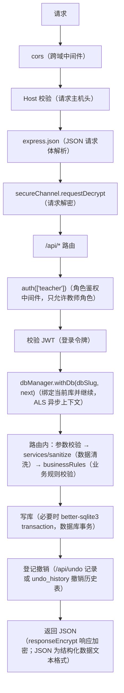

# 后端路由与接口处理（`student-backend/routes/`）

<!-- doc-tree:start -->
## 本篇涉及的文件

只展示本篇会讲到的代码文件（从仓库根目录到文件）；模块内其余文件见同级 README。

```text
project-name/
└── student-backend/
    ├── routes/
    │   ├── ai/
    │   │   ├── ai.tools/
    │   │   │   ├── tools.executors/
    │   │   │   │   ├── executors.checks.js
    │   │   │   │   ├── executors.common.js
    │   │   │   │   ├── executors.image.js
    │   │   │   │   ├── executors.impact.js
    │   │   │   │   ├── executors.js
    │   │   │   │   ├── executors.proposal.js
    │   │   │   │   ├── executors.query.js
    │   │   │   │   └── executors.snapshot.js
    │   │   │   ├── tools.js  # 工具注册表与 runTool 分发（query / propose_* / 图表 / 体检 …
    │   │   │   ├── tools.schema.js
    │   │   │   └── tools.subagent.js
    │   │   ├── ai.config.js  # GET/PUT /config（读取/保存配置）、GET /models（模型列表）、POS…
    │   │   ├── ai.constants.js  # 读写表白名单
    │   │   ├── ai.conversations.js  # POST /chat（对话）、POST /chat/stream（流式对话，SSE（服务器推…
    │   │   ├── ai.dataRoutes.js  # GET /records/:table（读表）、POST /doc（生成文档）、POST /…
    │   │   ├── ai.helpers.js  # 列元数据归一
    │   │   ├── ai.js  # AI 接口聚合
    │   │   ├── ai.llm.js  # LLM 调用与工具集
    │   │   ├── ai.memory.js  # GET/PUT /memory（读取/保存长期记忆）
    │   │   ├── ai.skills.js  # GET /skills（技能列表）、GET /skills/:name（技能详情）、POST…
    │   │   ├── ai.subagent-tools.js  # 子代理只读白名单
    │   │   └── ai.upload.js  # POST /upload（文本/PDF/Word/PPT/Excel 解析，临时文件用完即删…
    │   ├── undo/
    │   │   ├── undo.executors.js
    │   │   ├── undo.helpers.js  # 记录构造/方向切换辅助
    │   │   ├── undo.js
    │   │   └── undo.records.js  # undo_history 读写、裁剪与 redo 侧失效
    │   ├── account.js  # 挂载 /api/account
    │   ├── activities.js
    │   ├── album.js
    │   ├── auth.js  # 挂载 /api
    │   ├── cadres.js  # /api/cadres
    │   ├── countdowns.js  # 活动路由
    │   ├── dashboard.js  # /api/dashboard
    │   ├── duty.js  # /api/duty
    │   ├── dynamicTable.js  # 工厂
    │   ├── groupManage.js  # /api/group-manage
    │   ├── historyRoutes.js
    │   ├── leaves.js  # /api/leaves
    │   ├── schedule.js  # /api/schedule
    │   ├── scores.js  # /api/scores
    │   ├── search.js  # /api/search
    │   ├── seats.js  # /api/seats
    │   └── widgetSettings.js  # /api/widget-settings
    └── scanWorker.js
```
<!-- doc-tree:end -->

本文件回答两件事：每个路由文件挂在哪、有哪些接口；每个接口按什么流程处理。跨层机制（安全通道、AI 提案、撤销执行器细节）见 [README.md](./README.md)、[topics/ai.md](../topics/ai.md)。

接口路径和方法保留英文：`GET`（查询）、`POST`（新增/提交）、`PUT`（整体更新）、`PATCH`（局部更新）、`DELETE`（删除）；`router`（路由实例）注册处理函数，`req` / `res` / `next` 分别是请求对象 / 响应对象 / 下一个中间件，`req.params` / `req.query` / `req.body` 是路径参数 / 查询参数 / 请求体，`res.status(...)` 设置 HTTP 状态码（`HTTP` 即超文本传输协议）。

## 综合概述

- **定位**：后端 HTTP 路由层（`student-backend/routes/`），负责挂载点、接口清单与每个接口的处理链。
- **公共逻辑**：所有业务接口经 `auth(['teacher'])` → JWT 校验 → `dbManager.withDb` 绑定当前库；路由内做参数校验、`sanitize` 清洗、事务写库、撤销登记与统一 JSON 响应。
- **局限**：不展开数据层加密/多库细节、安全通道握手、AI 提案与撤销执行器内部实现；这些见 [data-layer.md](./data-layer.md)、[topics/security.md](../topics/security.md)、[topics/ai.md](../topics/ai.md)。

---
### 处理契约写法

- 简单查询 / CRUD：表格一行写方法 / 路径 / 职责；写操作尽量补「写哪些表 / 是否登记撤销」。
- 复杂接口（注册登录、导出恢复、加密转换、AI 流式、撤销执行器）：在表格下按「入参校验 → 写库与事务 → 撤销 → 副作用 → 失败与局限」展开。
- 跨层机制（安全通道、AI 提案、撤销执行器细节）只给链接，不在本文重复源码。
- 示范：第 2 节的 `POST /register`。

## 详细说明

### 1. 所有接口的公共处理链



少数例外：`/api/secure/handshake`（公开）、`/api` 下登录/注册（无需 JWT）、`/uploads` 与 `/api/background`（`authStatic()` 只校验 token 不校验角色）。

### 2. 认证与账号

#### [`routes/auth.js`](../../../student-backend/routes/auth.js)（挂载 `/api`）

| 方法 | 路径 | 处理要点 |
| --- | --- | --- |
| GET | `/accounts` | 返回可登录账号列表（登录页下拉），不返回密钥信息 |
| GET | `/me` | 校验 token 后返回当前用户与库标识 |
| GET | `/media-token` | 签发/回填静态资源用的短时媒体 token（`` / CSS `url()` 无法带头部） |
| POST | `/logout` | 清 Cookie 并失效当前会话 |
| POST | `/db-login` | 选择账号库并校验（隐私模式下走口令包裹） |
| POST | `/db-recover` | 用恢复词解库（登录页恢复路径） |
| POST | `/login` | bcrypt 异步比对 → 签发 7 天 JWT → 写 httpOnly Cookie |
| POST | `/register` | 生成恢复密钥草稿（12 字），返回前 3 词供确认 |
| POST | `/register/confirm` | 确认恢复词后创建账号与加密库 |
| POST | `/recover-password` | 恢复密钥哈希比对 → 重置密码 |

#### 处理契约示范：`POST /register`（挂载 `/api`）

- **入参**：`username`（账号名）、`role`（必须为 `teacher`）、`level`（`plain` / `nopass` / `password` / `privacy`）、`password`（目标为 `password` / `privacy` 时必填）；旧参数 `encrypted` / `privacy` 作为兼容回退。
- **校验**：账号名走 `normalizeUsername` + `usernameError`；明文模式不允许带密码；超级隐私必须加密且必须带密码；密码少于 6 位拒绝；账号名跨所有库唯一（重复返回 `409`）。
- **写库与事务**：非隐私等级直接 `createTeacher`（建 `<slug>.db`、写 `users`、登记 `registry`），随后签发会话；隐私等级只把待确认信息写入内存草稿 `pendingRegs`，不落库。
- **撤销**：不登记（账号创建不参与 `Ctrl+Z`）。
- **副作用**：隐私等级生成 12 词恢复词，响应返回 `draftId` 与 `recovery`；草稿有 TTL，确认失败后需重新注册。
- **失败与局限**：只有 `/register/confirm` 才会真正建库；草稿过期返回 `400`；非 `teacher` 角色返回 `403`。

#### [`routes/account.js`](../../../student-backend/routes/account.js)（挂载 `/api/account`）

| 方法 | 路径 | 处理要点 |
| --- | --- | --- |
| GET | `/recovery-key` | 重新生成并返回恢复密钥（需登录） |
| POST | `/export` | 导出备份包（加密库 + 登记信息） |
| POST | `/restore` | 从备份包恢复 |
| GET / POST | `/db-encryption` | 查询/切换加密状态；POST 用 NDJSON 流逐步上报进度 |
| POST | `/restore-offline` | 离线恢复（登录页使用） |
| PUT | `/username` / `/password` | 改名（同步学生档案引用）/ 改密 |
| GET / POST | `/security-level` | 读取/切换账号安全等级（`plain` / `nopass` / `password` / `privacy`） |
| GET | `/privacy` | 查询超级隐私状态 |
| POST | `/privacy/enable` / `/privacy/disable` | 开启（需密码 + 恢复词）/ 关闭超级隐私 |
| DELETE | `/` | 删除账号（不清理共享目录） |

### 3. 表格类（动态列）

#### [`routes/dynamicTable.js`](../../../student-backend/routes/dynamicTable.js) · 工厂

- **签名**：`createDynamicTableRouter(tableName, { minCount, protectedColumns, fieldTypeOverrides, extraRoutes })`。
- 挂载：`/api/students`（`students`，保护 `学号/姓名`）、`/api/fee-records`（`fee_records`）。

| 方法 | 路径 | 处理要点 |
| --- | --- | --- |
| GET | `/` | `tableService.queryAll`：按 position 排序，缺失字段元数据时降级用结果键 |
| POST | `/` | 插入行；`atPosition` 指定插入点；`minCount` 保持最少行数 |
| PUT | `/:id` | 更新整行或单元格；先 sanitize 再写 |
| DELETE | `/:id` | 删行；受 `minCount` 限制 |
| POST | `/move-row` | 行移动（重排 position） |
| POST | `/move` | 批量移动/重排 |
| POST | `/add-column` | 新增列（写 `table_meta` 与 ALTER TABLE） |
| POST | `/rename-column` | 重命名列（同步元数据） |
| DELETE | `/columns/:columnName` | 删列（至少保留一个数据字段；保护列拒绝） |
| POST | `/move-column` | 列顺序调整（`sort_order`） |
| POST | `/reorder` | 行顺序整体重排 |
| POST | `/import` | 批量导入（自动补建缺失列、事务插入） |
| POST | `/upload-receipt` | 班费收据上传（仅 fee-records）：10MB、图片扩展名 + MIME + 魔数校验 |

列名白名单正则 `^[a-zA-Z0-9_\u4e00-\u9fa5]+$`，保留字段 `id/position/atPosition` 禁止直接操作。

### 4. 网格与业务

#### [`routes/schedule.js`](../../../student-backend/routes/schedule.js)（`/api/schedule`） · 课程表路由
`GET /`、`PUT /`（实行课表）、`GET/PUT /master`（模板）、`POST /apply-master`、`GET/PUT /settings`；学期：`GET /semesters`、`POST /semesters`、`PUT /semesters/current`、`PUT /semesters/:id`、`DELETE /semesters/:id`；历史四组由 [`historyRoutes.js`](../../../student-backend/routes/historyRoutes.js) 注册（`GET /history`、`GET /history/:weekStart`、`POST /snapshot`、`DELETE /history/:weekStart`）。

#### [`routes/seats.js`](../../../student-backend/routes/seats.js)（`/api/seats`） · 座位路由
`GET /`、`PUT /`、`PATCH /cell`、`PATCH /master/cell`、`GET/PUT /master`、`POST /apply-master`、`GET/PUT /settings`、`GET/PUT /weight`（权重表）、`GET/PUT/DELETE /draft`（排表草稿）、`GET /daily`（当日视图）、历史：`GET /history`、`GET /history/:weekStart`、`POST /snapshot`、`POST /snapshot/backfill`、`DELETE /history/:weekStart`、`POST /history/week`。**不复用** `historyRoutes`：`seat_history` 多出 mode/rows/cols/seats/aisle_cols/groups_config 等列。

#### [`routes/duty.js`](../../../student-backend/routes/duty.js)（`/api/duty`） · 值日路由
`GET/PUT /settings`、`GET/PUT /`、`PUT /save`、`GET/PUT /template`、`POST /apply-master`、`GET/PUT /weight`、`GET/PUT/DELETE /draft`、`GET /daily`；历史：`GET /history`、`GET /history/:weekStart`、`POST /snapshot`、`POST /snapshot/backfill`、`DELETE /history/:weekStart`、`POST /history/week`。模式 `daily` / `big` 由 `services/dutyMode.js` 解包。

#### [`routes/leaves.js`](../../../student-backend/routes/leaves.js)（`/api/leaves`） · 请假路由
`GET /`、`POST /`、`PUT /:id`、`POST /reorder`（记录排序）、`GET/POST /today-columns`（今日列配置）、`DELETE /:id`、`POST /:id/return`（销假）、`POST /:id/unreturn`（撤销销假）、`POST /:id/cancel`（取消请假）。

#### [`routes/scores.js`](../../../student-backend/routes/scores.js)（`/api/scores`） · 加减分路由
`GET /`、`POST /`、`PUT /:id`、`DELETE /:id`；个人/小组目标由 `target_type` 区分。

#### [`routes/groupManage.js`](../../../student-backend/routes/groupManage.js)（`/api/group-manage`） · 分组管理路由
`GET /bootstrap`（维度+小组+成员一次取回）、`GET /:dimId`、维度 CRUD（`POST /dimensions`、`PUT/DELETE /dimensions/:id`、`POST /dimensions/move`）、小组 CRUD（`POST /dimensions/:dimId/groups`、`PUT/DELETE /groups/:id`）、成员（`POST /groups/:groupId/members`、`PUT/DELETE /group-members/:id`、`POST /group-members/move`）、智能分组写回 `POST /dimensions/:dimId/apply-grouping`。

#### [`routes/activities.js`](../../../student-backend/routes/activities.js) / [`routes/countdowns.js`](../../../student-backend/routes/countdowns.js) · 活动路由
各四条：`GET /`、`POST /`、`PUT /:id`、`DELETE /:id`。

#### [`routes/cadres.js`](../../../student-backend/routes/cadres.js)（`/api/cadres`） · 班干部路由
班干部职务与成员：`GET /`（查询）、`POST /`（新增）、`PUT /:id`（更新）、`DELETE /:id`（删除）、`POST /:id/members`（新增成员）、`DELETE /members/:id`（删除成员）、`POST /:id/move`（移动职务）、`POST /members/:id/move`（移动成员）。

#### [`routes/widgetSettings.js`](../../../student-backend/routes/widgetSettings.js)（`/api/widget-settings`） · 小组件设置路由
`GET/PUT /`（整体覆盖写，前端必须整包 PUT）、`GET/PUT /apps`、`GET/PUT /class-info`。

#### [`routes/search.js`](../../../student-backend/routes/search.js)（`/api/search`） · 全局搜索路由
跨表关键字检索，返回分组结果（学生、记录、活动等），仅供全局搜索弹窗。

#### [`routes/dashboard.js`](../../../student-backend/routes/dashboard.js)（`/api/dashboard`） · 看板聚合路由
看板聚合只读接口（部分数据与 `widget-settings/class-info` 共用）。

### 5. 历史快照工厂

#### [`routes/historyRoutes.js`](../../../student-backend/routes/historyRoutes.js) · 历史快照路由工厂
- **签名**：`registerHistoryRoutes(router, { table, includeId, parseSnapshot, stringifySnapshot })`。
- 生成：`GET /history`、`GET /history/:weekStart`、`POST /snapshot`、`DELETE /history/:weekStart`。
- **使用方**：`duty.js`、`schedule.js`（差异通过参数注入）。

### 6. 相册（[`routes/album.js`](../../../student-backend/routes/album.js)，`/api/album`）

| 方法 | 路径 | 处理要点 |
| --- | --- | --- |
| GET | `/` | 相册列表（带 `cover_photo_id`，按 `mtime DESC` 取第一张非视频） |
| POST | `/` | `kind='folder'` 建文件夹相册并派发扫描；`kind='virtual'` 从其他相册复制索引；`POST /merge` 合并多个虚拟相册 |
| GET | `/photo/:photoId/info` | 单张照片的 EXIF / 尺寸 / 时间等详情 |
| PATCH | `/:id` | 改名/绑定目录等元数据 |
| PUT | `/reorder` | 相册排序 |
| DELETE | `/:id` | 删相册（可撤销；虚拟相册只删索引） |
| POST | `/:id/rescan` | 按 `kind` 分流 full / incremental / virtual，立即返回 |
| POST | `/:id/stop` / `/:id/pause` | 停止 / 暂停继续（子进程检查点原地等） |
| GET | `/:id/status` | 单册扫描状态（前端 800ms 轮询） |
| GET | `/tasks` | 主进程内存态全部任务（含自动发起的扫描） |
| GET | `/tasks/pending` | 库表遗留断点（重启后续扫用） |
| POST | `/tasks/resume` | 按断点续扫（`{albumIds}` 可指定） |
| GET | `/:id/photos` | 照片列表（`photo_date DESC, mtime DESC, id DESC`） |
| GET | `/photo/:photoId/file` | 原文件（鉴权后流式） |
| GET | `/photo/:photoId/thumb` | 缩略图（缓存命中即返回，过期按 `thumb_v` 重建） |
| POST | `/photo/thumbs` | 批量缩略图（≤200；二进制「长度+JPEG」拼接，`X-Thumb-Ids` 响应头） |
| GET | `/photo/:photoId/save-as` | 另存为 |
| DELETE | `/photo/:photoId` | 删除（移入应用内回收站，可撤销） |
| POST | `/photos/move` | 照片索引移动到虚拟相册（可撤销 `album_photo_move`） |

实现要点：扫描在独立子进程（[`scanWorker.js`](../../../student-backend/scanWorker.js)）；缩略图按库隔离（`{thumbsDir}/{slug}/{photoId}.jpg`）；场景细节见 [services.md](./services.md) 与 [data-layer.md](./data-layer.md)。

### 7. 撤销（[`routes/undo/`](../../../student-backend/routes/undo/undo.js)，`/api/undo`）

| 方法 | 路径 | 处理要点 |
| --- | --- | --- |
| GET | `/` | 按 key 分组返回 undo / redo 栈（每 key 上限 50） |
| GET | `/table/:key/status` | 查询某 key 当前可撤销/可重做数量（标题栏按钮态） |
| POST | `/` | 新增撤销记录（写 `undo_history`，使该 key 的 redo 侧失效） |
| POST | `/table/:key/undo` | 快捷键路径：撤销该 key 最近一条 |
| POST | `/table/:key/redo` | 快捷键路径：重做该 key 最近一条 |
| POST | `/:id/undo` | 撤销指定记录 |
| POST | `/:id/redo` | 重做指定记录 |
| DELETE | `/:id` | 删除单条记录 |
| DELETE | `/` | 按 key 清空（`?key=all|key`） |

执行器（[`undo.executors.js`](../../../student-backend/routes/undo/undo.executors.js)）按 `type` 注册 `validate/undo/redo/describe`：`cell_update`、`row_insert/update/delete`、`grid_cell`、`grid_snapshot`、`album_order`、`group_snapshot`、`photo_trash`、`album_delete/add`、`album_photo_move`。表名受 `ALLOWED_TABLES` 与 `GRID_SOURCES` 约束。

配套模块：[`undo.helpers.js`](../../../student-backend/routes/undo/undo.helpers.js)（记录构造/方向切换辅助）、[`undo.records.js`](../../../student-backend/routes/undo/undo.records.js)（`undo_history` 读写、裁剪与 redo 侧失效）。

### 8. AI（[`routes/ai/ai.js`](../../../student-backend/routes/ai/ai.js)（AI 接口聚合），`/api/ai`（AI 接口前缀））

`ai.js` 只做聚合挂载，接口分布如下（机制见 [topics/ai.md](../topics/ai.md)）：

| 文件 | 主要接口 |
| --- | --- |
| [`ai.config.js`](../../../student-backend/routes/ai/ai.config.js)（模型配置接口） | `GET/PUT /config`（读取/保存配置）、`GET /models`（模型列表）、`POST /models`（新增模型）、`PUT /models/:id/active`（启用模型）、`DELETE /models/:id`（删除模型）、`POST /models/discover`（发现模型）、`GET /models/:id/models`（模型清单）、`PUT /models/:id`（更新模型）、`PUT /models/:id/reasoning`（推理参数）、`POST /config/test`（连通测试） |
| [`ai.conversations.js`](../../../student-backend/routes/ai/ai.conversations.js)（对话与 SSE 接口） | `POST /chat`（对话）、`POST /chat/stream`（流式对话，`SSE`（服务器推送））、`POST /conversations`（新建会话）、`GET /conversations`（会话列表）、`DELETE /conversations/:id`（删除会话）、`GET /conversations/:id/messages`（消息列表）、`POST /conversations/:id/messages`（新增消息）、`PUT /conversations/:id/messages/:mid`（更新消息）、`DELETE /conversations/:id/messages/last-assistant`（删最后一条助手消息）、`POST /conversations/:id/messages/delete`（批量删消息） |
| [`ai.dataRoutes.js`](../../../student-backend/routes/ai/ai.dataRoutes.js)（数据与快照接口） | `GET /records/:table`（读表）、`POST /doc`（生成文档）、`POST /apply-batch`（批量落库）、`POST /snapshot`（创建快照）、`GET /snapshots`（快照列表）、`POST /snapshot/restore`（恢复快照） |
| [`ai.memory.js`](../../../student-backend/routes/ai/ai.memory.js)（记忆接口） | `GET/PUT /memory`（读取/保存长期记忆） |
| [`ai.skills.js`](../../../student-backend/routes/ai/ai.skills.js)（技能接口） | `GET /skills`（技能列表）、`GET /skills/:name`（技能详情）、`POST /skills`（新增技能）、`PUT/DELETE /skills/:name`（更新/删除技能） |
| [`ai.upload.js`](../../../student-backend/routes/ai/ai.upload.js) | `POST /upload`（文本/PDF/Word/PPT/Excel 解析，临时文件用完即删） |
| [`ai.tools/tools.js`](../../../student-backend/routes/ai/ai.tools/tools.js) | 工具注册表与 `runTool` 分发（`query` / `propose_*` / 图表 / 体检 / 子代理等） |

其余 AI 文件（无 `router.get/post` 或只做内部能力，不单独挂接口）：

- [`ai.js`](../../../student-backend/routes/ai/ai.js)（聚合挂载）、[`ai.constants.js`](../../../student-backend/routes/ai/ai.constants.js)（读写表白名单）、[`ai.helpers.js`](../../../student-backend/routes/ai/ai.helpers.js)（列元数据归一）、[`ai.llm.js`](../../../student-backend/routes/ai/ai.llm.js)（LLM 调用与工具集）、[`ai.subagent-tools.js`](../../../student-backend/routes/ai/ai.subagent-tools.js)（子代理只读白名单）。
- 工具定义与执行：[`tools.schema.js`](../../../student-backend/routes/ai/ai.tools/tools.schema.js)、[`tools.subagent.js`](../../../student-backend/routes/ai/ai.tools/tools.subagent.js)、[`executors.js`](../../../student-backend/routes/ai/ai.tools/tools.executors/executors.js)、[`executors.common.js`](../../../student-backend/routes/ai/ai.tools/tools.executors/executors.common.js)、[`executors.checks.js`](../../../student-backend/routes/ai/ai.tools/tools.executors/executors.checks.js)、[`executors.image.js`](../../../student-backend/routes/ai/ai.tools/tools.executors/executors.image.js)、[`executors.impact.js`](../../../student-backend/routes/ai/ai.tools/tools.executors/executors.impact.js)、[`executors.proposal.js`](../../../student-backend/routes/ai/ai.tools/tools.executors/executors.proposal.js)、[`executors.query.js`](../../../student-backend/routes/ai/ai.tools/tools.executors/executors.query.js)、[`executors.snapshot.js`](../../../student-backend/routes/ai/ai.tools/tools.executors/executors.snapshot.js)。

### 9. 标准

- 所有写接口都要登记撤销（表格走 `useTableCRUD` 的 `/api/undo`，网格走 `recordGridSnapshotUndo`，相册/分组的撤销由路由自己写）。
- 新增接口必须同时更新 [frontend/views.md](../frontend/views.md) 的接口列与本文档。
- 不在路由里直接拼表名；统一走 `tableService` 或固定白名单。

## 注意事项

- 新增业务路由必须挂在 `auth(['teacher'])` 之后，否则 `db` Proxy 会抛「未绑定数据库连接」。
- 写操作要同步登记撤销记录，否则 `Ctrl+Z` 无效；撤销键与页面分组保持一致。
- 加密转换、导出/恢复等复杂接口的顺序不可随意调整（关连接 → 退 WAL → 预检 → 备份 → rekey → 校验 → 回写 → 删备份）。
- 接口路径或参数变化时，同步前端调用方与 [frontend/composables.md](../frontend/composables.md) 的契约。
