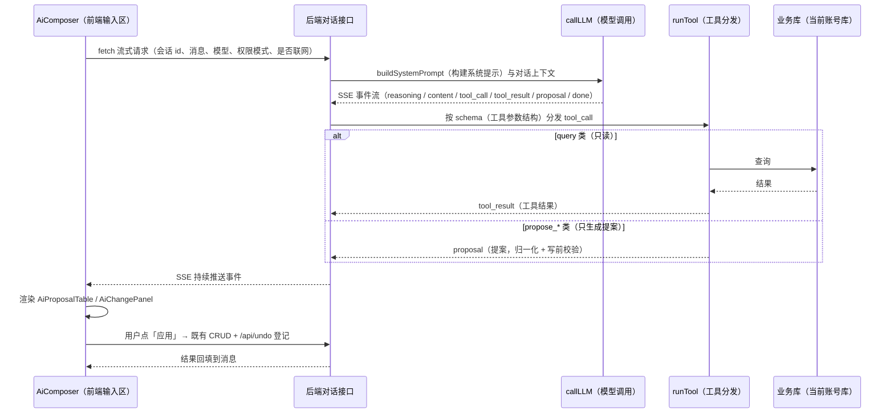

# AI 专题：前端组件 ↔ 后端工具链

<!-- doc-tree:start -->
## 本篇涉及的文件

只展示本篇会讲到的代码文件；模块内其余文件见同级 README。

```text
classnest/
├── student-backend/
│   └── routes/
│       └── ai/
│           ├── ai.tools/
│           │   ├── tools.executors/
│           │   │   ├── executors.checks.js  # 数据体检、排布冲突检测、座位/值日权重评分
│           │   │   ├── executors.common.js  # 日期解析、JSON 安全解析、拼音、值日模式解包、学生 id→姓名
│           │   │   ├── executors.image.js  # 课表/座位/值日 → 前端渲染规格
│           │   │   ├── executors.js  # 执行器门面：展示类工具（record/chart/ask/技能/导出规格/字段字典/教学周次…
│           │   │   ├── executors.proposal.js  # 写提案归一化与写入前校验（含旧值→新值 diff）
│           │   │   └── executors.query.js  # 查询/聚合/姓名拼音匹配/撤销栈/跨表检索
│           │   ├── tools.js  # 工具注册表门面：runTool 分发、TOOL_INFO、批量上限、快照工具、子代理工具
│           │   ├── tools.schema.js  # 各工具 JSON schema 与枚举（CHART_TYPES、AGG_FNS、MAX_BA…
│           │   └── tools.subagent.js  # 只读子代理（子模型执行子任务）
│           ├── ai.config.js  # 模型配置（OpenAI 兼容、多提供商、激活/发现/连通测试）、resolveEndpoin…
│           ├── ai.constants.js  # READ_TABLES / WRITE_TABLES / JSON_WRITE_TABLES…
│           ├── ai.conversations.js
│           ├── ai.dataRoutes.js  # 表数据读取、批量提案落库（/apply-batch）、快照创建/恢复
│           ├── ai.helpers.js  # 列元数据与取值归一化
│           ├── ai.js
│           ├── ai.llm.js  # 系统提示、callLLM、consumeStream、主/子代理工具集装配
│           ├── ai.memory.js  # 长期记忆读写 + 长对话压缩（CONTEXT_COMPRESS_AT）
│           ├── ai.skills.js  # 技能 md 文件 CRUD（聊天输入 / 匹配）
│           └── ai.upload.js  # 附件解析：文本/PDF/Word/PPT/Excel，临时文件用完即删
└── student-frontend/
    └── src/
        ├── components/
        │   ├── ai/
        │   │   ├── AiComposer/
        │   │   │   └── AiComposer.vue  # 输入器：附件、/ 技能、权限模式、模型选择、ask 分步表单
        │   │   ├── AiChangePanel.vue  # 变更/提案面板：单条与批量的 diff、跳转定位
        │   │   ├── AiChatMessages.vue  # 消息流：Markdown、推理段、工具块、提案块、重试/回滚/撤销/跳转
        │   │   ├── AiConversationPanel.vue  # 会话列表：新建/切换/删除/分页
        │   │   ├── AiLinkPanel.vue  # 链接预览与外部打开
        │   │   └── AiStreamTail.vue  # 流式文本尾巴（分段淡入）
        │   ├── tables/
        │   │   ├── AiGridPreview.vue  # 课表/座位/值日排布预览
        │   │   ├── AiProposalTable.vue  # 提案明细（含技能 md 行级 diff）
        │   │   └── AiRecordTable.vue  # 查询结果记录预览
        │   └── AiChart.vue  # 柱/横条/饼/折线图表
        └── views/
            └── AiAssistant.vue
```
<!-- doc-tree:end -->

---

## 专题总览

- **定位**：AI 专题：前端组件 ↔ 后端工具链的一次完整对话链路与能力边界。
- **边界**：组件接口与路由清单不在这里重复，见 [frontend/components/ai.md](../frontend/components/ai.md) 与 [backend/routes.md](../backend/routes.md)。
- 模型**只读**：`query`（查询）/ `aggregate`（聚合统计）/ `resolve_student`（解析学生）/ `search_all`（全表搜索）等工具只查表。
- 模型**不直接写库**：所有写操作走 `propose_write`（提议写入）/ `propose_batch`（批量提议）/ `propose_delete`（提议删除）等生成**提案**，前端展示「旧值 → 新值」，用户确认后才调用既有 `CRUD`（增删改查，`/api/students`、`/api/fee-records` 等）。
- 后端负责：配置、会话、提示词、工具 `schema`（数据结构）、提案归一化与落库前校验、快照、记忆、技能。
- 前端负责：对话 UI（界面）、流式渲染、提案确认、调用既有 CRUD、登记撤销。

---

## 详细说明

### 1. 前端构成

页面：[`views/AiAssistant.vue`](../../../student-frontend/src/views/AiAssistant.vue)。组件逐个见 [frontend/components/ai.md](../frontend/components/ai.md)：

| 组件 | 作用 |
| --- | --- |
| [`AiConversationPanel.vue`](../../../student-frontend/src/components/ai/AiConversationPanel.vue) | 会话列表：新建/切换/删除/分页 |
| [`AiChatMessages.vue`](../../../student-frontend/src/components/ai/AiChatMessages.vue) | 消息流：Markdown、推理段、工具块、提案块、重试/回滚/撤销/跳转 |
| [`AiStreamTail.vue`](../../../student-frontend/src/components/ai/AiStreamTail.vue) | 流式文本尾巴（分段淡入） |
| [`AiComposer.vue`](../../../student-frontend/src/components/ai/AiComposer/AiComposer.vue) | 输入器：附件、`/` 技能、权限模式、模型选择、`ask` 分步表单 |
| [`AiChangePanel.vue`](../../../student-frontend/src/components/ai/AiChangePanel.vue) | 变更/提案面板：单条与批量的 diff、跳转定位 |
| [`AiLinkPanel.vue`](../../../student-frontend/src/components/ai/AiLinkPanel.vue) | 链接预览与外部打开 |
| [`AiProposalTable.vue`](../../../student-frontend/src/components/tables/AiProposalTable.vue) | 提案明细（含技能 md 行级 diff） |
| [`AiRecordTable.vue`](../../../student-frontend/src/components/tables/AiRecordTable.vue) | 查询结果记录预览 |
| [`AiGridPreview.vue`](../../../student-frontend/src/components/tables/AiGridPreview.vue) | 课表/座位/值日排布预览 |
| [`AiChart.vue`](../../../student-frontend/src/components/AiChart.vue) | 柱/横条/饼/折线图表 |

### 2. 一次对话的数据流

1. `POST /api/ai/chat/stream`（`fetch`（浏览器原生请求函数）流式读取，不是 `axios`（HTTP 客户端））：请求体含会话 id、消息、模型、权限模式、是否联网。
2. 后端 [`ai.conversations.js`](../../../student-backend/routes/ai/ai.conversations.js) 组装系统提示（`ai.llm.buildSystemPrompt`，构建系统提示）→ 调模型 → 以 `SSE`（Server-Sent Events，服务器持续推送）回传 `reasoning`（推理段）/ `content`（正文）/ `tool_call`（工具调用）/ `tool_result`（工具结果）/ `proposal`（提案）/ `done`（结束）等事件。
3. 工具调用循环：`runTool` 按 schema 分发；`query` 类直接回结果；`propose_*` 类只生成提案（`executors.proposal.js` 归一化 + 写前校验）。
4. 前端收到 `proposal` 后渲染 `AiProposalTable` / `AiChangePanel`；用户点「应用」→ 前端调用既有 CRUD → 调 `/api/undo` 登记 → 把结果回填到消息。
5. 支持回滚最后一条助手消息（`DELETE /conversations/:id/messages/last-assistant`）与撤销（`runUndoChange`）。

一次对话的时序：



### 3. 后端文件

入口 [`routes/ai/ai.js`](../../../student-backend/routes/ai/ai.js) 只做聚合，接口清单见 [backend/routes.md](../backend/routes.md#8-ai)。

| 文件 | 作用 |
| --- | --- |
| [`ai.config.js`](../../../student-backend/routes/ai/ai.config.js) | 模型配置（OpenAI 兼容、多提供商、激活/发现/连通测试）、`resolveEndpoint`、`reasoningParams` |
| [`ai.conversations.js`](../../../student-backend/routes/ai/ai.conversations.js) | 对话、SSE、消息 CRUD、工具循环编排 |
| [`ai.llm.js`](../../../student-backend/routes/ai/ai.llm.js) | 系统提示、`callLLM`、`consumeStream`、主/子代理工具集装配 |
| [`ai.constants.js`](../../../student-backend/routes/ai/ai.constants.js) | `READ_TABLES` / `WRITE_TABLES` / `JSON_WRITE_TABLES` 白名单与中文说明 |
| [`ai.dataRoutes.js`](../../../student-backend/routes/ai/ai.dataRoutes.js) | 表数据读取、批量提案落库（`/apply-batch`）、快照创建/恢复 |
| [`ai.memory.js`](../../../student-backend/routes/ai/ai.memory.js) | 长期记忆读写 + 长对话压缩（`CONTEXT_COMPRESS_AT`） |
| [`ai.skills.js`](../../../student-backend/routes/ai/ai.skills.js) | 技能 md 文件 CRUD（聊天输入 `/` 匹配） |
| [`ai.upload.js`](../../../student-backend/routes/ai/ai.upload.js) | 附件解析：文本/PDF/Word/PPT/Excel，临时文件用完即删 |
| [`ai.helpers.js`](../../../student-backend/routes/ai/ai.helpers.js) | 列元数据与取值归一化 |

### 4. 工具链（`routes/ai/ai.tools/`）

| 文件 | 内容 |
| --- | --- |
| [`tools.js`](../../../student-backend/routes/ai/ai.tools/tools.js) | 工具注册表门面：`runTool` 分发、`TOOL_INFO`、批量上限、快照工具、子代理工具 |
| [`tools.schema.js`](../../../student-backend/routes/ai/ai.tools/tools.schema.js) | 各工具 JSON schema 与枚举（`CHART_TYPES`、`AGG_FNS`、`MAX_BATCH_OPS` 等） |
| [`tools.executors/executors.js`](../../../student-backend/routes/ai/ai.tools/tools.executors/executors.js) | 执行器门面：展示类工具（record/chart/ask/技能/导出规格/字段字典/教学周次/联网搜索/撤销）与过程块文案 |
| [`executors.proposal.js`](../../../student-backend/routes/ai/ai.tools/tools.executors/executors.proposal.js) | 写提案归一化与写入前校验（含旧值→新值 diff） |
| [`executors.query.js`](../../../student-backend/routes/ai/ai.tools/tools.executors/executors.query.js) | 查询/聚合/姓名拼音匹配/撤销栈/跨表检索 |
| [`executors.checks.js`](../../../student-backend/routes/ai/ai.tools/tools.executors/executors.checks.js) | 数据体检、排布冲突检测、座位/值日权重评分 |
| [`executors.image.js`](../../../student-backend/routes/ai/ai.tools/tools.executors/executors.image.js) | 课表/座位/值日 → 前端渲染规格 |
| [`executors.common.js`](../../../student-backend/routes/ai/ai.tools/tools.executors/executors.common.js) | 日期解析、JSON 安全解析、拼音、值日模式解包、学生 id→姓名 |
| [`tools.subagent.js`](../../../student-backend/routes/ai/ai.tools/tools.subagent.js) | 只读子代理（子模型执行子任务） |

### 5. 记忆、技能、子代理

- **记忆**：`GET/PUT /api/ai/memory`，目录固定（`dbManager.memoryDir`），不随设置搬迁；长对话超过阈值时压缩（`compressConversation`），压缩状态用 `compressingConvs` 去重。
- **技能**：md 文件固定存 `<数据目录>/content/ai-skills/<slug>/`，随数据根目录一起搬迁、随备份包一起带走；接口 `GET/POST/PUT/DELETE /api/ai/skills`；聊天输入 `/` 触发匹配。
- **子代理**：`subagentTool` 派生只读子任务，工具集由 `getSubagentTools()` 提供，不授予写权限。

---

## 验证与注意事项

- **表白名单**：`READ_TABLES` / `WRITE_TABLES` 是唯一可触达的表；新增表必须两边同步，否则工具不可见。
- **字段消毒**：提案落库前统一走 `services/sanitize` 与 `ai.helpers.normColVal`，禁止直接拼 SQL。
- **提案需确认**：`permissionMode='approve'`（默认）时前端必须二次确认；自动模式仍走同一套校验。
- **快照兜底**：批量写前可 `POST /api/ai/snapshot`，失败可 `POST /api/ai/snapshot/restore`。
- **撤销联动**：写操作后登记 `/api/undo`，`runUndoChange` 让模型也能撤销自己刚做的事。
- **文件上传**：临时目录 `os.tmpdir()/ai-uploads`，解析完成即删；超大文本截断 100000 字符。

### 验证

- 单测：`testjs/units/frontend.test.js`（图表解析、`collectPdfText` 边界）。
- 冒烟：`testjs/smoke/pptx-guard-test.cjs`、`testjs/smoke/api-routes-test.cjs`（含 AI 路由）。
- 手工：设置页「测试连通」→ 发一条只读提问 → 一条写提案（确认后检查撤销栈）。

---
