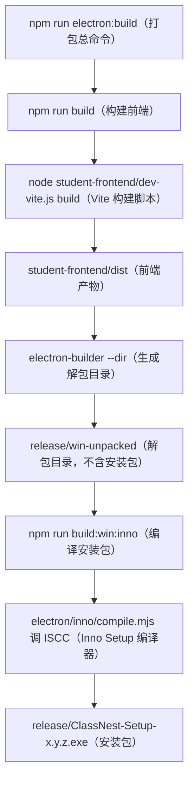

# 打包与分支专题：打包流程与开发分支

<!-- doc-tree:start -->
## 本篇涉及的文件

只展示本篇会讲到的代码文件；模块内其余文件见同级 README。

```text
classnest/
├── electron/
│   ├── inno/
│   │   ├── compile.mjs  # 按「INNO_SETUP_ISCC 环境变量 → PATH 中 iscc → 常见安装目录（…
│   │   └── setup.iss  # 固定 AppId GUID（升级/卸载识别）、PrivilegesRequired=admi…
│   ├── main/
│   │   └── main.updater.js
│   └── afterPack.js
└── student-frontend/
    ├── dev-vite.js  # 直连 vite（跳过两层 npm，实测省约 1.1s）；build 子命令原样透传
    └── vite.config.js  # 5 个 HTML（网页）入口、base:'./'（相对路径基址）、build.target:…
```
<!-- doc-tree:end -->

---

## 专题总览

- **定位**：打包与分支专题：`npm run electron:build`（打包总命令）全流程、产物裁剪与 Inno Setup 安装包、Vue 3.6 / 3.5 双分支。
- **产物**：`release/`（默认通道）与 `release36/`（3.6 通道）；`afterPack`（产物精简钩子）负责剔除无用文件，安装包由 Inno Setup 编译。
- **CI/CD**：GitHub Actions（GitHub 的自动化流水线服务）在 push / PR 上跑测试；`main` 上打包并把安装包、免安装 ZIP、源码 ZIP 挂进 Draft Release（草稿发布，不自动发布），详见第 7 节。
- **局限**：只记录本项目配置与剔除规则，不展开 electron-builder 的通用文档。

---

## 详细说明
### 本地开发手动打包

#### 1. 打包流程总览



| 命令 | 作用 | 产物目录 |
| --- | --- | --- |
| `npm run build` | 仅构建前端（Vue 3.5 主线） | `student-frontend/dist/` |
| `npm run build:new` | 用 Vue 3.6 预览通道构建 | `student-frontend/dist/` |
| `npm run electron:build` | 3.5 主线：前端 → electron-builder（`--dir`）→ Inno | `release/` |
| `npm run electron:buildnew` | 3.6 预览：`electron-builder --dir --config.directories.output=release36` + Inno（`-- release36`） | `release36/` |
| `npm run build:win:inno` | 只编译安装包（需先有 unpacked 产物） | 同上 |
| `npm run setup:vue36` | 安装 Vue 3.6 预览依赖到 `student-frontend/vue36/` | — |

两个通道的产物目录刻意分离（`release/` 与 `release36/`），互不覆盖；安装包文件名固定为 `ClassNest-Setup-x.y.z.exe`，便于 [`main.updater.js`](../../../electron/main/main.updater.js) 按 `*-Setup-*.exe` 匹配更新资产。

#### 2. 前端构建阶段

- 入口脚本 [`student-frontend/dev-vite.js`](../../../student-frontend/dev-vite.js)：直连 `vite`（跳过两层 npm，实测省约 1.1s）；`build` 子命令原样透传。
- [`vite.config.js`](../../../student-frontend/vite.config.js)：5 个 `HTML`（网页）入口、`base:'./'`（相对路径基址）、`build.target:'chrome120'`（目标浏览器版本）、`nonBlockingCss`（CSS 改非阻塞，先出画面后到样式）、`modulePreload.polyfill:false`（关闭模块预加载补丁）、`server.warmup`（开发服务器预热热点模块）。
- 产物落在 `student-frontend/dist/`，由主进程 `app://` 协议加载（不是 `file://`）。
- `public/` 中 `NotoSansSC-6.ttf` 只作 PDF 子集源，**不进安装包**；`.ttf.gz` 随包。

#### 3. electron-builder 阶段（[`electron-builder.json`](../../../electron-builder.json)）

- `productName: 班集`、`appId: com.classnest.app`、`directories.output: release`、`win.target: dir`（安装包交给 Inno）。
- `compression: maximum`；`npmRebuild: false`（原生模块已由 `@electron/rebuild` 预编译）。
- `electronLanguages: zh-CN / en-US`；`electronDownload.mirror` 指向 npmmirror。
- `electronFuses`（Electron 打包熔断开关）：`runAsNode: true`（允许后端以 `ELECTRON_RUN_AS_NODE`（纯 Node 模式）运行）、`enableCookieEncryption: true`（Cookie 加密）、关闭 `NodeCliInspectArguments`（命令行调试参数）/ `NodeOptionsEnvironmentVariable`（`NODE_OPTIONS` 环境变量）、`grantFileProtocolExtraPrivileges: false`（不给 `file://` 额外权限）、`onlyLoadAppFromAsar: true`（只从 `asar`（应用归档包）加载）。

##### 会被剔除的文件

| 规则 | 剔除内容 |
| --- | --- |
| 打包脚本 | `electron/afterPack.js`、`electron/inno/**`、`electron/installer-assets/**`、`**/.gitignore` |
| 用户数据 | `student-backend/data/**`、`student-backend/uploads/**` |
| 原生模块源码 | `better-sqlite3-multiple-ciphers` 的 `deps/`、`src/`、`binding.gyp`、README，以及 linux/darwin/win32-arm64 预编译产物 |
| PDF 相关 | `pdfjs-dist/**`、`@napi-rs/**`、`pdf-parse` 的 web/esm/worker/node/bin 与 `pdf.worker.mjs` |
| 其他无用产物 | `mammoth.browser*.js`、`mammoth/test`、`jszip/dist`、`xlsx` 的多余 dist/mjs/png、`trash/macos-trash`、`codepage/bin`、`koffi/vendor` 与 `cnoke.cjs`、`**/*.h(hpp/hh)`、`**/*.md`、`**/test(s)`、`**/*.map`、`**/*.d.ts` |
| 前端静态 | `dist/NotoSansSC-6.ttf`、`dist/logo-icon.png` |
| sharp wasm（`WebAssembly` 版图像处理库） | `@img/sharp-wasm32/**` |

##### 会保留 / 必须打进包里的

- `electron/**`（除上述排除）、`student-frontend/dist/**`、`student-backend/**`、`resources/ffmpeg/**`、`package.json`。
- `asarUnpack`：`resources/ffmpeg/**`、`**/student-backend/**`、`node_modules/**/*`、`**/*.node` —— 原生模块与后端子进程必须在 asar 外，否则无法 fork / 加载 `.node`。
- 运行时 DLL：`libGLESv2.dll`、`libEGL.dll`、`d3dcompiler_47.dll`、`icudtl.dat`、`resources.pak`、`v8_context_snapshot.bin`、`snapshot_blob.bin`、`ffmpeg.dll`。
- FFmpeg（LGPL 版）与许可声明（压缩后的 `third-party-licenses.zip`）。

#### 4. `afterPack` 精简（[`electron/afterPack.js`](../../../electron/afterPack.js)，仅 win32）

- 删除运行时不用的 Chromium 组件：`vk_swiftshader.dll`、`vk_swiftshader_icd.json`、`vulkan-1.dll`、`dxcompiler.dll`、`dxil.dll`（约 -32MB；依据是开 CDP 核对删除前后渲染/WebGL 一致）。
- `LICENSES.chromium.html`（约 19.4MB）压成 `third-party-licenses.zip`（自实现 CRC32 + `deflateRawSync`，不引第三方依赖）；许可仍随包分发（**不得改为联网下载**）。
- 明确不要删：ANGLE 三件套、`icudtl.dat`、`resources.pak`、快照文件、`ffmpeg.dll`。

#### 5. 安装包阶段（Inno Setup）

- [`inno/compile.mjs`](../../../electron/inno/compile.mjs)：按「`INNO_SETUP_ISCC` 环境变量 → PATH 中 `iscc` → 常见安装目录（Inno 6/7）→ 注册表 `InstallLocation`」定位 `ISCC.exe`；找不到时打印中文提示与下载地址并以退出码 1 结束；`spawnSync(iscc, [setup.iss], { stdio:'inherit' })` 编译。
- [`inno/setup.iss`](../../../electron/inno/setup.iss)：固定 AppId GUID（升级/卸载识别）、`PrivilegesRequired=admin`（机器级安装，触发 UAC）、`WizardStyle=modern`、`CloseApplications/RestartApplications=yes`（静默升级自动关旧进程）、`#define MyAppVersion` 必须与 `package.json` 一致；界面由 `[Code]` 段自绘（logo/路径/协议勾选/协议弹窗）。
- 资源：`installer.ico` / `uninstaller.ico` / `license.txt`（UTF-8 BOM）/ `field-bg.png` / `wizard-large.bmp` / `wizard-small.bmp` / `app-icon.png`。
- `AppDir` 默认 `release`，3.6 通道传 `release36`。

#### 6. Vue 3.6 与 3.5 双分支

目标：**同一份源码同时被 3.5 与 3.6 编译**，默认走 3.5，按需切 3.6。

- **依赖隔离**：[`student-frontend/vue36/package.json`](../../../student-frontend/vue36/package.json) 单独安装 `vue@3.6.0-rc.14`；主线 `node_modules` 里的 `vue` 保持 3.5，两份互不覆盖；由 `npm run setup:vue36` 安装。
- **开关只从环境变量进 Vite**：[`dev-vite.js`](../../../student-frontend/dev-vite.js) 把 `--vue36` 翻译成 `VUE_CHANNEL=36`、`--vdom` 翻译成 `VUE_VAPOR=0`（Vite 本身不认识这两个参数）；普通 dev 会显式清掉这两个变量，避免终端残留串味。
- **运行时选择**（[`vite.config.js`](../../../student-frontend/vite.config.js)）：3.6 通道用官方 `dist/vue.runtime-with-vapor.esm-browser(.prod).js`（自包含、同时含 VDOM + Vapor helper），不用只有 830 字节的 `vue.runtime.esm-bundler.js`；纯 VDOM 对照通道换 `vue.runtime.esm-browser(.prod).js`。
- **编译器**：3.6 通道取 `vue36/node_modules/@vue/compiler-sfc`；缺依赖时明确报错「请先执行 `npm run setup:vue36`」。
- **3.5 兼容的写法**：组件写 `<script setup vapor>`，3.5 编译时把 `vapor` 当普通未知属性**逐字忽略**，因此零影响。拼错标记不会报错，只会静默失效。
- **纯 VDOM 对照**：`--vue36 --vdom` 时用 `stripVaporAttr()` 在 `compiler-sfc` 读取前剥掉根级 `vapor` 属性，让同一编译器产出 VDOM 代码，用来分离「3.6 编译器收益」与「Vapor 收益」。
- **Vapor 互操作**：入口通过 `virtual:vapor-interop` 条件导出 `vaporInteropPlugin`（3.5 下导出空），`main.js` 里 `if (vaporInterop) app.use(vaporInterop)` 两条通道都能跑。
- **缓存隔离**：三条通道（`vue35-vdom` / `vue36-vdom` / `vue36-vapor`）各用一份 Vite 缓存目录，产物互不兼容，不能共用。
- **构建产物**：`npm run build`（3.5）→ `release/`；`npm run build:new` + `electron:buildnew`（3.6）→ `release36/`。

### 自动打包 CI/CD 流水线（[`ci.yml`](../../../.github/workflows/ci.yml)）
#### 1. 打包流水线构成
流水线分三段串行执行，前一段失败即中断后续：

| 阶段 | Job | 执行内容 |
| --- | --- | --- |
| 测试 | `test`（`windows-latest`） | 版本号一致性、ESLint 检查、错误边界检查、单元 + 行为快测、构建前端、冒烟测试 |
| 打包 | `package`（`windows-latest`） | `npm ci` → 安装 Inno Setup 7 → `electron-builder --dir --publish never` → Inno 编译安装包 → 生成免安装 ZIP 与源码 ZIP → 上传 Actions 产物 |
| 草稿 | `draft`（`ubuntu-latest`） | 下载产物，用 `gh release create --draft` 创建或更新 Draft Release（草稿，不发布） |

**触发条件**：push 到 `main`、向 `main` 开 PR、手动 `workflow_dispatch`。PR 只跑测试；打包与草稿只在非 PR 且测试通过后执行；同一分支的重复触发会自动取消旧运行。

### 2.打包结果
Draft Release 固定挂三类资产，每类都附 `.sha256`（SHA-256 校验值）：

| 资产   | 文件名                        | 生成方式                                                            |
| ---- | -------------------------- | --------------------------------------------------------------- |
| 安装包  | `ClassNest-Setup-x.y.z.exe`       | Inno Setup 编译 `release/win-unpacked`                            |
| 免安装版 | `ClassNest-Portable-x.y.z-win-x64.zip` | 复制 `release/win-unpacked` 到临时目录后压缩，解压得到 `ClassNest/ClassNest.exe`             |
| 源码   | `ClassNest-Source-x.y.z.zip`          | `git archive`（Git 的归档命令）只打包被跟踪文件，排除 `node_modules`、`.env` 与构建产物 |
### 3.注意事项
- **版本号一致性**：测试阶段校验 `package.json` 的 `version` 与 [`setup.iss`](../../../electron/inno/setup.iss) 的 `MyAppVersion` 相同，并确认 [`ChineseSimplified.isl`](../../../electron/inno/ChineseSimplified.isl)（安装界面简体中文译文）存在；任一不符直接失败。
- **不自动发布**：草稿用 `--draft` 创建；同标签已有草稿时覆盖更新资产，该标签已正式发布时只告警并跳过，避免流水线把版本放出去。应用内更新读 `releases/latest`，草稿不会成为 `latest`。
- **Inno Setup 7**：Chocolatey（Windows 包管理器）与 winget（Windows 包管理器）目前只提供 6.x，流水线按 `INNO_SETUP_VERSION` 从官方 GitHub Release 下载并静默安装 7.1.1，再定位 `ISCC.exe` 写入 `INNO_SETUP_ISCC` 供 [`compile.mjs`](../../../electron/inno/compile.mjs) 使用。
- **简体中文译文**：官方 Inno 安装包不自带 `ChineseSimplified.isl`，该译文随仓库分发，`setup.iss` 按相对路径引用，CI 与本机都不依赖本机语言包。
- **产物留存**：Actions 产物保留 7 天；Draft Release 资产不设期限，人工发布后即为正式版本。安装包命名必须保持 `*-Setup-*.exe`，否则 `main.updater.js` 的更新资产匹配会失效。

---

## 验证与注意事项

```powershell
npm run lint                      # 三块代码一次检查
npm test                          # units + behavior（约 2.4s）
node testjs/probe/vapor-verify.mjs        # 只看 __vapor:true 判据
node testjs/probe/measure-startup.mjs     # 启动耗时
npm run smoke                     # 发版前链路冒烟（约 1min）
```

- **红线**：`resources/ffmpeg/` 与打包脚本（`electron/inno/compile.mjs`、`electron-builder.json`）不要随意动；FFmpeg 只保留 LGPL 版，改前核 `sha256`。
- 打包前建议清理 `node_modules/.cache`；原生模块版本变更后需重新 `@electron/rebuild`。
- 许可合规：Chromium 许可压缩后仍随包；依赖许可原文见 [dependencies/licenses.md](../dependencies/licenses.md)。
- 改 CI 的 Inno 版本时同步核对官方发布资产名（`is-x_y_z` 标签 + `innosetup-x.y.z-x64.exe` 文件），否则下载会 404；改任何发布资产名要同步 `draft` 步骤的 glob 与 [main.updater.js](../../../electron/main/main.updater.js) 的匹配规则。

---
