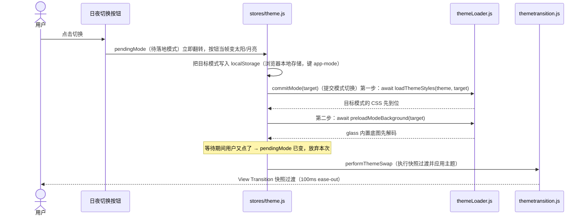

# 界面设计与交互专题：主题、夜间模式、图标、排版与动效

<!-- doc-tree:start -->
## 本篇涉及的文件

只展示本篇会讲到的代码文件；模块内其余文件见同级 README。

```text
classnest/
├── electron/
│   └── main/
│       ├── main.js  # Windows 11 上真实透出桌面模糊；不用透明窗口，避免系统材质失效
│       └── main.window-material.js  # Windows 11 上真实透出桌面模糊；不用透明窗口，避免系统材质失效
├── student-frontend/
│   ├── splash/
│   │   └── splash.css  # 后端未就绪时先给稳定画面，不闪白
│   ├── src/
│   │   ├── components/
│   │   │   ├── album/
│   │   │   │   └── AlbumYearRuler.vue
│   │   │   ├── base/
│   │   │   │   ├── AppHelp.vue
│   │   │   │   ├── AppSwitch.vue
│   │   │   │   ├── ConfirmDialog.vue  # 通用确认框组件
│   │   │   │   ├── DialogShell.vue
│   │   │   │   ├── IconGlyph.shapes.js
│   │   │   │   ├── IconGlyph.vue
│   │   │   │   ├── NotificationToast.vue
│   │   │   │   ├── SearchBar.vue
│   │   │   │   ├── SearchDialog.vue
│   │   │   │   ├── Tabs.vue
│   │   │   │   ├── ThemePickerDialog.vue  # 主题选择弹窗
│   │   │   │   └── ViewSwitch.vue
│   │   │   ├── dialogs/
│   │   │   │   └── AddStudentDialog.vue
│   │   │   ├── layout/
│   │   │   │   └── Sidebar.vue
│   │   │   ├── tables/
│   │   │   │   ├── DynamicTable/
│   │   │   │   │   └── DynamicTable.vue
│   │   │   │   └── GridView/
│   │   │   │       └── GridView.vue
│   │   │   └── AiChart.vue
│   │   ├── config/
│   │   │   └── searchIndex.js
│   │   ├── stores/
│   │   │   └── theme.js
│   │   ├── styles/
│   │   │   ├── dialog-transition.css
│   │   │   ├── index.css
│   │   │   ├── theme-base-accent.css
│   │   │   ├── theme-base.css
│   │   │   ├── theme-glass.css
│   │   │   ├── theme-night.css  # 重映射 --color-*，覆盖页面底色与弥散光斑、标题栏、侧栏、按钮、输入框、卡片、弹窗、…
│   │   │   ├── themeLoader.js
│   │   │   ├── themetransition.js
│   │   │   └── utilities.css
│   │   ├── subwindows/
│   │   │   └── setup/
│   │   │       └── Setup.vue
│   │   ├── views/
│   │   │   ├── ScheduleView/
│   │   │   │   └── ScheduleView.vue
│   │   │   ├── SettingsView/
│   │   │   │   └── SettingsView.vue
│   │   │   ├── AiAssistant.vue
│   │   │   ├── DutyView.vue
│   │   │   └── SeatView.vue
│   │   ├── App.vue
│   │   └── main.js  # 选择 base / glass / glass2
│   └── index.html  # 后端未就绪时先给稳定画面，不闪白
└── testjs/
    └── tools/
        ├── component-vapor-audit.mjs
        ├── gen-icon-shapes.mjs
        ├── radius-audit.js
        └── template-binding-audit.mjs
```
<!-- doc-tree:end -->

> 数据来源：`student-frontend/src/styles/*`、[`stores/theme.js`](../../../student-frontend/src/stores/theme.js)、[`themeLoader.js`](../../../student-frontend/src/styles/themeLoader.js)、[`themetransition.js`](../../../student-frontend/src/styles/themetransition.js)、[`IconGlyph.vue`](../../../student-frontend/src/components/base/IconGlyph.vue)、[`DialogShell.vue`](../../../student-frontend/src/components/base/DialogShell.vue)、[`Sidebar.vue`](../../../student-frontend/src/components/layout/Sidebar.vue)、[`App.vue`](../../../student-frontend/src/App.vue) 与各组件内的 scoped CSS。本文归纳源码里的设计规则与时序，不做逐像素截图比对；动效时长直接取自 CSS，改样式后以源码为准。

---

## 整体设计

- 桌面感基线：无边框窗口、44px 自绘标题栏、侧边栏、主内容区与最小窗口约束。
- 主题令牌体系：`data-*` 切换开关、CSS 变量、Tailwind `@theme` 桥接、圆角档位与同心圆角规则。
- 三套预设主题：彩色色块（base）、毛玻璃（glass）、新毛玻璃（glass2）的配色、材质、按钮与背景设计。
- 日间/夜间模式：与主题正交的 `data-mode`、三套主题的夜间配色策略、跟随系统、切换时序。
- 动画设计：时长分层、缓动族、各场景动效清单、总开关与性能红线。
- 图标体系：`IconGlyph` 的 Props、76 个语义图标、内联 SVG、彩色/Emoji 两档、夜间提亮。
- 界面排版：标题栏、侧边栏、页面标题卡、内容分区、表格/网格、首页卡片、登录页与浮窗。
- 弹窗排版：外壳、尺寸档、正文滚动、按钮区、层级阶梯与遮罩。
- 交互规范：乐观高亮、悬停预取、快捷键、通知、拖拽、禁用态与焦点反馈。

### 1. 设计基线：先把「网页」做成「桌面应用」

| 设计选择 | 实现 | 目的 |
| --- | --- | --- |
| 无边框窗口 | 主窗口 `frame: false`（无系统边框）、`transparent: false`（不使用透明窗口）+ 系统亚克力（[`main.js`](../../../electron/main/main.js) 调 [`main.window-material.js`](../../../electron/main/main.window-material.js) 的 `applyBackgroundMaterial(win, 'acrylic')`，即「应用系统亚克力材质」） | Windows 11 上真实透出桌面模糊；不用透明窗口，避免系统材质失效 |
| 自绘标题栏 | [`App.vue`](../../../student-frontend/src/App.vue) 的 `.window-title-bar`（标题栏容器），固定 44px，整条 `-webkit-app-region: drag`（声明为窗口拖动区） | 统一三套主题的窗口外观，承载撤销/重做/搜索/主题/账户/设置/关于与窗口控制 |
| 标题栏按钮 | `.tb-btn`（标题栏小按钮）26×26，`tint="current"`（图标继承文字色）的 15px 图标；窗口控制 46px 宽，关闭钮 hover 用 Win11 红 `#c42b1c` | 接近系统窗口的点击热区与反馈 |
| 侧边栏 | [`Sidebar.vue`](../../../student-frontend/src/components/layout/Sidebar.vue) 展开 `w-60`（宽度 240px）、折叠 `w-16`（宽度 64px），5 个分组、14 个导航项 | 信息密度高但不挤占内容区；折叠状态写入 `app-sidebar-collapsed`（侧边栏折叠本地存储键） |
| 主内容区 | `main`（主内容容器）占满剩余空间，`p-6`（内边距 24px），`overflow-auto`（内容溢出时滚动）+ 自定义滚动条；`<KeepAlive :max="16">`（最多缓存 16 个页面实例） | 切页不重建，滚动条不出现系统样式割裂 |
| 去网页感 | 全局 `user-select: none`（禁止选中文本，输入框/文本域/`contenteditable`（可编辑区域）例外）；系统 UI 字体栈；禁止全局 `-webkit-user-drag: none`（关闭原生拖拽） | 避免拖蓝、字体跳变；同时保留表格行/列等原生拖拽 |
| 尺寸约束 | 主窗口默认 1280×800，最小 1200×600 | 保证三栏表格与侧边栏在最小尺寸下仍可用 |
| 首屏 | [`index.html`](../../../student-frontend/index.html) 内联 splash（启动占位页）兜底底色；[`splash.css`](../../../student-frontend/splash/splash.css) 的旋转环 1.4s 线性循环 | 后端未就绪时先给稳定画面，不闪白 |

布局骨架：

```
App
├─ window-title-bar（44px，拖拽区 + 左侧功能按钮 + 右侧窗口控制）
└─ content（flex-1）
   ├─ /login：全屏 router-view，无侧边栏、标题栏左侧功能区隐藏
   └─ 其他页面：Sidebar（240/64px） + main（p-6、滚动、KeepAlive）
      └─ 页面：标题卡 → 分区 → 表格/网格/卡片
```


**实现位置**：`main.js`（应用入口）调 `main.window-material.js` 的 `applyBackgroundMaterial`（应用系统亚克力材质）。

---

## 详细设计

### 2. 主题架构：属性选择器 + CSS 变量 + Tailwind 桥接

#### 2.1 根元素上的开关

| 属性 / 类 | 谁写 | 作用 |
| --- | --- | --- |
| `data-theme`（主题标识） | [`main.js`](../../../student-frontend/src/main.js) 启动前写一次；[`stores/theme.js`](../../../student-frontend/src/stores/theme.js) 的 `applyTheme()`（应用主题函数）后续维护 | 选择 `base` / `glass` / `glass2`（未知 id 会被 `setTheme` 拒绝并回落 `glass`） |
| `data-mode`（日/夜模式标识） | 同上，取值 `day` / `night` | 日/夜配色层，与主题正交 |
| `data-page`（页面标识） | [`App.vue`](../../../student-frontend/src/App.vue) 的 `syncPageKey()`（同步页面标识函数） | 旧版「每页一个模块色」的入口；当前被 `theme-base-accent.css` 的 B 方案统一成深蓝 |
| `data-topbar-color`（顶栏配色标识） | `applyTheme()`（应用主题函数） | 毛玻璃标题栏/侧边栏的「深蓝 / 白色调」两档 |
| `has-bg-image`（有背景图标记） | `applyTheme()`（应用主题函数） | 是否有背景图，决定遮罩层与玻璃配方是否启用 |
| `bg-night-default`（夜间默认底图标记） | `applyTheme()`（应用主题函数） | `glass + 夜间 + 未自选图`：使用更轻的夜间遮罩 |
| `no-animations`（关闭动画类） | `syncNoAnimations()`（同步动画开关函数） | 关闭全部过渡/动画 |
| `theme-switching`（切换事务类） | [`themetransition.js`](../../../student-frontend/src/styles/themetransition.js) | 日夜切换事务窗口内瞬时化元素过渡 |
| `system-acrylic`（系统亚克力标记） | 桌面小组件入口使用 | 让子窗口只借主题配色、背景交给系统亚克力 |

#### 2.2 三组令牌

1. **基础令牌**（[`theme-base.css`](../../../student-frontend/src/styles/theme-base.css) 的 `:root`（根元素））：`--color-primary / success / warning / danger / info`（品牌主色 / 成功 / 警告 / 危险 / 信息色）、`--color-bg / surface / sidebar`（页面底 / 面板 / 侧栏）、`--color-text / text-secondary / text-muted / text-inverse`（主文字 / 次要文字 / 弱化文字 / 反白文字）、`--color-border / border-strong`（普通边框 / 加强边框）、`--shadow-*`（阴影档位）、`--radius-*`（圆角档位）。
2. **透明度阶梯**：`--alpha-white-02 … --alpha-white-98`（白色透明度阶梯）、`--alpha-black-03 … --alpha-black-62`（黑色透明度阶梯）。各主题文件统一引用这些变量，改整体浓淡只动这一组。
3. **圆角档位**：`xs / sm / md / lg / xl / 2xl / 3xl / full`，再由角色别名映射：

| 角色 | 用途 | base | glass | glass2 |
| --- | --- | --- | --- | --- |
| `--radius-control` | 按钮、输入框、下拉、复选框 | 6px | 12px | 12px |
| `--radius-card` | 卡片、内嵌面板、统计块 | 10px | 20px | 22px |
| `--radius-surface` | 弹窗、抽屉、悬浮面板 | 12px | 20px | 26px |
| `--radius-table` | 表格容器 `.table-scroll-wrapper` / `.grid-view-container` | 10px | 16px | 22px |

- [`index.css`](../../../student-frontend/src/styles/index.css) 的 `@theme`（Tailwind 主题变量声明）把 Tailwind 的 `rounded-*`（圆角工具类）自引用桥接到这些变量（`--radius-lg: var(--radius-lg)`，即「圆角大档引用同名主题变量」），因此 `class="rounded-xl"`（圆角超大档工具类）会随主题变圆角。**漏桥接任何一档，该档就退回 Tailwind 默认 rem 值，并造成档位倒挂**（文件内有明确注释）。
- 同心圆角：内层圆角 = 外层圆角 − 内缩间距（`--radius-concentric-gap: 12px`，即「同心圆角内缩间距」），主题选择卡的三层预览窗就按这个规则叠。
- 组件里凡是圆角都应走 `var(--radius-*)`（圆角变量），不要写死 px；圆形控件（相册播放/缩放）用 `rounded-full`（全圆角），glass 主题的全局按钮皮肤会让部分控件变方，glass2 已刻意不改 `rounded-full`。

#### 2.3 样式加载顺序

```
index.css（入口，始终加载）
├─ @import tailwindcss
├─ @import theme-base.css          ← 基础令牌 + 默认外观
├─ @import utilities.css           ← 工具类（glass / transition-theme / dlg-close / btn-plain…）
└─ @import theme-base-accent.css   ← base 的 B 方案 + base 的夜间规则（常驻）

运行时按需（themeLoader.js）
├─ theme-glass.css   ← 仅当前主题为 glass，或切换时
├─ theme-glass2.css  ← 仅当前主题为 glass2
└─ theme-night.css   ← 仅 glass / glass2 且 mode=night
```

- 每个主题文件都用 `:root[data-theme="glass"]`（根元素 glass 主题选择器）/ `:root[data-theme="glass2"]`（根元素 glass2 主题选择器）/ `:root[data-mode="night"]`（根元素夜间模式选择器）限定作用域，**属性不匹配时规则本就不生效**，所以「只加载当前主题」与「全部加载」视觉等价，只是省掉未用文件的下载与解析。
- 加载缓存存的是 `Promise`（异步加载结果）而非布尔值，切换并发时共享同一次加载；失败会删缓存，下次切换可重试。
- 启动时 [`main.js`](../../../student-frontend/src/main.js) 在 Vue 初始化前就写 `data-theme` / `data-mode`、`--glass-opacity`（玻璃层透明度）、`--bg-mask-opacity`（背景遮罩不透明度）、`--bg-image`（背景图 URL），并开始 `loadThemeStyles()`（加载主题样式函数）；splash（启动占位页）会等它完成，避免「入口样式已应用、主题样式还没到」时闪一下基础配色。
- 空闲期 `prefetchThemeStyles()`（空闲预取主题样式函数）逐条预热未加载的主题 CSS，避免首次切换时出现基础主题的一瞬。

**实现位置**：`src/main.js`（启动前写主题变量）、`stores/theme.js`（主题状态）、`themeLoader.js`（主题样式按需加载）、`themetransition.js`（主题切换过渡）。

### 3. 三套预设主题的设计

#### 3.1 `base` · 彩色色块主题（B 方案：深蓝 + 琥珀）

- **设计定位**：性能优先、无毛玻璃、纯色块。文件头注释写明规则：每个模块一个模块色，只用于标题条、表头、行号、导航选中与主按钮；一个工具栏只保留一个实心主按钮，其余用浅底；1px 描边、不做大阴影。
- **实际落地**（[`theme-base-accent.css`](../../../student-frontend/src/styles/theme-base-accent.css) 覆盖层）：
  - 主色统一深蓝：`--page-accent: #3b82f6`（页面主色）、`--page-accent-dark: #2563eb`（深一档悬停色）、`--page-accent-ink: #1e3a8a`（深蓝墨色）、浅底 `#dbeafe` / `#eff6ff`；`[data-theme="base"][data-page]`（base 主题 + 页面标识选择器）把所有页面的模块色都收成同一套蓝（App 仍会写 `data-page`，但视觉上不再分页换色）。
  - 侧边栏深墨蓝 `#0f172a`，页面底 `#f8fafc`，卡片纯白 `#ffffff`。
  - 工具栏 `.opbar`（操作栏）的按钮用琥珀三档：实心主操作 `--warm-strong-bg`（暖色强档背景）、刷新/中性 `--warm-soft-bg`（暖色柔档背景）、警告/导出 `--warm-pale-bg`（暖色浅档背景）；夜间对应换成深琥珀底 + 浅琥珀字。
  - 几何：控件 6px、卡片 10px、弹窗 12px、表格 10px；阴影极轻（`0 1px 2px` 级）。
  - 表头/页头输入框/侧栏滚动条有独立变量（`--base-app-grid-*`（表头配色变量组）、`--base-input-*`（页头输入框变量组）、`--sidebar-*`（侧栏滚动条变量组）），夜间只改这些变量即可翻转。
- **代价**：几乎无 `backdrop-filter`，是三套里最省的；适合低配机器或长时间数据录入。

#### 3.2 `glass` · 毛玻璃主题（v3）

- **设计定位**：蓝灰底 + 薄白玻璃 + 荧光描边按钮，偏「网页感」。
- **配色**：页面底 `#f0f4f8`，主色 `#3b82f6`，卡片 `--alpha-white-92`（92% 白玻璃），侧栏 `--alpha-white-70`（70% 白玻璃），文字 `#1e293b / #475569 / #64748b`（主文字 / 次要文字 / 弱化文字）。
- **材质配方**（[`theme-glass.css`](../../../student-frontend/src/styles/theme-glass.css)）：
  - 统一玻璃 = 底色 + `blur(24px) saturate(1.4)`（模糊 24px、饱和度 1.4）+ 顶部受光渐变（`linear-gradient(180deg, alpha-white-22 → 06 → 00)`，即「顶部 22% 白到透明的受光渐变」）+ 内高光。
  - 标题栏、内容卡、弹窗、班费表容器、网格表格全部引用同一组 `--sidebar-glass-bg`（侧栏玻璃底色）/ `--sidebar-glass-blur`（侧栏玻璃模糊）；`data-topbar-color=blue`（顶栏配色为深蓝）时侧栏与标题栏用深蓝 `rgba(30,64,175,.55)`，`light`（顶栏配色为白色调）用淡蓝 `rgba(219,234,254,.55)`。
  - 组件透明玻璃层的基准由设置页滑块 `--glass-opacity`（玻璃层透明度，默认 0.4）驱动。
- **按钮**：给**所有** `button`（按钮）加 1px 描边、内高光与 `::before`（前置伪元素）荧光描边环（渐变遮罩只留 1px 边），按压 `translateY(1px)`（向下位移 1px）；彩色按钮改成半透明玻璃底 + 深色字。这带来一个副作用：不想被套皮肤的按钮必须用 `.dlg-close`（弹窗关闭按钮类）/ `.btn-plain`（无边框按钮类）或在组件层用 `!important` 压掉（[`utilities.css`](../../../student-frontend/src/styles/utilities.css) 已收口）。
- **背景**：
  - 无自选图时用内置 `glass-bg-opt.webp`（日间默认底图）；夜间换 `glass-bg-night.webp`（夜间默认底图），并用 `.bg-night-default`（夜间默认底图标记类）把遮罩系数降到 0.30。
  - 背景图不画在 `body`（页面主体），而是固定视口 `body::before`（body 前置伪元素）一层「遮罩 + 图」，避免 Windows/Electron 下 `background-attachment: fixed`（背景固定于视口）的分块拼接缝与滚动露边。
- **代价**：几乎所有元素都挂 `backdrop-filter`，表格多、窗口大时 GPU 采样成本最高。

#### 3.3 `glass2` · 新毛玻璃主题（薰衣草冷雾）

- **设计定位**：与 glass 并存的第二套玻璃皮肤，设计语言取自 `agent/wechat-rag-frontend` 的 tokens；底色薰衣草/长春花，更厚的高光玻璃。
- **配色**：页面底 `#eef1f8`，光晕/焦点环 `#5b7cfa`；实色按钮用更深的 `#4a65e8`，保证白字对比度 ≥ 4.5:1；成功 `#14874a`、警告 `#c2740a`、危险 `#d63a3a`。
- **玻璃配方**：
  - `--g2-a = --glass-opacity`（玻璃浓度基准值，取用户滑块，默认 0.4），`--g2-glass = rgba(255,255,255, a + 0.15)`（玻璃底色，默认 0.55）；`strong = a + 0.34`（强档玻璃）、`soft = a − 0.10`（弱档玻璃）。
  - 三层高光 `--g2-hl`（顶亮边 + 底暗边 + 内圈柔光）、外圈冷色发丝线 `--g2-edge`、冷色三段阴影 `--g2-shadow-1/2/3`（近 / 中 / 远）。
  - **只在「大面板」做模糊**：侧栏、顶栏、内容卡、表格容器、弹窗、吐司。按钮/标签/输入框躺在已模糊的面板里，不再叠 `backdrop-filter`（背景模糊滤镜），这是与 glass 的关键取舍。
- **按钮**：不再给所有按钮套荧光描边，改用实色强调色 + 圆角 + 顶部内高光；只对模板上原本 `rounded`（4px 圆角）的操作栏按钮提升到 `--radius-control`（控件圆角），保留 `rounded-lg / xl / full`（大 / 超大 / 全圆角）的原本形状；按压 `translateY(1px)`（向下位移 1px），键盘 `focus-visible`（键盘焦点态）用 2px 强调色外框。
- **背景**：`body`（页面主体）自身是冷雾渐变；`body::before / ::after`（body 的前 / 后伪元素）两团 48vw / 42vw（视口宽 / 高的 48% / 42%）柔光斑（蓝/紫），`blur(60px)`（模糊 60px），34s / 41s 缓慢漂移，只改 `transform`（变换）。自选图时两团光斑隐藏，遮罩并入 `body` 背景。
- **代价**：模糊面板数量比 glass 少，长表格下更稳；但背景漂移是常驻合成层，低配机器可关闭「动画效果」。

#### 3.4 三套主题对照

| 维度 | base | glass | glass2 |
| --- | --- | --- | --- |
| 底色 | `#f8fafc` 纸白 | `#f0f4f8` 蓝灰 | `#eef1f8` 薰衣草冷雾 |
| 主色 | `#3b82f6` 深蓝 + 琥珀工具栏 | `#3b82f6` 亮蓝 | `#4a65e8` 长春花蓝 |
| 玻璃 | 无 | 薄白玻璃（0.4 基准），全局按钮/控件都挂 blur | 厚高光玻璃（0.55 基准），只在大面板挂 blur |
| 按钮 | 实色/浅底，1px 描边 | 半透明玻璃底 + 荧光描边环 | 实色强调色 + 内高光，去掉描边环 |
| 背景 | 纯色 | 弥散光斑 / 内置风景图（日/夜各一张） | 冷雾渐变 + 漂移柔光斑，无内置照片 |
| 圆角（控件 / 卡片 / 弹窗） | 6 / 10 / 12 | 12 / 20 / 20 | 12 / 22 / 26 |
| 夜间底 | `#0b1220` | `#182238` | `#1b2036` |
| 性能开销 | 最低 | 最高（大量 backdrop-filter） | 中（面板级 blur + 常驻漂移） |

#### 3.5 主题选择

- [`ThemePickerDialog.vue`](../../../student-frontend/src/components/base/ThemePickerDialog.vue)（主题选择弹窗）：3 列主题卡，卡片内用 `PREVIEW`（预览配色表）画「侧栏 / 顶栏 / 内容块」缩略示意；点击立即 `setTheme()`（切换主题函数），无需保存；下方带「启用动画效果」开关。
- 引导页 [`Setup.vue`](../../../student-frontend/src/subwindows/setup/Setup.vue)、主题弹窗与设置页下拉 [`SettingsView.vue`](../../../student-frontend/src/views/SettingsView/SettingsView.vue) 都读 `themeStore.allThemes`（主题列表），三处入口的候选集一致。
- **自定义主题功能已移除**：旧版设置页的「新建自定义主题 / 颜色调整」入口与对应 store API（`createCustomTheme` 等）已删除；启动时会清掉遗留的 `app-custom-themes` / `app-theme-custom` 两个本地存储键，避免出现无样式可匹配的无效主题卡片。

**实现位置**：`ThemePickerDialog.vue`（主题选择卡）、`SettingsView.vue`（外观设置）、`styles/theme-base.css` / `theme-glass.css` / `theme-glass2.css`（三套主题样式）。

### 4. 日间 / 夜间模式的设计

#### 4.1 模式模型

- 界面上的称呼是「日间 / 夜间」，实现只有一个开关：`html[data-mode="day"|"night"]`（根元素日/夜模式标识）。它**与主题正交**：同一套主题可以叠日间或夜间。
- 支持夜间配色的主题：`base / glass / glass2`（`NIGHT_THEMES`，支持夜间的主题列表）。当前三套预设主题都支持夜间，日夜按钮始终可用；若以后新增不支持夜间的主题，按钮会 `disabled`（禁用），title（悬停提示）为「当前主题暂不支持夜间模式」。
- 跟随系统：`followSystem`（跟随系统开关）读 `window.matchMedia('(prefers-color-scheme: dark)')`（读取系统深色偏好）；开启后系统深浅色变化会走完整的切换流程；手动切日/夜会自动关闭跟随，避免随后被系统偏好覆盖。Electron 主进程没有 `nativeTheme.themeSource`（原生主题源）干预，配色完全由渲染层决定。

#### 4.2 夜间配色的设计原则

1. **不用纯黑**：base `#0b1220`、glass `#182238`、glass2 `#1b2036`，面板在底色上再抬一档（如 glass 玻璃基色 `rgba(46,64,100,.92)`），避免大面积死黑。
2. **文字反向分层**：主文字 `#e6ecf5` 级，次要 `#a7b4c9`，弱化 `#7f8ea6`；彩色主色整体提亮一档（如 glass 夜间 primary `#60a5fa`，glass2 `#7c93ff`）。
3. **阴影加重、描边减弱**：夜间用更大的黑阴影区分层次；日间靠白描边叠在浅底上，夜间白描边会变成一圈亮线，因此 `class-info-card` 等夜间把 border 改透明、改用投影。
4. **原生控件跟随深色**：`color-scheme: dark` 让日期选择器、下拉、滚动条走系统深色。
5. **语义图标提亮**：夜间对 `.icon-color`（彩色语义图标类）加 `filter: brightness(1.22) saturate(1.10)`（亮度 ×1.22、饱和度 ×1.10 的滤镜），色相不变，避免深底上发灰。
6. **glass / glass2 的夜间按钮悬浮冻结**：鼠标移到按钮上**颜色不变**，只靠光标和阴影加深反馈。做法是给静止色类补「同值 + `!important`（最高优先级）」规则压住模板里的 `hover:bg-*`（悬停背景色工具类）；**不要再给这些类补 `:hover`（悬停）版本**，那正是要消灭的东西。
7. **背景图遮罩按图调整**：glass 夜间内置底图本身是深色风景图，遮罩系数从通用 0.6 降到 0.30；自定义图仍走 0.6。

#### 4.3 三套主题的夜间实现位置

| 主题 | 文件 | 做法 |
| --- | --- | --- |
| `base` | [`theme-base-accent.css`](../../../student-frontend/src/styles/theme-base-accent.css) 的 `:root[data-theme="base"][data-mode="night"]` | 夜间规则**直接合并在本主题内**，随 `index.css` 常驻，不需要额外加载 `theme-night.css`。重定义 `--page-accent / --color-* / --warm-* / --base-* / --sidebar-*`，再覆盖标题栏、滚动条、表头、页头输入框、侧栏按钮。 |
| `glass` | [`theme-night.css`](../../../student-frontend/src/styles/theme-night.css) 的 A 段 | 重映射 `--color-*`，覆盖页面底色与弥散光斑、标题栏、侧栏、按钮、输入框、卡片、弹窗、表格、Toast、滚动条；对原文件里的硬编码色用「更高特异性 + `!important`」逐条覆盖。 |
| `glass2` | 同文件的 B 段 | 重映射 `--g2-glass / strong / soft / line / hair / hl / edge / shadow / accent`，再覆盖页面底色、光斑、标题栏、侧栏、按钮、表单、卡片、表格、吐司、浮层、登录页、滚动条。 |
| 公共块 | 同文件的 C 段 | `glass / glass2` 共用的硬编码浅色玻璃：`.ai-glass-panel`（AI 对话列表/聊天区）改深色玻璃；`.class-info-card`（首页班级信息大框）改深底 + 投影；`ShutdownMenuDialog` 等退出确认弹窗同步。 |

`theme-night.css` 只在「当前是 glass/glass2 且 mode=night」时按需加载（`loadThemeStyles()` 判断），base 的夜间规则常驻。

#### 4.4 切换时序（`stores/theme.js` + `themetransition.js`）



- **先 CSS 后就地改属性**：反过来（先改 `data-mode` 再异步加载 CSS）第一次切换会付两次全量样式重算，这是「首次切夜间更卡」的来源之一。
- **快照过渡**：`document.startViewTransition()`（启动视图过渡）在切换前后各拍一张整屏快照，只用合成器动画新快照层 `opacity`（不透明度；默认第一帧 0.62，100ms `ease-out`（先快后慢）收到 1），成本与表格规模无关。
- **连点打断**：不掐掉上一段、也不新排 dissolve（交叉溶解），而是读当前混合度 `r`，把反向的新快照起始不透明度设为 `1 − r`，时长取「已用时长 × 真正走过的比例」，从半途平滑退回。
- **事务窗口**：`html.theme-switching`（根元素切换事务类）把元素级 `transition-duration`（过渡时长）压到 `0.001ms`，避免上千个 `button`（按钮）/`tr`（表格行）同时做颜色/阴影过渡；**只压 `transition`（过渡），不动 `animation`（动画）**。
- **日夜按钮单独成层**：`view-transition-name: theme-toggle`（给日夜按钮命名独立快照层），旧层隐藏、新层全显，按钮不会跟着整页 100ms 慢慢淡。
- **放行指针**：`::view-transition*`（视图过渡伪元素）全部 `pointer-events: none`（不接收指针事件），淡入期间点击能落到实时 DOM 上，连点才能立刻掉头。
- **动画总开关关闭时**：`snapshotTransitionAllowed()`（是否允许快照过渡）返回 false，直接走瞬时切换，CSS 里的 `theme-switch-in`（主题切换进入动画）也双保险关掉。
- **启动**：若开启跟随系统，store 初始化时直接按系统偏好设 `mode`，不走过渡；启动时本来就是正确配色。

**实现位置**：`stores/theme.js`（`data-mode`（明暗模式）与夜间切换）、`Sidebar.vue`（日夜按钮）、`styles/theme-night.css`（夜间配色层）。

### 5. 动画设计

#### 5.1 三条原则

1. **动效表达状态变化，不做装饰**：没有页面级淡入淡出、没有常驻 hover（悬停）动画；切页靠 `KeepAlive`（页面缓存）直接呈现，只有周切换、抽屉、弹窗这类「同一位置换内容」才做过渡。
2. **只用便宜属性**：绝大多数动效只动 `transform`（变换：位移/缩放/旋转）与 `opacity`（不透明度）；`backdrop-filter`（背景模糊滤镜）从不参与动画（逐帧重采样会明显发顿）。
3. **进入有方向、退出走回头路**：弹窗从 96% 弹到 101.5% 再落回 100%；新增行从上方落下、取消沿同方向收回；抽屉从侧边滑入、按更快的曲线滑出。

#### 5.2 时长分层

| 层级 | 典型时长 | 适用场景 |
| --- | --- | --- |
| 微反馈 | 80–120ms | 帮助气泡进出、`ViewSwitch` 文字色、按钮按压、开关滑块 120ms |
| 小控件 | 140–200ms | 导航项 100ms、输入框/复选框 160ms、主题卡选中 150ms、面板内条目 180ms |
| 内容过渡 | 200–260ms | 弹窗遮罩 240/250ms、周切换 250ms、ViewSwitch 滑块 260ms、筛选面板 200ms |
| 强调/回弹 | 300–350ms | 弹窗卡片 340ms、Tabs hover/选中 300ms、Toast 进 350ms、表格整表 350ms、行 FLIP 320ms、单行进出 240–320ms |
| 环境动画 | 0.8s–41s | 骨架 shimmer 1.4s、splash 旋转 1.4s、Toast 倒计时线性、glass2 光斑 34s/41s |

#### 5.3 缓动族

| 曲线 | 用法 |
| --- | --- |
| `ease`（缓入缓出）/ `ease-out`（先快后慢）/ `ease-in`（先慢后快） | 通用淡入淡出、颜色/阴影过渡；退出偏 `ease-in`，进入偏 `ease-out` |
| `cubic-bezier(0.22, 1, 0.36, 1)`（标准缓动曲线） | 「快出慢收」：弹窗、Toast、抽屉、表格行、筛选面板；glass2 的 `--g2-ease`（glass2 缓动变量）同族 |
| `cubic-bezier(0.34, 1.56, 0.64, 1)`（回弹缓动曲线） | 轻过冲回弹：弹窗卡片、表格行进入、抽屉面板、勾选标记 |
| `cubic-bezier(0.34, 1.08, 0.64, 1)`（FLIP 缓动曲线） | `FLIP`（先记录首尾位置、再反向补偿的动画技法）让位：行/列交换时其它行平滑滑开，过冲更小 |
| `cubic-bezier(0.4, 0, 0.2, 1)`（Material 标准曲线） | 开关滑块、复选框对勾描画 |
| `linear`（匀速） | 只用于进度：Toast 倒计时条、splash 旋转 |

#### 5.4 场景清单

| 场景 | 动作 | 时序 / 曲线 | 位置 |
| --- | --- | --- | --- |
| 弹窗打开 | 遮罩淡入 + 卡片 0.96 → 1.015 → 1 | 遮罩 240ms ease；卡片 340ms | [`dialog-transition.css`](../../../student-frontend/src/styles/dialog-transition.css) |
| 弹窗关闭 | 遮罩淡出 + 卡片 1 → 0.97 | 遮罩/卡片 250ms | 同上 |
| 日夜切换 | 整屏快照交叉叠加，新画面首帧 0.62 → 1 | 100ms ease-out；连点反向按已走比例缩短 | [`index.css`](../../../student-frontend/src/styles/index.css)、[`themetransition.js`](../../../student-frontend/src/styles/themetransition.js) |
| 通知吐司 | 从右 60px + 0.92 缩放滑入；离开同向滑出 | 进 350ms 标准曲线，出 250ms ease-in；进度条线性，hover 暂停 | [`NotificationToast.vue`](../../../student-frontend/src/components/base/NotificationToast.vue) |
| Tabs 选中 | 标签 hover 放大 1.05；选中态加阴影 | 300ms ease-in-out | [`Tabs.vue`](../../../student-frontend/src/components/base/Tabs.vue) |
| 视图切换 | 内嵌滑块宽度/位移跟随目标段 | 260ms `cubic-bezier(0.34,1.35,0.64,1)` | [`ViewSwitch.vue`](../../../student-frontend/src/components/base/ViewSwitch.vue) |
| 表格整表首次进入 | tbody 从左侧 20px 淡入 | 350ms 回弹曲线 | [`DynamicTable.vue`](../../../student-frontend/src/components/tables/DynamicTable/DynamicTable.vue)、[`GridView.vue`](../../../student-frontend/src/components/tables/GridView/GridView.vue) |
| 新增行 | 从上方 18px 落入；取消沿上方 18px 加速收回 | 进 240ms 回弹；出 120ms 加速 | 同上 |
| 删除/恢复/保存行 | 从下方 16px 浮入；向下 10px 淡出 | 进 300ms / 出 180ms | 同上 |
| 行/列拖拽换位 | FLIP：其它行/列平滑让位 | 320ms `cubic-bezier(0.34,1.08,0.64,1)` | 同上 |
| 搜索/筛选级联 | 行按顺序错开 30ms 进入；筛选条目错开 14ms | 行 250–300ms；条目 180ms | [`DynamicTable.vue`](../../../student-frontend/src/components/tables/DynamicTable/DynamicTable.vue)、[`index.css`](../../../student-frontend/src/styles/index.css) |
| 表头筛选面板 | 从上 8px + 0.97 缩放入场 | 200ms 标准曲线 | [`index.css`](../../../student-frontend/src/styles/index.css) |
| 搜索弹窗结果 | 每条从左侧 10px 浮入，最多错开 10 条 × 30ms | 180ms ease-out | [`App.vue`](../../../student-frontend/src/App.vue)、[`SearchDialog.vue`](../../../student-frontend/src/components/base/SearchDialog.vue) |
| 设置页搜索结果 | 弹层 180ms，条目 200ms + 30ms 错开 | 关键词搜索时逐条浮入 | [`SettingsView.vue`](../../../student-frontend/src/views/SettingsView/SettingsView.vue) |
| AI 抽屉 | 面板从侧边滑入；离开更快 | 进 220ms `(0.16,1,0.3,1)`；出 160ms `(0.4,0,0.7,0.2)` | [`AiAssistant.vue`](../../../student-frontend/src/views/AiAssistant.vue) |
| AI 浮窗 | 从贴合图标的一侧 0.86 缩放浮现；截屏时收起 | 100ms 标准曲线 | [`App.vue`](../../../student-frontend/src/App.vue) |
| AI 图表 | 柱/点/扇区颜色与透明度变化 | 180–240ms ease | [`AiChart.vue`](../../../student-frontend/src/components/AiChart.vue) |
| 复选框 | hover 1.1、按下 0.92、对勾从左「描画」出来 | 边框/底色 160ms；对勾 300ms 标准曲线 | [`index.css`](../../../student-frontend/src/styles/index.css) |
| 开关 | 轨道变色，滑块右移 16px | 120ms 标准曲线 | [`AppSwitch.vue`](../../../student-frontend/src/components/base/AppSwitch.vue) |
| 侧边栏折叠 | 宽度 240↔64、头部高度 28↔96、导航项 padding 位移 | 150ms ease；导航项 100ms | [`Sidebar.vue`](../../../student-frontend/src/components/layout/Sidebar.vue) |
| 周切换 | 新旧表同向推拉 60px | 250ms ease + opacity | [`SeatView.vue`](../../../student-frontend/src/views/SeatView.vue)、[`ScheduleView.vue`](../../../student-frontend/src/views/ScheduleView/ScheduleView.vue)、[`DutyView.vue`](../../../student-frontend/src/views/DutyView.vue) |
| 搜索栏展开 | `grid-template-rows` 0→1fr | 140ms `(0.32,0.72,0.24,1)` | [`SearchBar.vue`](../../../student-frontend/src/components/base/SearchBar.vue) |
| 帮助气泡 | 上 3px + 0.98 缩放；带一道 360ms 扫光 | 进 100ms、出 80ms | [`AppHelp.vue`](../../../student-frontend/src/components/base/AppHelp.vue) |
| 相册年份尺 | 拖动时提示浮层淡入 | 150ms ease | [`AlbumYearRuler.vue`](../../../student-frontend/src/components/album/AlbumYearRuler.vue) |
| 骨架占位 | 渐变扫光 | 1.4s ease-in-out 无限循环 | [`utilities.css`](../../../student-frontend/src/styles/utilities.css) |
| 启动占位 | 圆环旋转 | 1.4s linear 无限 | [`splash.css`](../../../student-frontend/splash/splash.css) |
| 引导页步骤 | 旧内容淡出、新内容淡入 | `wfade`（引导页淡入淡出过渡名）80ms，`mode="out-in"`（旧内容先出、新内容再进） | [`Setup.vue`](../../../student-frontend/src/subwindows/setup/Setup.vue) |

#### 5.5 总开关与「减少动效」

- **应用内总开关**：设置页「动画效果」、主题弹窗、引导页共用 `AppSwitch`（开关组件）。关闭后根元素打 `.no-animations`（关闭动画类），全局把 `animation-duration`（动画时长）/ `transition-duration`（过渡时长）压到 `0.001ms`、`iteration-count`（播放次数）设为 1、`scroll-behavior`（滚动行为）设为 `auto`（即时滚动）；日夜切换的 JS 也直接走瞬时分支。
  - 关闭动作延迟 180ms 再加类：让开关自己的 120ms 滑块先滑完，否则类会当场掐断滑块过渡，表现为「开启有动画、关闭直接硬切」。
- **系统 `prefers-reduced-motion`**（系统「减少动效」偏好）：目前只在局部生效——复选框过渡、开关滑块、帮助气泡、AI 流式尾巴的淡入、glass2 背景漂移。它不是全局替代方案；真正的全局开关是 `.no-animations`（关闭动画类）。
- **拖拽期间不走响应式**：AI 浮窗/工具箱拖动直接改 DOM（页面元素）的 `transform`（变换），松手才同步回响应式状态，避免每帧触发根组件重渲染。
- **不要用 `will-change`（提前声明将变化的属性）常驻**：侧边栏导航项曾常驻 `will-change`，每个导航项各占一个合成层；现已移除。`dialog-transition.css` 也明确不用 `will-change: transform`，避免创建包含块导致内部 `position: fixed`（固定定位）错位。

#### 5.6 动效性能红线

| 红线 | 原因 |
| --- | --- |
| 不对 `backdrop-filter`（背景模糊滤镜）做逐帧过渡 | 每帧重新模糊整块背景，Electron 下弹窗会明显发顿 |
| 不在 `data-mode`（日/夜模式标识）切换时放任上千元素做颜色过渡 | 与快照淡入叠加，等于逐帧重绘，表格越多越明显；用 `theme-switching`（切换事务类）瞬时化 |
| 不用 `View Transition`（视图过渡）的默认 `plus-lighter`（加亮混合模式）交叉淡入 | 「旧画面不淡出 + 新画面半透明」会被加亮成一片白；改成普通 alpha（透明度）叠加 |
| 不全局禁 `-webkit-user-drag`（原生拖拽开关） | 会连表格行列、智能排表、劳动项目等原生拖拽一起禁掉 |
| 不把动画写在业务 JS 的每帧回调里 | 能用 CSS `transition`（过渡）/ `keyframes`（关键帧）/ `FLIP`（位置补偿动画）就不逐帧改样式 |

**实现位置**：`styles/dialog-transition.css`（弹窗进出过渡）、`DynamicTable.vue` / `GridView.vue`（表格动效与 `FLIP`（先记录首尾位置再反向补偿的动画技法））。

### 6. 图标体系

#### 6.1 `IconGlyph`（图标组件）

[`IconGlyph.vue`](../../../student-frontend/src/components/base/IconGlyph.vue) 的对外接口：

| Prop | 类型 / 默认 | 说明 |
| --- | --- | --- |
| `name`（图标键名） | `String`，必填 | 语义 key，如 `students`（学生）、`refresh`（刷新）、`moon`（月亮） |
| `size`（尺寸） | `Number`，默认 24 | 像素尺寸，SVG 与 Emoji 一致 |
| `strokeWidth`（线宽） | `Number`，默认 2 | 仅彩色 SVG 生效 |
| `tint`（取色方式） | `String`，默认 `'color'` | `'current'`（继承当前文字色）用于按钮；其他走语义色 |
| `glyph`（强制图形） | `Boolean`，默认 false | 强制画 SVG，不受「图标样式 = Emoji」影响。工具型图标（加号/叉/面板开合/关机等）必须带它 |

渲染逻辑：`iconStyle`（图标样式）为 `'color'`（彩色）或 `glyph`（强制图形）→ 内联 `<svg>`（可缩放矢量图）+ 按 `ICON_SHAPES`（图标形状数据表）输出 `path`（路径）/`circle`（圆）/`rect`（矩形）/`line`（线）/`polyline`（折线）/`polygon`（多边形）/`ellipse`（椭圆）；否则输出 `<span class="icon-emoji">`（表情图标容器）。`name === 'loading'`（加载图标）时 SVG 旋转（`icon-spin 1s linear infinite`，即「1 秒一圈匀速旋转」）。未登记的 key 在开发态 `console.warn`（控制台警告），并静默回退成「学生」图标。

#### 6.2 图形数据与语义色

- [`IconGlyph.shapes.js`](../../../student-frontend/src/components/base/IconGlyph.shapes.js) 由 [`gen-icon-shapes.mjs`](../../../testjs/tools/gen-icon-shapes.mjs) **从 `@lucide/vue`（Lucide 线性图标库）自动生成**，文件头注明「自动生成，勿手改」。这样做是为了不再为每个图标实例化一个 VDOM 组件，而是一个 `<svg>` + 若干形状元素。
- [`IconGlyph.vue`](../../../student-frontend/src/components/base/IconGlyph.vue) 的 `MAP`（语义图标映射表）登记 **76 个 key**（图标键名），每项含 `lucide`（Lucide 图标名）、`emoji`（表情符号兜底）与语义 `color`（颜色）：
  - 页面主标题：`students #60a5fa`、`group #818cf8`、`schedule #22d3ee`、`fee #fbbf24`、`seat #fb923c`、`duty #34d399`、`leave #a78bfa`、`score #f87171`、`album #f472b6`、`activity #fb7185`、`ai #38bdf8`、`settings/about #94a3b8`。
  - 通用：刷新、下载/上传、删除、搜索、文件夹、撤销、图片、勾选、时钟、图表、工具箱、调色板、大脑、主页、电源等。
  - 工具型：箭头、加减、方形、数据库、筛选、地球、布局、显示器、月亮/太阳、面板开合等。
- 侧边栏导航的图标颜色来自 [`searchIndex.js`](../../../student-frontend/src/config/searchIndex.js) 的每项 `color`（会覆盖 `MAP` 的默认色），因此「课程表」在侧栏是 `#a3e635`，而页面标题里是 `#22d3ee`。

#### 6.3 两档图标样式

设置页「图标样式」：`color`（彩色图标）/ `emoji`（Emoji），存 `app-icon-style`。

- `color`（彩色图标档）：侧边栏渲染 `IconGlyph`（图标组件），`tint="current"`（继承文字色）+ `glyph`（强制图形）+ `class="icon-color"`（彩色语义图标类），再用行内 `color: item.color`（该导航项颜色）覆盖；
- `emoji`（表情档）：侧边栏直接渲染 `item.emoji`（该导航项表情）的 `<span class="nav-emoji">`（导航表情图标类，20px 宽、14px 字，保持与 16px SVG 视觉等宽）；
- 搜索弹窗结果左侧图标同样跟随 `iconStyle`：`color` 档渲染 `IconGlyph`（页面项取自 `searchIndex.js` 的 `icon`，设置项用 `settings/wrench`，业务数据按表名映射），`emoji` 档保留原有表情；
- 标题栏、窗口控制、工具型图标始终带 `glyph`（强制图形），所以 Emoji 档下仍是 SVG，不会变成表情；
- 夜间对 `.icon-color`（彩色语义图标类）统一提亮（`brightness(1.22) saturate(1.10)`，即亮度 ×1.22、饱和度 ×1.10），`tint="current"`（继承文字色）的按钮图标不参与提亮；
- `loading`（加载图标）的旋转动画与主题无关，始终可用。

相关工具脚本：[`gen-icon-shapes.mjs`](../../../testjs/tools/gen-icon-shapes.mjs) 生成形状数据；[`component-vapor-audit.mjs`](../../../testjs/tools/component-vapor-audit.mjs) 检查组件 Vapor 标记；[`template-binding-audit.mjs`](../../../testjs/tools/template-binding-audit.mjs) 检查模板绑定；[`radius-audit.js`](../../../testjs/tools/radius-audit.js) 检查圆角使用是否统一。

**实现位置**：`IconGlyph.vue`（图标渲染与语义表）、`IconGlyph.shapes.js`（图标形状数据）、`gen-icon-shapes.mjs`（形状数据生成脚本）。

### 7. 界面排版

#### 7.1 全局骨架

| 区域 | 排版规则 |
| --- | --- |
| 标题栏 | 44px 高；左侧 6px 间距的 26×26 按钮组（撤销/重做/搜索/主题/账户/设置/关于），登录页隐藏；右侧 46px 宽窗口控制贴边；整条可拖动，按钮区 `no-drag` |
| 侧边栏 | 240px / 折叠 64px；顶部 logo 28px + 应用名 18px；5 个分组标题 11px 大写；导航项 8×12px 内边距、10px 图标文字间距、`--radius-control` 圆角；展开态右侧留 20px 给自定义滚动条 |
| 主内容区 | 24px 内边距；业务页纵向排列，标题卡与内容块之间 24px；页面纵向滚动 |
| 页面标题卡 | 多数业务页统一 `w-full bg-surface shadow-md rounded-xl mb-6 px-5 py-3 border border-border min-h-[4.5rem] flex items-center`；`h1` 为 `text-2xl font-bold` + 语义图标；页头右侧放操作按钮/搜索 |
| 内容分区 | `mb-6` + `text-xl font-semibold` 分区标题（带 20px 图标）；分区体 `bg-surface rounded-lg border border-border p-6` |
| 表格 | 容器 `.table-scroll-wrapper`（表格滚动容器）用 `--radius-table`（表格圆角），表头吸顶、行高紧凑；空表时不铺白底，让主题背景透上来 |
| 网格 | `.grid-view-container`（网格表格容器）同样走 `--radius-table`（表格圆角）；课表/座位/值日用固定网格 + 表头吸顶，`--grid-title-h`（网格标题行高度变量）量出标题行高度后让列头下移 |
| 首页 | 欢迎卡 `welcome-card`（欢迎卡类名）+ 班级信息大框 `.class-info-card`（班级信息大框类名）+ 7 张可点击统计卡（`card-link`，可点击卡片类名），统一 `bg-surface rounded-xl p-5 border`（面板底 / 超大圆角 / 20px 内边距 / 边框） |
| 登录页 | 全屏、无侧栏、标题栏左侧隐藏；登录卡片居中，背景与主题共用 |
| AI 浮窗 | 宽 `36rem`（576px）、高 `min(520px, 100vh - 6.5rem)`（取 520px 与「视口高 − 6.5rem」的较小值），距边 12px；标题栏可拖，内容区独立滚动 |

#### 7.2 字号与间距

- 页面标题 `text-2xl`（Tailwind 超大字号类，24px）；分区标题 `text-xl`（超大字号类，20px）；卡片内小标题 `text-lg`（大字号类，18px）；正文/表单 `text-sm`（小字号类，14px）；辅助说明 `text-xs`（超小字号类，12px）；侧栏分组标题 `11px`。
- 常用间距：页面块之间 24px、表单行 12px、按钮组 8px、卡片内 16–20px、页面内边距 24px。
- 按钮高度以 `py-2`（上下内边距 8px，约 32–36px 总高）为基准；标题栏按钮 26px、窗口控制 44px 满高、弹窗关闭 28px。
- 表单控件圆角统一 `--radius-control`（控件圆角），聚焦用主色边框 + 3px 淡色外发光；复选框 16px、开关 38×22。

#### 7.3 层级（z-index）阶梯

| 层级 | 用途 |
| --- | --- |
| 1–6 | 表格 sticky 表头、列头行、局部浮层 |
| 9999 | 右键菜单 `ContextMenu`（右键菜单组件） |
| 10001 | 普通记录弹窗（添加学生/请假/加分/活动/倒计时/班级信息/去重/设置） |
| 10002 | 数据管理弹窗 |
| 10003 | 相册管理/相册任务/新建/移动相册 |
| 10004 | 嵌套设置（座位/值日设置、回填） |
| 10005 / 10006 | AI 设置、确认框（确认框用最高默认档，保证二次确认压在业务弹窗上） |
| 10070 | AI 设置里的「添加模型」弹窗（压过父弹窗） |
| 20000 / 20001 | AI 悬浮图标 / AI 浮窗 |
| 2147483000 | 通知吐司、运行期后端异常全屏遮罩 |

**实现位置**：`App.vue`（标题栏与页面模块色）与各页面 / 组件的 scoped CSS（组件内局部样式）。

### 8. 弹窗排版

#### 8.1 统一外壳

[`DialogShell.vue`](../../../student-frontend/src/components/base/DialogShell.vue) 只做四件事：

```vue
<Teleport to="body">                 <!-- Teleport：把弹窗挂到 body 下，避免被父容器裁剪 -->
  <Transition name="dialog">         <!-- Transition：套用 dialog 进出动画 -->
    <div v-if="visible" class="fixed inset-0 flex items-center justify-center"
         :class="overlayClass" :style="{ zIndex }" @click.self="$emit('overlay')">
      <slot />                        <!-- 默认插槽：各业务弹窗自己的面板内容 -->
    </div>
  </Transition>
</Teleport>
```

| Prop | 默认 | 说明 |
| --- | --- | --- |
| `visible`（显隐） | false | 显隐；由使用方 `v-if`（条件渲染）或 `visible` 控制 |
| `zIndex`（层级） | 10006 | 层级，业务弹窗按上面的阶梯传 |
| `overlayClass`（遮罩附加类） | `bg-black/50 pointer-events-auto`（50% 黑遮罩、恢复指针事件） | 遮罩附加类；个别弹窗改浓度/对齐 |

- 默认遮罩：`bg-black/50`（50% 黑遮罩）；非 glass 主题下 [`utilities.css`](../../../student-frontend/src/styles/utilities.css) 会把整屏黑色遮罩改成透明底 + `blur(18px) saturate(1.1)`（模糊 18px、饱和度 1.1），做出磨砂虚化；**相册看图 `bg-black/90`（90% 黑遮罩）、票据预览 `bg-black/80`（80% 黑遮罩）被排除**，必须保留深底对比。
- 大多数弹窗卡片自带 `bg-surface p-5 rounded-xl shadow-lg dialog-card`（面板底 / 20px 内边距 / 超大圆角 / 大阴影 / 弹窗卡片动画类）；`dialog-card`（弹窗卡片动画类）负责进出动画。
- 关闭按钮统一 `class="dlg-close"`（弹窗关闭按钮类）：28×28、`--radius-control`（控件圆角）、淡色底 + 10px 模糊，hover（悬停）加深；用 `!important`（最高优先级）压掉 glass 主题给所有按钮的描边与荧光环。

#### 8.2 卡片内部排版

典型结构（以 [`AddStudentDialog.vue`](../../../student-frontend/src/components/dialogs/AddStudentDialog.vue) 为例）：

```
卡片 p-5 rounded-xl w-[600px] max-w-full shadow-lg dialog-card
├─ h3（三级标题）标题 text-lg font-bold mb-4
├─ 正文 grid grid-cols-2 gap-3 max-h-[60vh] overflow-y-auto p-1 + CustomScrollbar
│   └─ 每个字段：label（字段标签）text-sm text-text-secondary mb-1 + 控件（输入框/AppSelect）
└─ 按钮区 flex justify-end gap-2 mt-4
    ├─ 取消：bg-text-muted text-text-inverse（中性灰底、反白字）
    └─ 确认：bg-primary text-text-inverse（主色底、反白字），禁用时 opacity-50（半透明）
```

- **正文滚动**：长表单用 `max-h-[60vh]`（最高 60% 视口高）；大列表用 `max-h-[85vh]`（85% 视口高）或 `max-h-[88vh]`（88% 视口高），再加自定义滚动条。`p-1`（4px 内边距）是给 3px 聚焦外发光留空间，避免被 `overflow`（溢出裁剪）裁掉。
- **按钮区**：右对齐、间距 8px，取消在左、确认在右；确认按钮用主色，取消用中性灰或 `bg-surface-hover`（面板悬停底）。
- **确认框**：[`ConfirmDialog.vue`](../../../student-frontend/src/components/base/ConfirmDialog.vue)（通用确认框组件）居中文本、`min-w-[300px] max-w-[600px]`（最窄 300px、最宽 600px）、`shadow-card`（卡片阴影）；确定用 `bg-info`（信息色底），可禁用；`showCancel=false`（不显示取消按钮）时点遮罩不关闭。列名校验、错误文案由宿主传入，组件只展示。
- **尺寸档**（业务弹窗实际取值）：
  - 紧凑：340（账户）、380/440/460（信息/确认/小表单）
  - 标准：520（新增活动/倒计时/请假/加分、主题选择）、540/560/600（新增学生、搜索、相册重命名/移动）
  - 复杂：680（值日设置）、750（记录设置）、760（相册任务）、820（相册管理）
  - 宽表：900（去重、Excel 导入）、1100（相册照片选择）
- **窄屏**：几乎所有卡片都带 `max-w-full`（最大宽度占满父容器）或 `max-w-[92vw]`（最大 92% 视口宽），宽度先按设计值，窗口不够时收缩。

#### 8.3 弹窗的进出动画

- 遮罩：`opacity`（不透明度）0→1（240ms `ease`（缓入缓出）），关闭 250ms；
- 卡片：`dialogCardIn`（弹窗卡片进入关键帧）从 0.96 → 1.015（70%）→ 1（100%），340ms；关闭 `dialogCardOut`（弹窗卡片退出关键帧）1 → 0.97 + 淡出，250ms；
- `backface-visibility: hidden`（隐藏元素背面）避免缩放时的边缘闪烁；
- 刻意**不**过渡 `backdrop-filter`，毛玻璃保持静态；卡片自身需要模糊时自己带静态 `backdrop-filter`。

**实现位置**：`DialogShell.vue`（弹窗外壳）、`themetransition.js`（弹窗进出过渡）。

### 9. 交互规范

#### 9.1 导航与预取

- 侧边栏选中态**按下即高亮**：`onNavPointerDown`（导航按下处理）先写 `pendingPath`（待落地路径），路由真正切换后交回 `route.path`（当前路由路径），避免大页面懒加载时「点了没反应」。同一时间只有一个高亮。
- 鼠标移入导航项即 `prefetchRoute()`（预取路由）预取目标 chunk（代码分包）；标题栏的搜索/主题/账户按钮与 AI 悬浮图标 hover（悬停）时也预取对应弹窗/页面 chunk（32ms 防抖）。
- 侧边栏折叠状态持久化；折叠后只留图标，导航项 padding 从 12px 收到 8px，靠过渡平移而不是瞬跳。

#### 9.2 主题与模式按钮

- 日夜按钮在「班集」标题旁，图标跟 `pendingMode` 翻（太阳/月亮），页面配色等 `commitMode` 完成后才落；主题不支持夜间时按钮 `disabled`。
- 主题弹窗点卡片立即生效，无「保存」；设置页主题下拉同样即时。
- 跟随系统是独立开关；手动切换日/夜会关闭它。

#### 9.3 快捷键与撤销

- 全局 `Ctrl+Z` 撤销，`Ctrl+Shift+Z` / `Ctrl+Y` 重做，作用于当前激活页面/当前表格；输入框/文本域内不拦截，保留原生文本撤销。
- 多页面同时挂载时用递增 `pageId`（页面实例编号）标记「最近激活」的页面，只让它的快捷键生效（`KeepAlive` 下用 `onActivated`（激活钩子）/ `onDeactivated`（失活钩子）维护）。
- 标题栏的撤销/重做按钮与快捷键共用同一套 `undoState`（撤销/重做状态），悬停时轻量刷新可用态。

#### 9.4 通知与反馈

- 通知固定在右上角（top/right 16px，宽 300–420px），左侧 4px 类型色条 + 圆形图标 + 标题/正文 + 可选动作按钮（如「撤销」）+ 关闭钮；
- 同一类型的重复提示可合并并显示 `×N` 计数（设置页「提示合并」）；
- 进度条 3px 从右向左收缩，hover（悬停）暂停；有 `undoable`（可撤销）动作时停留更久；
- 成功/错误/警告/信息四种类型分别用主题功能色。

#### 9.5 拖拽、右键与浮层

- AI 悬浮图标与浮窗作为一个整体拖动：拖动中只改 DOM，包围盒钳制在可视区 12px 边距内；位移超过 2px 视为拖动，不触发点击；松手同步状态。
- 点击浮窗/图标以外区域自动收起，`Teleport`（挂载到 body 的传送组件）出来的 AI 弹出层带 `data-ai-float-keep`（AI 浮层内部标记）时视为内部。
- 右键菜单 `Teleport` 到 `body`（页面主体）、`z-[9999]`（层级 9999），点击外部关闭；AI 图标右键走主进程原生菜单。
- 下拉框 `AppSelect`（自定义下拉组件）菜单也 `Teleport` 到 `body`，避免被父容器 `overflow`（溢出裁剪）/ `transform`（变换）/ `backdrop-filter`（背景模糊）裁剪；键盘支持上下、`Enter`（回车）、`Esc`（退出键）。

#### 9.6 表单与焦点

- 多数输入框用 `bg-surface-hover` 底、`border-border` 边、`--radius-control` 圆角，聚焦主色边框 + 3px `--color-primary-light` 外发光。
- 复选框 hover（悬停）1.1、按下 0.92，选中用主色底 + 白勾；`focus-visible`（键盘焦点态）用 3px 淡色环。
- 开关 38×22，滑块 16px，120ms 位移；关闭动画总开关时全局瞬时化。
- 禁用态统一降透明度（按钮 0.4–0.5、输入 0.5），并 `cursor: not-allowed`；glass2 还会清掉投影与位移。

#### 9.7 空态、加载与滚动

- 空表显示图标 + 文案 + 引导按钮，容器不铺白底；空态 300ms 淡入上移 6px。
- 骨架块 320px 高、圆角 `--radius-control`、1.4s 扫光。
- 滚动条是自绘组件 `CustomScrollbar`（自定义滚动条组件）：12px 轨道 / 8px 紧凑档、可选上下箭头、可自动隐藏；侧边栏先隐藏原生滚动条再用它，避免 Chromium 悬停色无法过渡的问题。

**实现位置**：`Sidebar.vue`（导航与预取）、`NotificationToast.vue`（通知吐司）、`ViewSwitch.vue`（分段控件）。

---

## 验证与注意事项

### 验证方式

- 改主题 / 动效后逐套目测（base、glass、glass2 与夜间），圆角改动跑 `radius-audit.js`（圆角使用审计脚本）；本专题没有截图视觉回归。

### 设计红线

1. **主题规则必须带属性作用域**：新主题/夜间规则一律以 `:root[data-theme=...]` / `:root[data-mode=...]` 开头，否则按需加载时会污染其他主题。
2. **新圆角/新颜色走令牌**：不要在组件里写死 px 或十六进制，否则夜间与自定义配色无法统一翻转。
3. **glass 主题的全局按钮皮肤会误伤**：新按钮若不想带描边/荧光环，用 `.btn-plain` / `.dlg-close` 或组件层 `!important` 收口；不要再去改 glass 的全局规则。
4. **夜间不要给 glass / glass2 的冻结按钮补 `:hover`**：那会直接破坏「夜间悬浮不变色」的设计。
5. **毛玻璃不要做动画属性**：包括 `backdrop-filter` 过渡与逐帧改 blur。
6. **夜间不要用纯黑 + 纯白描边**：会形成亮线圈；用抬高的深色面板 + 投影分层。
7. **不要全局禁 `-webkit-user-drag`**：会破坏所有原生拖拽。
8. **`view-transition-name`（视图过渡层名）必须唯一**：只给日夜按钮，不要给同名折叠按钮，否则整段过渡会被跳过。
9. **弹窗层级按阶梯取**：新弹窗不要随手写 `z-[10000]`（层级 10000），先看它压在谁上面；确认框用最高默认档，嵌套弹窗按需再高（如 10070）。
10. **动画总开关是全局承诺**：新增动效必须能被 `.no-animations`（关闭动画类）压掉；需要 JS 分支的（如 `View Transition`（视图过渡））要在代码里判断。
11. **改样式后跑文档校验**：`npm run docs:verify` 会检查死链与源码覆盖；视觉与动效描述属于人工核对项，见 [文档写作、更新与校验](../dev-doc-verification.md)。

---
