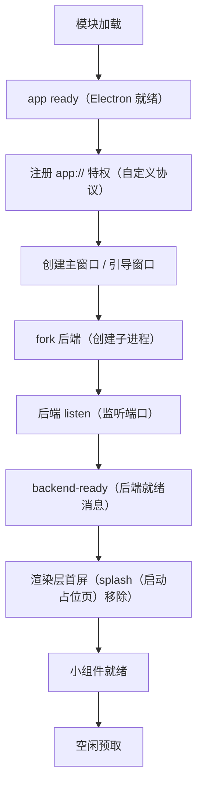

# 性能专题：启动、内存与前后端优化

<!-- doc-tree:start -->
## 本篇涉及的文件

只展示本篇会讲到的代码文件；模块内其余文件见同级 README。

```text
classnest/
├── electron/
│   ├── main/
│   │   ├── main.privateWorkingSet.js  # 与任务管理器「进程」页一致
│   │   └── main.startup-timer.js
│   └── afterPack.js  # 仅 win32
└── testjs/
    └── probe/
        ├── bundle-diff.mjs  # 构建产物体积差异
        ├── etag-revalidate-probe.cjs  # 缓存校验
        ├── inp-probe.mjs  # 交互延迟（INP），自动起 Vite + 带调试口的 Electron，CDP 派发真实输入
        ├── longframe-probe.mjs  # 长帧
        ├── measure-startup.mjs  # 启动耗时；--backend-only / --dev / --json / --runs
        └── pdf-leak-probe.mjs  # PDF 导出内存泄漏（看 V8 external）
```
<!-- doc-tree:end -->

> 数据来源：`electron/main/*`、`student-backend/app.js`、`testjs/probe/*` 的实测记录与 `doc/开发文档/优化文档.md`（不入库）。文中数值是**历史实测值**，不是本次重新测量；改代码后用 `testjs/probe` 复测。

---

## 专题总览

- **定位**：性能专题：启动全链路与计时口径、内存采样、前后端优化清单、打包体积与测量方法。
- **测量口径**：启动计时以「后端就绪 + 首屏可见」为准；内存看 `PDH`（Windows 性能计数器）的专用工作集，不看任务管理器里的 `rss`（常驻内存）。
- **局限**：文中数值是历史实测，换机 / 升级 / 改代码后需用 `testjs/probe` 复测（见文末「验证与注意事项」）。

---

## 详细说明

### 1. 启动全链路



计时由 [`main.startup-timer.js`](../../../electron/main/main.startup-timer.js) 统一采集：

- 起点为模块加载时刻；`mark(name)` 打印 `[startup] +Nms name`。
- `end(name)` 定死「启动完成」锚点（幂等，只认第一次）：**进程启动 → 第一个窗口首次显示**，即 `revealWindow()` 里的 `startupTimer.end('窗口首次显示')`。
- 后端就绪、首屏数据、小组件就绪等更晚事件只记时间线，**不再抬高总耗时**；用户在引导页停留也不计入。
- 渲染层 `[startup]` 日志（Vue 挂载完成、占位页移除）由主进程 `console-message` 采集；只收首次加载，`did-finish-load` 后停收（「占位页移除」例外放行一次）。
- 输出：`whenReady` 后 5 秒打印时间线，并追加写入 `userData/data/startup.log`；性能面板经 `perf-startup` 读取。

关键打点：`app.whenReady 就绪`、`协议注册完成`、`createMainWindow/createSetupWindow 完成`、`startBackend 完成`、`ready-to-show`、`Vite 就绪`、`loading 页面加载完成`、`Vite 页面加载完成`、`后端就绪`、`Vue 挂载完成`、`占位页移除（界面可见）`。

### 2. 内存口径与采样

| 口径 | 来源 | 用途 |
| --- | --- | --- |
| 专用工作集（Private Working Set） | [`main.privateWorkingSet.js`](../../../electron/main/main.privateWorkingSet.js) 用 `koffi`（FFI 库，JS 调 C/DLL）调 `pdh.dll`（Windows 性能数据 DLL）的 `\Process V2(*)\Working Set - Private` | 与任务管理器「进程」页一致 |
| 工作集 / 提交大小 | Electron `app.getAppMetrics()`（应用指标）/ Node | 仅作对比，**不是**任务管理器口径 |
| 后端自报 | 主进程经 `IPC`（进程间通信）向后端查询 `mem-report`（内存报告） | 后端进程内存与 `GC`（垃圾回收）状态 |

- `PDH`（Windows 性能数据助手）的 `PdhAddEnglishCounterW`（添加英文性能计数器）在每个进程内**首次调用会同步阻塞约 500ms**（Windows 计数器 provider 一次性载入，换路径也一样）。原先放在主进程启动路径上会把窗口/首屏/后端就绪整体推迟 500~600ms，现改到 **worker 线程**执行：主线程只做一次异步往返，首次查询约 0.7s 全在后台线程。
- 采样：`startMemSampling()`（开始内存采样）后台定时汇总「总计 / 近一分钟平均 / 自启动最高」；面板通过 `perf-snapshot`（性能快照）读取，`perf-restart-frontend`（重启前端）、`perf-restart-widget`（重启小组件）、`perf-relaunch-app`（重启应用）、`perf-gc`（触发垃圾回收）提供处置手段。
- 非 Windows 或 koffi 不可用时返回 `null`，调用方回退 Electron 自带口径。

### 3. 前端优化

| 优化 | 做法 | 目的 / 代价 |
| --- | --- | --- |
| splash 占位 | `index.html` 内联启动画面，等「后端就绪 + 路由就绪 + 样式就绪」再移除 | 避免白屏；超时 12s 强制移除兜底 |
| 主题变量先行 | Vue 挂载前写入 `--bg-image` 等 CSS 变量 | 消除首屏主题闪烁 |
| 非阻塞 CSS | `vite.config.js` 的 `nonBlockingCss` 把 CSS link 改 `media="print" onload` | 首屏不被样式阻塞 |
| warmup | `server.warmup` 预编译首屏模块 | 减少首次请求编译时间 |
| 路由预取 | `prefetchRoutes()` 空闲逐条预热 chunk；`Sidebar` 悬停 `prefetchRoute` | 点击无等待 |
| 弹窗预取 | `v-preload`（悬停 80ms）+ `defineAsyncComponent` | 打开弹窗即用 |
| KeepAlive | `<KeepAlive :max="16">` | 返回页面不再重建 |
| 首屏数据聚合 | `ensureDashboardData()` 并行 9 个接口 + 模块级缓存 | 避免串行与重复请求 |
| 表头先行 | 表格挂载先渲染表头，数据后填 | 空表不塌陷、无 skeleton 闪动 |
| 缩略图批量 | `useThumbBatch` 一次批量取 ≤200 张（0.22~0.32ms/张，逐个并发 6 时 2.15ms/张） | 约 10x；objectURL 必须 revoke |
| 时间轴虚拟滚动 | `usePhotoTimeline` 只挂载视口附近分组 | 大相册不卡 |
| 字体子集 | `utils/pdfFont.js` + `hbSubset.js` 按实际字符子集 | PDF 体积与内存 |
| 避免同步 IO | 缩略图改用异步读 + 内存 LRU（`fs.existsSync` 实测 100~524us 会阻塞） | 单请求 1829us → 167us |

**不做的事**：`GridView` 不做虚拟滚动（rowspan + 拖拽依赖完整 DOM）；首屏体积不是瓶颈（实测 325KB）；数据库索引合理，不再加。

### 4. 后端优化

| 优化 | 做法 | 原因 |
| --- | --- | --- |
| 路由懒加载 | `listen` 回调里 `setImmediate` 逐个 `require` 并挂载 | 把 sharp/pdf-parse 等重依赖的加载推到就绪信号之后 |
| 依赖懒加载 | better-sqlite3、sharp、bcryptjs、multer、pdf-parse 按需 `require` | 缩短启动 |
| warmup | 就绪后 `setImmediate` 调 `dbManager.warmup()` 打开 `index.db` | 消化一次冷启动成本，不阻塞就绪 |
| 连接 LRU | `CONN_CACHE_MAX = 10`，超限按 LRU 关闭 | 多账号切换不重复打开 |
| 扫描独立子进程 | `scanWorker` fork，空闲 60s 退出，崩溃限流重建 | sharp 的 libuv 池是进程级，只有 fork 才隔离 |
| 批量写库 | 缩略图 10 条一批事务；断点 20 个文件一次 | 减少事务与锁竞争 |
| 分批删除/让出 | `DELETE_BATCH=2000` + `yieldLoop()`；每 16 文件让出 | better-sqlite3 同步执行会卡住整个进程 |
| bcrypt 异步 | `services/bcryptAsync.js` | 同步版每次阻塞 56~65ms |
| 缩略图内存缓存 | 索引 + 64MB LRU | 单请求 167us |
| 心跳/看门狗 | 30s ping、4s 超时、连续 2 次判假死；请求失败触发即时探测 | 后端异常可快速发现并重连 |

### 5. 打包体积与磁盘

- [`afterPack.js`](../../../electron/afterPack.js)（仅 win32）：剔除 `vk_swiftshader.dll`、`vk_swiftshader_icd.json`、`vulkan-1.dll`、`dxcompiler.dll`、`dxil.dll`（约 -32MB）；`LICENSES.chromium.html`（约 19.4MB）压成 `third-party-licenses.zip`（自实现 CRC32 + `deflateRawSync`）。
- 保留：`libGLESv2.dll` / `libEGL.dll` / `d3dcompiler_47.dll`（ANGLE）、`icudtl.dat`、`resources.pak`、`v8_context_snapshot.bin`、`snapshot_blob.bin`、`ffmpeg.dll`（视频播放）。
- [`electron-builder.json`](../../../electron-builder.json)：`compression:'maximum'`；排除 `pdfjs-dist`、`@napi-rs`、`pdf-parse` 的多余 dist、`mammoth` 浏览器版、`xlsx` 无用 dist、`koffi/vendor`、`*.map`、`*.d.ts`、`**/*.md`、测试目录；`NotoSansSC-6.ttf` 不进包（只留 `.ttf.gz`）。
- `asarUnpack`（不打进 asar 包、保留为独立文件）：`resources/ffmpeg/**`（视频处理）、`student-backend/**`（后端子进程代码）、`node_modules/**`（原生模块）、`*.node`（原生二进制）。
- 磁盘：用户数据在 `userData/data`；缩略图按库隔离、回收站有上限策略（`album-thumbs/`、`album-trash/`）。

---

## 验证与注意事项

| 命令 / 脚本 | 测量内容 |
| --- | --- |
| `npm run inp` → [`testjs/probe/inp-probe.mjs`](../../../testjs/probe/inp-probe.mjs) | 交互延迟（INP），自动起 Vite + 带调试口的 Electron，CDP 派发真实输入 |
| [`testjs/probe/measure-startup.mjs`](../../../testjs/probe/measure-startup.mjs) | 启动耗时；`--backend-only` / `--dev` / `--json` / `--runs` |
| [`testjs/probe/longframe-probe.mjs`](../../../testjs/probe/longframe-probe.mjs) | 长帧 |
| [`testjs/probe/pdf-leak-probe.mjs`](../../../testjs/probe/pdf-leak-probe.mjs) | PDF 导出内存泄漏（看 V8 external） |
| [`testjs/probe/bundle-diff.mjs`](../../../testjs/probe/bundle-diff.mjs) | 构建产物体积差异 |
| [`testjs/probe/etag-revalidate-probe.cjs`](../../../testjs/probe/etag-revalidate-probe.cjs) | 缓存校验 |
| 性能面板 | `perf-snapshot`（逐进程内存、总计、平均、最高）、`perf-startup`（启动时间线） |

结论口径：**收益要能端到端测出来**。例如 Vapor 迁移「100% 收益来自 Vapor，但绝对收益 <1ms、首屏 gzip +41KB」，因此只作为可选通道；命名管道方案实测快 70% 但因 fetch adapter 对 204 误判导致页面闪跳，已全量回退。历史数据与推导在 `doc/开发文档/`（不入库）。

---
