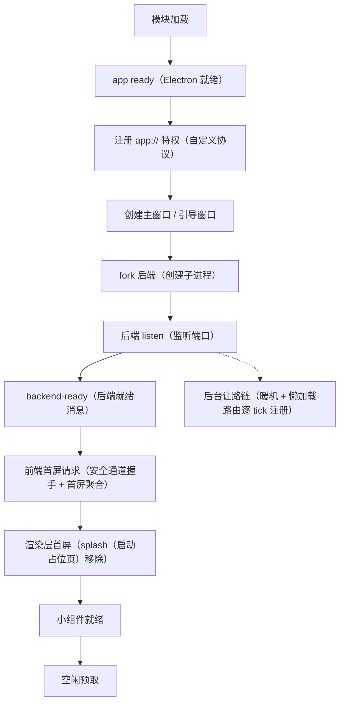

# 性能专题：启动、内存与前后端优化

<!-- doc-tree:start -->
## 本篇涉及的文件

只展示本篇会讲到的代码文件；模块内其余文件见同级 README。

```text
classnest/
├── electron/
│   ├── main/
│   │   ├── main.privateWorkingSet.js  # 与任务管理器「进程」页一致
│   │   └── main.startup-timer.js
│   └── afterPack.js  # 仅 win32
└── testjs/
    └── probe/
        ├── bundle-diff.mjs  # 构建产物体积差异
        ├── etag-revalidate-probe.cjs  # 缓存校验
        ├── inp-probe.mjs  # 交互延迟（INP），自动起 Vite + 带调试口的 Electron，CDP 派发真实输入
        ├── longframe-probe.mjs  # 长帧
        ├── measure-startup.mjs  # 启动耗时；--backend-only / --dev / --json / --runs
        └── pdf-leak-probe.mjs  # PDF 导出内存泄漏（看 V8 external）
```
<!-- doc-tree:end -->

> 数据来源：`electron/main/*`、`student-backend/app.js`、`testjs/probe/*` 的实测记录与 `doc/开发文档/优化文档.md`（不入库）。文中多数数值是**历史实测值**；第 6 节标 2026-11-07 的打包版实测与独立探针结果，第 7 节标 2026-11-09 复测后的最终定案与新基线。改代码后用 `testjs/probe` 复测。

---

## 专题总览

- **定位**：性能专题：启动全链路与计时口径、内存采样、前后端优化清单、打包体积与测量方法。
- **测量口径**：启动计时以「后端就绪 + 首屏可见」为准；内存看 `PDH`（Windows 性能计数器）的专用工作集，不看任务管理器里的 `rss`（常驻内存）。
- **归因口径**：「后端已监听」不等于「首个请求能被处理」。启动后还有一段后台同步工作，判断它有没有挡住首屏，看握手 `fetch`（网络往返）段与后端「懒加载队列完成」时刻的先后，不看总耗时（见第 6 节）；另一个相位是首条握手请求早于后端 `listen`（监听）发出，会撞连接被拒后的固定退避（见第 7 节）。
- **局限**：文中数值是历史实测，换机 / 升级 / 改代码后需用 `testjs/probe` 复测（见文末「验证与注意事项」）；开发版页面晚约 2 秒加载，后端启动窗口类优化在开发版测不出来，必须打包验证。

---

## 详细说明

### 1. 启动全链路



就绪信号在 `listen` 回调的最前面发出；后台让路链随后每次只跑一步、把事件循环交还给 `poll`（网络 I/O）阶段，因此首屏请求不必等它跑完。启动期真正会被访问的 `/api/secure/handshake` 与 `/api/dashboard` 已在 `listen` 之前挂好。

计时由 [`main.startup-timer.js`](../../../electron/main/main.startup-timer.js) 统一采集：

- 起点为模块加载时刻；`mark(name)` 打印 `[startup] +Nms name`。
- `end(name)` 定死「启动完成」锚点（幂等，只认第一次）：**进程启动 → 第一个窗口首次显示**，即 `revealWindow()` 里的 `startupTimer.end('窗口首次显示')`。
- 后端就绪、首屏数据、小组件就绪等更晚事件只记时间线，**不再抬高总耗时**；用户在引导页停留也不计入。
- 渲染层 `[startup]` 日志（Vue 挂载完成、占位页移除）由主进程 `console-message` 采集；只收首次加载，`did-finish-load` 后停收（「占位页移除」例外放行一次）。
- 输出：`whenReady` 后 5 秒打印时间线，并追加写入 `<数据目录>/logs/startup.log`；性能面板经 `perf-startup` 读取。

关键打点：`app.whenReady 就绪`、`协议注册完成`、`createMainWindow/createSetupWindow 完成`、`startBackend 完成`、`ready-to-show`、`Vite 就绪`、`loading 页面加载完成`、`Vite 页面加载完成`、`后端就绪`、`Vue 挂载完成`、`占位页移除（界面可见）`。

除主进程时间线外，还有三组归因打点（2026-11-07 补，输出格式保持原样）：

- 渲染层 `握手完成 Nms 分段(IPC / keygen / fetch / derive)`：把一次安全通道握手拆成主进程往返、密钥生成、网络往返、密钥派生四段，用于区分本机阻塞与后端排队。
- 渲染层 `首屏请求汇总 就绪 重试N次 共Nms`：记录首屏数据从发起到就绪的重试次数与总耗时。
- 后端 `[boot] +Nms ...`：核心模块加载完成、开始监听、`监听成功 = 就绪`、`数据库 warmup 完成`、`懒加载路由全部注册完成（队列 Nms）`；另有 `dashboard 首屏聚合 Nms（进入 N）` 记录请求到达时刻与该接口自身耗时。

⚠️ 两个日志文件的计时零点不同（`startup.log` 取模块加载，`backend.log` 取后端入口），**不能跨文件把绝对时刻相减对齐**；只用 `startup.log` 内部的相对时刻，或 `backend.log` 内部的段内差值。

### 2. 内存口径与采样

| 口径 | 来源 | 用途 |
| --- | --- | --- |
| 专用工作集（Private Working Set） | [`main.privateWorkingSet.js`](../../../electron/main/main.privateWorkingSet.js) 用 `koffi`（FFI 库，JS 调 C/DLL）调 `pdh.dll`（Windows 性能数据 DLL）的 `\Process V2(*)\Working Set - Private` | 与任务管理器「进程」页一致 |
| 工作集 / 提交大小 | Electron `app.getAppMetrics()`（应用指标）/ Node | 仅作对比，**不是**任务管理器口径 |
| 后端自报 | 主进程经 `IPC`（进程间通信）向后端查询 `mem-report`（内存报告） | 后端进程内存与 `GC`（垃圾回收）状态 |

- `PDH`（Windows 性能数据助手）的 `PdhAddEnglishCounterW`（添加英文性能计数器）在每个进程内**首次调用会同步阻塞约 500ms**（Windows 计数器 provider 一次性载入，换路径也一样）。原先放在主进程启动路径上会把窗口/首屏/后端就绪整体推迟 500~600ms，现改到 **worker 线程**执行：主线程只做一次异步往返，首次查询约 0.7s 全在后台线程。
- 采样：`startMemSampling()`（开始内存采样）后台定时汇总「总计 / 近一分钟平均 / 自启动最高」；面板通过 `perf-snapshot`（性能快照）读取，`perf-restart-frontend`（重启前端）、`perf-restart-widget`（重启小组件）、`perf-relaunch-app`（重启应用）、`perf-gc`（触发垃圾回收）提供处置手段。
- 非 Windows 或 koffi 不可用时返回 `null`，调用方回退 Electron 自带口径。

### 3. 前端优化

| 优化 | 做法 | 目的 / 代价 |
| --- | --- | --- |
| splash 占位 | `index.html` 内联启动画面，等「后端就绪 + 路由就绪 + 样式就绪」再移除 | 避免白屏；超时 12s 强制移除兜底 |
| 主题变量先行 | Vue 挂载前写入 `--bg-image` 等 CSS 变量 | 消除首屏主题闪烁 |
| 非阻塞 CSS | `vite.config.js` 的 `nonBlockingCss` 把 CSS link 改 `media="print" onload` | 首屏不被样式阻塞 |
| warmup | `server.warmup` 预编译首屏模块 | 减少首次请求编译时间 |
| 路由预取 | `prefetchRoutes()` 空闲逐条预热 chunk；`Sidebar` 悬停 `prefetchRoute` | 点击无等待 |
| 弹窗预取 | `v-preload`（悬停 80ms）+ `defineAsyncComponent` | 打开弹窗即用 |
| KeepAlive | `<KeepAlive :max="16">` | 返回页面不再重建 |
| 首屏数据聚合 | `ensureDashboardData()` 并行 9 个接口 + 模块级缓存 | 避免串行与重复请求 |
| 表头先行 | 表格挂载先渲染表头，数据后填 | 空表不塌陷、无 skeleton 闪动 |
| 缩略图批量 | `useThumbBatch` 一次批量取 ≤200 张（0.22~0.32ms/张，逐个并发 6 时 2.15ms/张） | 约 10x；objectURL 必须 revoke |
| 时间轴虚拟滚动 | `usePhotoTimeline` 只挂载视口附近分组 | 大相册不卡 |
| 字体子集 | `utils/pdfFont.js` + `hbSubset.js` 按实际字符子集 | PDF 体积与内存 |
| 避免同步 IO | 缩略图改用异步读 + 内存 LRU（`fs.existsSync` 实测 100~524us 会阻塞） | 单请求 1829us → 167us |
| 回环预连接（已撤回） | `index.html` 曾加 `preconnect`（预连接）并把地址由 `localhost` 改成 IPv4 字面量 `127.0.0.1:3000`，2026-11-09 打包复测后整行删除 | 三包同口径对比（`localhost` / `127.0.0.1` / 无），慢簇占比 2/7 → 10/11 → 5/5，与预连接有无无关，「同源预连接放大慢簇」的归因作废；同源请求本就不需要预连接，源码注释已写明别加回来（见第 7 节） |
| 主密钥预取 | `preload.js` 在页面脚本之前（`document-start`）发起 `get-master-key`，渲染层经 `window.__MASTER_KEY__.get()` 复用同一个在途 `promise` | 把 18~30ms 的跨进程往返从握手关键路径挪到页面解析之前；取不到时回退现场 `invoke`。⚠️ 有相位副作用：省下的约 20ms 会让裸 `fetch` 早于后端 `listen`（监听）发出，撞连接被拒并触发约 210ms 固定退避，**必须与下一行配套**（见第 7 节） |
| 握手前等后端就绪 | `secureChannel.js` 在 `ensureSession()` 的裸 `fetch` 之前 `await waitForBackendReady(1500)`（等待后端就绪，短超时不抛错） | 无论主密钥是否预取，都不让首条请求落到后端 `listen` 之前；等待计入 `keygen` 分段，保持 `IPC` / `fetch` 两个判据口径纯净。超时照发，交回既有重试链，避免每轮重试各白等一遍 |
| 回环地址统一 | 6 处 `localhost:3000` 改为 `127.0.0.1:3000`（`httpClient` / `apiUrl` 必须同步改，否则 host-only Cookie 域分裂） | 打包版热启动界面可见约 844ms → 640ms |

**不做的事**：`GridView` 不做虚拟滚动（rowspan + 拖拽依赖完整 DOM）；首屏体积不是瓶颈（325KB 时代实测；当前静态入口 375KB，见第 7 节待重判）；数据库索引合理，不再加；骨架屏方案（`HOME_SKELETON_ONLY`）可再省约 200ms，代价是先看到骨架屏，默认不开。

### 4. 后端优化

| 优化 | 做法 | 原因 |
| --- | --- | --- |
| 路由懒加载（让路链） | `listen` 后把暖机、19 个 loader、错误兜底、完成打点串成 `runStep` 链：每次只排一个 `setImmediate` 回调，在该回调内再排下一步 | 旧写法一次性入队，Node 会在同一轮 check 阶段清空整个队列，连续同步 100~160ms，期间到达的 HTTP 请求连 accept 都进不去；新写法每步之间必经 `poll`（网络 I/O）阶段 |
| 首屏路由提前注册 | `/api/secure/handshake` 与 `/api/dashboard` 在 `listen` 之前挂载 | 让路链下首屏请求会早于其余路由注册完成就到达，不提前挂会 404 |
| loader 重排 | `dashboard` 依赖的 7 个模块集中在链首，`ai` / `multer` 等首屏用不到的挤到链尾 | 缩小首屏请求与后台链的资源竞争 |
| 端口重入保护 | `deferredStarted` 标记，端口占用递归重入时不重复 `app.use` | 避免路由与错误中间件在 Express 栈里堆叠 |
| 依赖懒加载 | better-sqlite3、sharp、bcryptjs、multer、pdf-parse 按需 `require` | 缩短启动 |
| warmup | 就绪后作为让路链的**第 0 步**调 `dbManager.warmup()` 打开 `index.db`，仍留在链首 | 消化一次业务库冷开成本；曾试过挪到链尾，握手快 154ms，但真实首屏会撞业务库冷开，收益不可证，已回退 |
| 保住打点口径 | 「懒加载路由全部注册完成（队列 Nms）」仍在链尾打印，输出格式不变 | 让路后队列本身会被 poll 阶段拉长（线上 ~66ms → 154~174ms），它是「让路生效」的观测信号，不是变慢 |
| 连接 LRU | `CONN_CACHE_MAX = 10`，超限按 LRU 关闭 | 多账号切换不重复打开 |
| 扫描独立子进程 | `scanWorker` fork，空闲 60s 退出，崩溃限流重建 | sharp 的 libuv 池是进程级，只有 fork 才隔离 |
| 批量写库 | 缩略图 10 条一批事务；断点 20 个文件一次 | 减少事务与锁竞争 |
| 分批删除/让出 | `DELETE_BATCH=2000` + `yieldLoop()`；每 16 文件让出 | better-sqlite3 同步执行会卡住整个进程 |
| bcrypt 异步 | `services/bcryptAsync.js` | 同步版每次阻塞 56~65ms |
| 缩略图内存缓存 | 索引 + 64MB LRU | 单请求 167us |
| 心跳/看门狗 | 30s ping、4s 超时、连续 2 次判假死；请求失败触发即时探测 | 后端异常可快速发现并重连 |

### 5. 打包体积与磁盘

- [`afterPack.js`](../../../electron/afterPack.js)（仅 win32）：剔除 `vk_swiftshader.dll`、`vk_swiftshader_icd.json`、`vulkan-1.dll`、`dxcompiler.dll`、`dxil.dll`（约 -32MB）；`LICENSES.chromium.html`（约 19.4MB）压成 `third-party-licenses.zip`（自实现 CRC32 + `deflateRawSync`）。
- 保留：`libGLESv2.dll` / `libEGL.dll` / `d3dcompiler_47.dll`（ANGLE）、`icudtl.dat`、`resources.pak`、`v8_context_snapshot.bin`、`snapshot_blob.bin`、`ffmpeg.dll`（视频播放）。
- [`electron-builder.json`](../../../electron-builder.json)：`compression:'maximum'`；排除 `pdfjs-dist`、`@napi-rs`、`pdf-parse` 的多余 dist、`mammoth` 浏览器版、`xlsx` 无用 dist、`koffi/vendor`、`*.map`、`*.d.ts`、`**/*.md`、测试目录；`NotoSansSC-6.ttf` 不进包（只留 `.ttf.gz`）。
- `asarUnpack`（不打进 asar 包、保留为独立文件）：`resources/ffmpeg/**`（视频处理）、`student-backend/**`（后端子进程代码）、`node_modules/**`（原生模块）、`*.node`（原生二进制）。
- 磁盘：用户数据在 `userData/data`；缩略图按库隔离、回收站有上限策略（`album-thumbs/`、`album-trash/`）。

### 6. 2026-11-07 启动归因与本轮优化

**先立可证伪的判据，再谈结论**：同一二进制连续启动，握手 `fetch` 段呈双峰且中间有空档 —— 快簇 118 / 121 / 129 / 134ms（08:34~09:07），慢簇 282~336ms（09:08 起）；09:07:51 → 09:08:06 只隔 15 秒就 134 → 283ms，同一时段后端核心 require 135→144ms、懒加载队列 265→273ms、warmup 44→38ms 几乎不动。整机噪声不会只挑单个指标翻倍，据此排除「环境变慢」这一类解释。

**机制**：`app.js` 的 `listen` 回调先发 `backend-ready`，随后把 20 个 loader 一次性 `setImmediate` 入队；Node 在 check 阶段清空**整个** immediate 队列，这些 `require` 连续同步跑完约 100~160ms，期间到达的 HTTP 请求排不上。前端收到就绪立刻发握手，正好撞进去。握手分段中 IPC 3~30ms、keygen 0~5ms、derive 0~1ms，`dashboard` handler 恒 2~4ms，慢的全在 `fetch` 段。开发版 Vite 页面晚约 2 秒加载、请求到达时后端已空闲，`fetch` 仅 51 / 59ms —— 变量是请求到达相对于后端启动完成的相位，不是网络速度。

**独立探针**：fork 真实 `student-backend/app.js`（隔离数据目录、随机密钥、不依赖 Electron 与打包），收到 `backend-ready` 的瞬间发出「OPTIONS 预检 → POST 握手」、免登录 GET 与握手后的 `/api/dashboard` GET。同批次各 3 轮中位数（ms）：

| 版本 | 握手 | OPTIONS | 并发 GET | 首屏 GET | 后台链完成 |
| --- | --- | --- | --- | --- | --- |
| 基线（一次性入队） | 467 | 411 | 423 | 10 | ready 后约 395ms |
| 让路链 | 248 | 185 | 187 | 19 | 约 460ms |
| 让路链 + 重排（采用） | 235 | 169 | 179 | 16 | 约 450ms |

基线一次复现线上形态：OPTIONS 411ms ≈ 队列 391ms。后台链自己跑完更晚，但请求不再陪它等待，这正是目的。另有纯 Node 实验佐证：20 个各 5ms 的同步 loader，一次性入队时服务端 127ms 才收到请求，链式分 tick 只需 17ms。

**打包实测**：确认包内 `app.asar.unpacked/student-backend/app.js` 与源码逐字一致后，插电状态快簇 5 批界面可见 616 / 633 / 651 / 657 / 671ms，改动前 09:08 那批为 812~855ms，约省 190ms；`dashboard 首屏聚合` 打点跑到「队列完成」之前，是旧包不可能出现的形态。

**否掉的两项（都做过实测或推算）**：

| 方案 | 结果 | 不采用的理由 |
| --- | --- | --- |
| warmup 移至链尾 | 握手 235 → 81ms | 探针里首屏 GET 返回 401、未碰数据库；真实首屏会撞业务库冷开（线上 38~64ms），省下的时间要还回去，且会改掉队列打点口径 |
| `backend-ready` 推迟到队列完成 | 无需实测即可判负 | 让路链已让请求不必等队列；推迟只让前端晚约 230ms 发请求，净负收益。主进程另有 stdout 正则兜底探测，单挪 IPC 上报未必真能推迟前端就绪 |

**电源事件要与回归分开**：12:59 两批 1586ms / 1828ms 出自笔记本未插电。判据是不碰网络、不碰后端队列的段也一起变慢 —— 进程创建→计时起点 280 / 297ms 对 85~88ms（3.2~3.4 倍）、握手 IPC 46 / 80ms 对 18~20ms、Vue 挂载 37 / 22ms 对 9~10ms；而这两批 `fetch` 仅 131 / 133ms，比插电后慢簇的 280ms 还低，与请求排队无关，不可当基线。

**两条判据已在 2026-11-09 打包验证，结论与后续定案见第 7 节**：主密钥预取生效，`分段(IPC Xms)` 从 18~20ms 降到 0~1ms；`preconnect`（预连接）改 IPv4 字面量**不是**偶发延迟的原因，三包对比已排除，真因是预取改变了握手相位，已由「握手前等后端就绪」修好。

**限制**：探针是后端独立口径，不等于界面可见时间；开发版请求到达时后端早已空闲，让路链与握手相位两项在开发版收益为 0、测不出来，只能打包验证。

### 7. 2026-11-09 复测：握手相位竞态定案与新基线

**排除预连接**：三个包用同一口径对比（去掉开发版与当天首启冷启动），慢簇与预连接有无完全无关：

| 包 | `preconnect` | 握手 `IPC` 段 | `fetch` 中位 | 慢簇 |
| --- | --- | --- | --- | --- |
| A（11/07 21:03 前） | `localhost` | 18~20ms | 74ms | 2/7 |
| B（11/07 21:45 打包） | `127.0.0.1` | 0~1ms | 280ms | 10/11 |
| C（11/09 10:34） | 无 | 0~1ms | 286ms | 5/5 |

删掉整行预连接后慢簇一个没少，「同源预连接放大慢簇」的归因作废；删除本身保留（同源请求本就不需要它）。**唯一与慢簇同步变化的变量是握手 `IPC` 段降到 0ms，即主密钥预取。**

**真因**：`secureChannel.js` 的握手走一条裸 `fetch`（不经 axios、不等后端就绪）。旧包 `await getMasterKey()` 的 18~20ms IPC 恰好把这条请求推到后端 `listen`（监听）之后；主密钥预取省掉这 20ms，请求提前落进未监听窗口 → 连接被拒 → Chromium 网络栈固定退避约 210ms，`fetch` 稳定 275~299ms。慢簇数值恒定（定时器形状而非负载抖动）、旧包偶发 2/7 到新包常态 10/11、开发版一直 28~48ms（Vite 页面晚约 2 秒，后端早就绪）三条证据一致。⚠️ 早前用「首屏请求汇总 重试0次」排除连接被拒是错的：那个计数只统计 axios 拦截器重试，裸 `fetch` 的网络层重试不计入。

**修法**：在裸 `fetch` 之前 `await waitForBackendReady(1500)`，位置在 `seg('IPC')` 之后 / `generateKey` 之前 —— 等待计入 `keygen` 分段，保持 `IPC` 与 `fetch` 两个判据口径纯净；放在 `pendingSession` 的 IIFE 内，避免并发请求各自等待、破坏握手去重。超时 `resolve(false)` 不抛错、请求照发，因为后端不可达时 axios 最多重试 6 轮，抛错会让每轮各白等一遍超时。安全中性：只改请求发出时刻，不改报文、密钥来源与认证参数。

**验证（11-09 11:46 重新打包，11:50~11:51 共 8 批）**：当天首启那批 1070ms 属冷盘冷启动，单列；其余 7 批界面可见 630 / 630 / 634 / 651 / 647 / 635 / 669ms，`fetch` 42~68ms，`IPC` 0~1ms，`keygen` 21~46ms。**275~299ms 慢簇完全消失**。`keygen` 段变大是等待计入该分段，不是变慢。

**最终定案（三项都保留）**：让路链 + 首屏路由提前注册 + loader 重排（第 6 节）、主密钥预取、握手前等后端就绪。别再回头怀疑预连接或电源，也别回退主密钥预取。

**当前基线（7 批中位，总约 645ms）**：

| 段 | ms | 占比 |
| --- | --- | --- |
| 进程创建→计时起点 + `app.whenReady` | 89 + 46 | 21% |
| 协议注册 + 建窗 + fork 后端 | 91 | 14% |
| 渲染层冷启动（`startBackend` 完成 → 背景图 URL） | 129 | 20% |
| Vue 挂载 + 发首屏请求 | 45 | 7% |
| 握手（等后端 43 + `fetch` 63） | 105 | 16% |
| 首屏数据往返 | 102 | 16% |
| 占位页移除 | 25 | 4% |

前两块合计 226ms（35%）是 Electron 进程加载、建窗与 fork，平台固定；可动的是后三段合计 52%。

**口径坑**：`dashboard.js` 的 `res.json()` 在打点前同步执行，且 `responseEncrypt`（响应加密）包装了 `res.json` → `[boot] dashboard 首屏聚合 7ms` **已含** `JSON.stringify` + 加密 + 发送，不是只算查询；AES-256-GCM 实测 1MB 仅 0.8ms，加解密不是首屏 102ms 的主因。

**未定位项（本轮零代码改动、打点未动）**：首屏 102ms 里后端只占 7ms，余下约 95ms 无归属；静态入口资源 375KB（JS 254KB + CSS 123KB，其中 `styles-*.css` 单文件 111KB 最大），是「首屏体积不是瓶颈」在 325KB 时代之后待重判的对象。两项都需先定位再谈改动，别照体积猜收益。

**11-09 定案（与启动性能解耦）**：44.9.3 → 45.2.3 的 A/B 实测中位 635.4 → 652.0ms（+16.7ms，两组范围重叠、无可感知收益；Chromium 156 让渲染层快了 57ms，但「后端就绪」没提前，收益被 `waitForBackendReady(1500)` 完整吃掉，全计入 `keygen` 段）。用户决定**保留 45.2.3**，目的不是提速，而是为 Electron 46 移除 `safeStorage`（Electron 安全存储）同步 API 做准备。同步方法已全部改为异步，主密钥在 ready 后发起预热、与建窗并行，fork 前只等已解析的缓存；启动时序与打点口径不变。本节 645ms 基线仍是 44 口径，跨版本对比必须去掉升级后首启冷缓存批次。

**2026-11-09 补充：「提前后端 listen」已实测否决（勿再提）**。用真实 `fork` 后端进程、带 `NODE_COMPILE_CACHE` 且让子进程正常退出（否则 Windows 强杀不落盘、每轮都是冷编译）的开发版探针定位，顶层同步栈构成是：`express` 依赖树占 74~78%（其内部 `body-parser` 约 115ms、`qs` 约 55ms，全属框架自带）、登录必需的 `middleware/auth` 约 39ms，而「核心模块 require 完成 → 开始监听端口」只有 4~5ms。因此把 `app.listen` 往前挪几行没有空间。

Node 的 `server.listen()` 要到 `nextTick` 才真正绑定端口（同步返回时 `address()` 仍为 `null`），所以「在顶层 require 之前同步上报 `backend-ready`」会让首个请求撞上未监听的端口，回到 11-09 刚修掉的约 210ms 连接退避；除非新加一层 bootstrap 把整个 `app.js` 包进异步回调，收益上界约 20~30ms、改动面跨多个文件，不划算。

实际做过的 A/B：把 `createDynamicTableRouter` 与 `/api/students` 整块注册从顶层挪进让路链，同一探针各 12 轮（中位）：核心 require 完成 299 → 300ms、监听就绪 331 → 329ms、懒加载链完成 539 → **552ms**、从 fork 到握手返回 612 → 621ms；`students` 路由全程 401（已注册、鉴权生效）。总工作量只是搬家，`ready` 没有提前，链反而多一个 tick —— 已逐字回退（`app.js` 回到 455 行 / 27544 字节）。剩余优化优先级回到首屏约 100ms 黑洞。

**别再提**：提前后端 listen / 拆顶层 require、骨架屏（产品取舍，用户已否）、回退主密钥预取、动 `waitForBackendReady` / 让路链 / warmup 位置、`GridView` 虚拟滚动、Vapor。

---

## 验证与注意事项

| 命令 / 脚本 | 测量内容 |
| --- | --- |
| `npm run inp` → [`testjs/probe/inp-probe.mjs`](../../../testjs/probe/inp-probe.mjs) | 交互延迟（INP），自动起 Vite + 带调试口的 Electron，CDP 派发真实输入 |
| [`testjs/probe/measure-startup.mjs`](../../../testjs/probe/measure-startup.mjs) | 启动耗时；`--backend-only` / `--dev` / `--json` / `--runs` |
| [`testjs/probe/longframe-probe.mjs`](../../../testjs/probe/longframe-probe.mjs) | 长帧 |
| [`testjs/probe/pdf-leak-probe.mjs`](../../../testjs/probe/pdf-leak-probe.mjs) | PDF 导出内存泄漏（看 V8 external） |
| [`testjs/probe/bundle-diff.mjs`](../../../testjs/probe/bundle-diff.mjs) | 构建产物体积差异 |
| [`testjs/probe/etag-revalidate-probe.cjs`](../../../testjs/probe/etag-revalidate-probe.cjs) | 缓存校验 |
| 性能面板 | `perf-snapshot`（逐进程内存、总计、平均、最高）、`perf-startup`（启动时间线）、`perf-disk-usage`（空间管理归账）、`perf-logs-clear`（清空日志） |
| `<数据目录>/logs/startup.log` + `backend.log` | 主进程时间线、握手分段、后端 `[boot]` 段与首屏请求到达时刻；两文件零点不同，只做各自内部的段内比较 |
| 打包版复测 | 退出应用、机器空闲且接通电源后连启 2 次，取界面可见与握手 `fetch` 段的中位数；开发版不覆盖后端启动窗口 |

结论口径：**收益要能端到端测出来**。例如 Vapor 迁移「100% 收益来自 Vapor，但绝对收益 <1ms、首屏 gzip +41KB」，因此只作为可选通道；命名管道方案实测快 70% 但因 fetch adapter 对 204 误判导致页面闪跳，已全量回退。后端让路链的收益也先在独立探针上测到「握手 467 → 235ms」，再由打包版界面可见 812~855 → 616~671ms 交叉印证；只测后台链完成时刻会得出相反结论（它反而更晚）。历史数据与推导在 `doc/开发文档/`（不入库）。

---
