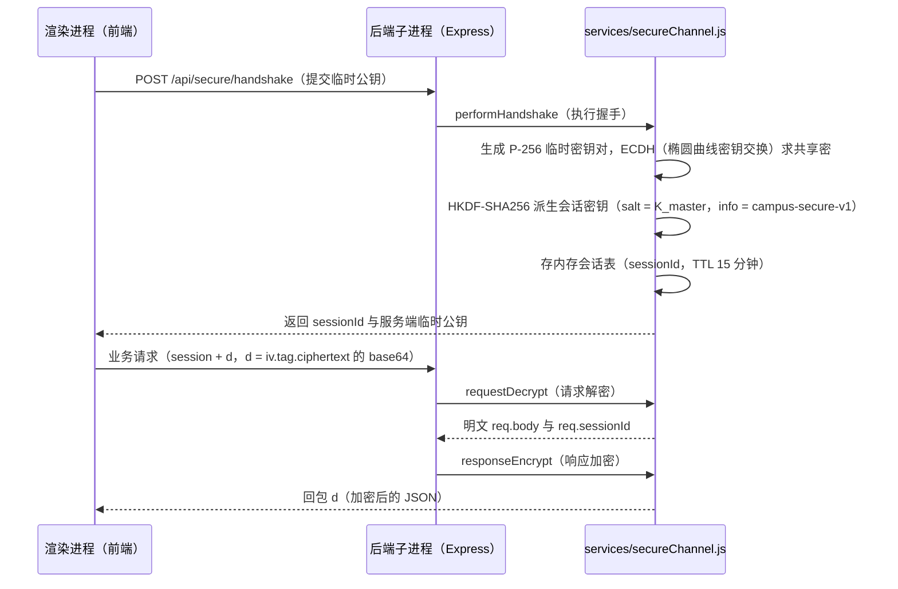

# 安全专题：架构、账号、传输、隔离与供应链

<!-- doc-tree:start -->
## 本篇涉及的文件

只展示本篇会讲到的代码文件；模块内其余文件见同级 README。

```text
classnest/
├── electron/
│   ├── inno/
│   │   └── setup.iss
│   ├── main/
│   │   ├── main.backend.js  # env 注入
│   │   ├── main.config.js  # getMasterKey
│   │   ├── main.desktop-layer.js
│   │   ├── main.js
│   │   ├── main.path-guard.js
│   │   ├── main.privateWorkingSet.js
│   │   ├── main.protocol.js
│   │   ├── main.update-integrity.js
│   │   ├── main.updater.js
│   │   ├── main.web-prefs.js
│   │   ├── main.webview-guard.js
│   │   └── main.widget.js
│   └── preload.js
├── student-backend/
│   ├── dbManager/
│   │   ├── dbManager.account.js
│   │   ├── dbManager.base.js
│   │   ├── dbManager.js
│   │   ├── dbManager.memory.js
│   │   └── dbManager.skills.js
│   ├── middleware/
│   │   └── auth.js
│   ├── routes/
│   │   ├── ai/
│   │   │   ├── ai.tools/
│   │   │   │   ├── tools.executors/
│   │   │   │   │   └── executors.proposal.js
│   │   │   │   └── tools.subagent.js
│   │   │   ├── ai.constants.js
│   │   │   ├── ai.dataRoutes.js
│   │   │   ├── ai.llm.js
│   │   │   ├── ai.subagent-tools.js
│   │   │   └── ai.upload.js
│   │   ├── undo/
│   │   │   └── undo.js
│   │   └── auth.js
│   ├── services/
│   │   ├── bcryptAsync.js
│   │   ├── businessRules.js
│   │   ├── pdfDomShim.js
│   │   ├── recoveryKey.js
│   │   ├── sanitize.js  # 裁剪/类型归一/结构校验
│   │   ├── secureChannel.js
│   │   └── unzipSafe.js  # 拦符号链接、路径穿越、绝对路径、反斜杠
│   ├── albumExif.js
│   └── app.js
├── student-frontend/
│   └── src/
│       ├── components/
│       │   └── ai/
│       │       └── AiComposer/
│       │           └── AiComposer.vue
│       ├── composables/
│       │   ├── secureAxios.js
│       │   └── secureChannel.js
│       ├── utils/
│       │   └── hbSubset.js
│       └── views/
│           └── AiAssistant.vue
└── testjs/
    ├── smoke/
    │   └── unzip-safe-test.cjs
    └── units/
        ├── pathGuard.test.js
        └── updateIntegrity.test.js
```
<!-- doc-tree:end -->

---

## 专题总览

- **定位**：安全专题：进程 / 窗口 / IPC / 路径 / 网络 / 数据 / 认证 / 网页 / AI / 更新 / 打包的分层措施与威胁边界。
- **边界**：账号与加密库的文件级细节见 [backend/data-layer.md](../backend/data-layer.md)，窗口与 IPC 的模块细节见 [main-process/README.md](../main-process/README.md)。

| 层 | 措施 | 实现位置 |
| --- | --- | --- |
| 进程 | 主进程 / 渲染进程 / 后端子进程分离；渲染层不直接拿 Node 能力 | [`electron/main/main.js`](../../../electron/main/main.js)、[`main.web-prefs.js`](../../../electron/main/main.web-prefs.js) |
| 窗口 | 所有窗口 `sandbox:true`（沙箱开启）+ `contextIsolation:true`（上下文隔离开启）+ `nodeIntegration:false`（Node 集成关闭）；生产 `webSecurity:true`（网页安全策略开启） | [`main.web-prefs.js`](../../../electron/main/main.web-prefs.js) |
| IPC | 三张白名单（`send`（发送）/ `invoke`（请求-响应）/ `receive`（接收））来自**单一来源** `electron/ipc-channels.json`，经 `additionalArguments`（附加启动参数）的 `--ipc-channels`（IPC 通道白名单参数）注入渲染进程（`sandbox`（沙箱）下 `preload`（预加载脚本）不能 `require`（加载）本地文件）；白名单外直接 `reject`（拒绝） | [`electron/preload.js`](../../../electron/preload.js)、[`electron/ipc-channels.json`](../../../electron/ipc-channels.json)、[`main.web-prefs.js`](../../../electron/main/main.web-prefs.js) |
| 路径 | 所有「路径参数」IPC 走白名单判定（绝对路径、拒绝系统目录/可执行扩展名、`realpath`（真实路径解析）防 `junction`（目录联接）） | [`main.path-guard.js`](../../../electron/main/main.path-guard.js) |
| 网络 | 后端只监听 `127.0.0.1`（本机回环地址）；Host 头白名单；`CORS`（跨域资源共享）白名单；安全通道加密 | [`student-backend/app.js`](../../../student-backend/app.js)、[`services/secureChannel.js`](../../../student-backend/services/secureChannel.js) |
| 数据 | 每账号独立加密 `SQLite`（`SQLCipher`（加密 SQLite 扩展）），库钥匙由主密钥包裹；超级隐私模式由密码/恢复词包裹 | [`dbManager/`](../../../student-backend/dbManager/dbManager.js) |
| 认证 | `JWT`（JSON Web Token，7 天）+ 登录口令（`bcrypt`（密码哈希算法）异步）+ 恢复密钥（哈希存储、常数时间比较） | [`middleware/auth.js`](../../../student-backend/middleware/auth.js)、[`routes/auth.js`](../../../student-backend/routes/auth.js) |
| 网页 | 外部网页只进 `<webview>`（内嵌网页容器，`ai-link-preview` 分区），禁 `preload`（预加载脚本）/`Node`（Node 能力）/下载，协议限 `http(s)` | [`main.webview-guard.js`](../../../electron/main/main.webview-guard.js) |
| AI | 读写表白名单 + 提案确认 + 只读子代理硬校验 + 按账号隔离的记忆/技能目录 | [`routes/ai/ai.constants.js`](../../../student-backend/routes/ai/ai.constants.js)、[`ai.subagent-tools.js`](../../../student-backend/routes/ai/ai.subagent-tools.js) |
| 更新 | 只允许 `HTTPS`（加密传输）；按 GitHub Releases 的 `sha256`（安全哈希）/ 大小校验安装包 | [`main.update-integrity.js`](../../../electron/main/main.update-integrity.js) |
| 打包 | `fuses`（Electron 熔断开关）关闭 `NODE_OPTIONS` / CLI `inspect`（调试端口）、`onlyLoadAppFromAsar`（只从 asar 包加载应用）、生产不开 `webSecurity`（网页安全）关闭 | [`electron-builder.json`](../../../electron-builder.json) |

**威胁模型局限**（明确不做的事）：

- 不防「同机同用户」的恶意进程：DPAPI/safeStorage 能挡拷贝到别的机器，挡不住当前用户自己读进程内存。
- 不承诺对抗已取得系统管理员权限的攻击者；不做代码签名校验（靠哈希 + HTTPS 分发）。
- 不为 Web 端兜底，不引入浏览器兼容分支。

---

## 详细说明

### 1. 账号等级与权限

#### 1.1 角色

- `users.role` 默认 `teacher`；注册接口**只放行 `teacher`**（`role !== 'teacher'` 直接 403「该角色正在开发中」）。
- 业务接口统一 `auth(['teacher'])`；`authStatic()` 只校验 token、不校验角色（用于 `/uploads`、`/api/background`）。
- token 载荷：`{ userId, username, role, dbSlug }`，有效期 7 天；登录同时写 httpOnly、`sameSite=lax` 的 `token` Cookie。

#### 1.2 安全等级（注册时的 `level`）

| 等级 | 库加密 | 登录密码 | 恢复词 | 库钥匙保存方式 | 说明 |
| --- | --- | --- | --- | --- | --- |
| `plain` | 否 | 不允许设置 | 无 | 无（明文库） | 明文库不允许密码；`wrapped_key` 空串、`encrypted=0` |
| `nopass` | 是 | 无 | 无 | 主密钥包裹（`wrapped_key`） | 打开库不校验口令，仅凭账号 |
| `password` | 是 | 有（bcrypt 哈希） | 无 | 主密钥包裹 | 常规加密账号 |
| `privacy`（超级隐私） | 是 | 必须有 | 12 字恢复词 | **不使用主密钥包裹**：库钥匙由密码/恢复词经 scrypt 派生包裹（`wrapped_by_password` / `wrapped_by_mnemonic`），`wrapped_key` 置空 | 拷走 `db-master.key` + 库文件也解不开 |

- scrypt 参数：`N=131072, r=8, p=1`（`SCRYPT_PARAMS`，显式放宽 `maxmem`）；每个账号独立 salt。
- 恢复词：512 字池随机取 12 字；服务端只存 `sha256('restore:'+phrase)`，比较用常数时间（`safeEqualHash`）。
- 超级隐私解锁出的库钥匙**只进内存表**，登出即丢；`resolveByUsername` 在 `protect=1` 时强制要求 password 或 mnemonic。
- 账号文件：`users` 表（`id/username/password/role/db_slug`）+ `index.db` 登记表（`slug / username / wrapped_key / encrypted / protect / wrapped_by_password / wrapped_by_mnemonic / salts / kdf_params`）。

实现： [`dbManager.account.js`](../../../student-backend/dbManager/dbManager.account.js)、[`dbManager.base.js`](../../../student-backend/dbManager/dbManager.base.js)、[`routes/auth.js`](../../../student-backend/routes/auth.js)、[`services/recoveryKey.js`](../../../student-backend/services/recoveryKey.js)。

### 2. 回环 HTTP 加密握手

1. **主密钥（认证锚点）**：主进程 `getMasterKey()` 每次运行生成 32 字节随机 `SECURE_MASTER`（进程内复用；后端崩溃重启仍复用），经 fork `env` 注入后端，经 `preload` 的 `--secure-channel` 标记告知渲染层。不落盘、不进传输。
2. **握手**：前端 `POST /api/secure/handshake` 提交临时公钥 → 后端 `performHandshake` 生成 P-256 临时密钥对 → ECDH 求共享密 → `HKDF-SHA256(ikm=共享密, salt=K_master, info='campus-secure-v1', 32)` 派生会话密钥 → 返回 `{ sessionId, pub }`。
3. **数据面**：请求体 `{ session, d }`，`d = base64(iv).base64(tag).base64(ciphertext)`；`requestDecrypt` 解密后写回 `req.body` 并记 `req.sessionId`；`responseEncrypt` 只对加密会话的 JSON 回包 `{ d: seal(...) }`。
4. **会话**：存内存，TTL 15 分钟（`SESSION_TTL_MS`）；豁免路径 `/api/secure`、`/uploads`、`/api/background`。
5. **降级策略**：非密文请求明文放行；只有收到过密文请求的会话才回加密；前端/后端开关不一致时各自退化为明文，不破坏功能。
6. **失败重试**：前端响应拦截器解密失败视为会话过期，`clearSession()` 后重新握手重试一次；错误响应同样解密以读取 `error` / `needConfirm`。

握手与数据面的时序：



实现： [`services/secureChannel.js`](../../../student-backend/services/secureChannel.js)、[`composables/secureChannel.js`](../../../student-frontend/src/composables/secureChannel.js)、[`composables/secureAxios.js`](../../../student-frontend/src/composables/secureAxios.js)、[`main.config.js`](../../../electron/main/main.config.js)（`getMasterKey`）、[`main.backend.js`](../../../electron/main/main.backend.js)（env 注入）、[`preload.js`](../../../electron/preload.js)（`__SECURE_CHANNEL__`）。

**局限**：只监听回环 + Host 白名单，防的是本机其它用户/进程与 DNS rebinding；加密防的是本机流量嗅探，不是防「同用户读进程内存」。

### 3. 后端鉴权与清洗

- **Token 解析**（`resolveToken`）：`Authorization: Bearer` → `Cookie: token=` → `?token=`（只给 `` / CSS `url()` 这类无法带头部的资源用）。
- **鉴权**：`auth(requiredRoles)` 无 token 401、角色不符 403，随后 `dbManager.withDb(user.dbSlug || 'default', next)` 用 `AsyncLocalStorage` 绑定库；未绑定库的请求在 `db.current()` 直接抛「未绑定数据库连接」。
- **JWT 密钥**：优先 `JWT_SECRET`（≥16 字符），否则读 `DATA_DIR/.jwt-secret`（不存在则生成并以 `0o600` 写入），杜绝硬编码兜底。
- **清洗**：所有写接口先过 [`services/sanitize.js`](../../../student-backend/services/sanitize.js)（裁剪/类型归一/结构校验）；业务规则在 [`services/businessRules.js`](../../../student-backend/services/businessRules.js)。
- **SQL 注入**：动态列走 `tableService` 正则白名单（`^[a-zA-Z0-9_\u4e00-\u9fa5]+$`）与保留字段保护；撤销/网格路由用固定表集合或 `PRAGMA table_info` 校验。
- **上传**：班费收据 10MB、扩展名 + MIME + **图片魔数**三重校验；AI 附件落 `os.tmpdir()/ai-uploads`，解析完即删；`express.json` 限 200MB（备份包需要）。
- **解压**：备份/资源解压走自研 [`services/unzipSafe.js`](../../../student-backend/services/unzipSafe.js)（拦符号链接、路径穿越、绝对路径、反斜杠）。
- **错误回包**：统一错误中间件只回 `{ error }`，不回栈。
- **密码**：bcrypt 统一走 [`services/bcryptAsync.js`](../../../student-backend/services/bcryptAsync.js)，避免同步版阻塞事件循环。

### 4. 网页隔离与 AI 权限隔离

#### 4.1 网页隔离（`<webview>` 抽屉）

- 外部网页只允许 `http/https`；`file:`、`data:`、`javascript:` 一律拒绝（`isHttpUrl` 唯一判定在 [`main.path-guard.js`](../../../electron/main/main.path-guard.js)）。
- `will-attach-webview` 强制：删除 `preload`（外部网页拿不到 `window.electron`）、`nodeIntegration=false`、`contextIsolation=true`、`sandbox=true`、`webSecurity=true`。
- `setWindowOpenHandler` 一律 `deny`（http(s) 改为当前 webview 内跳转）；`will-navigate` 再校验协议。
- 独立分区 `ai-link-preview`，禁用下载（拦截 `will-download` 并提示用本地浏览器）。
- 生产环境拦截 `Ctrl+R` / `F5` 等刷新快捷键，避免误触丢状态（非安全项，但同属护栏）。

实现：[`main.webview-guard.js`](../../../electron/main/main.webview-guard.js)。

#### 4.2 AI 权限隔离

| 能力 | 隔离方式 | 实现 |
| --- | --- | --- |
| 读 | `READ_TABLES` 白名单（学生/请假/班费/分数/活动/分组/班干部/课表/座位/值日/相册/撤销/设置等） | [`ai.constants.js`](../../../student-backend/routes/ai/ai.constants.js) |
| 行式写 | `WRITE_TABLES` 仅 7 张：学生、班费、活动、倒计时、请假、分数、班干部；**必须走提案** | 同上 + [`executors.proposal.js`](../../../student-backend/routes/ai/ai.tools/tools.executors/executors.proposal.js) |
| 整块 JSON 写 | `JSON_WRITE_TABLES`：课表/座位/值日各表与模板，只允许真实列、按整列替换 | 同上 |
| 前端设置 | `propose_frontend_setting` 仅允许主题/日夜/图标/标题栏/动画/透明度/提示合并；**背景图、自定义主题、账号与密钥不在范围** | [`ai.llm.js`](../../../student-backend/routes/ai/ai.llm.js) |
| 确认档位 | `approve`（默认，每次写入都要确认）/ `full`（切换时二次弹窗确认，提案自动执行）；仍记撤销 | [`views/AiAssistant.vue`](../../../student-frontend/src/views/AiAssistant.vue)、[`AiComposer.vue`](../../../student-frontend/src/components/ai/AiComposer/AiComposer.vue) |
| 子代理 | 只读白名单 10 个工具（query / aggregate / resolve_student / search_all / run_checks / run_conflict_checks / score_weights / describe_table / teaching_week / get_time）；执行前按名单硬校验，`propose_*`、`save_memory`、`undo_change`、`ask_user` 全部拒绝 | [`ai.subagent-tools.js`](../../../student-backend/routes/ai/ai.subagent-tools.js)、[`tools.subagent.js`](../../../student-backend/routes/ai/ai.tools/tools.subagent.js) |
| 数据隔离 | 记忆 `dataDir/ai-memory/<slug>.md`、技能 `ai-skills/<slug>/`（或 `AI_SKILLS_DIR`），按账号 slug 隔离 | [`dbManager.memory.js`](../../../student-backend/dbManager/dbManager.memory.js)、[`dbManager.skills.js`](../../../student-backend/dbManager/dbManager.skills.js) |
| 回滚 | 写前可建整库快照（`dataDir/snapshots/<slug>/`）；所有 AI 写操作登记 `/api/undo`，模型可用 `undo_change` 回退自己最近 N 次更改 | [`ai.dataRoutes.js`](../../../student-backend/routes/ai/ai.dataRoutes.js)、[`routes/undo/undo.js`](../../../student-backend/routes/undo/undo.js) |
| 附件 | 上传到系统临时目录、解析即删；模型只拿到文件名，需显式 `read_document` 才读取内容 | [`ai.upload.js`](../../../student-backend/routes/ai/ai.upload.js)、[`ai.llm.js`](../../../student-backend/routes/ai/ai.llm.js) |
| 联网 | 联网搜索是独立开关，未启用时工具不可用；链接预览走隔离 webview，不进入主窗口 | [`AiComposer.vue`](../../../student-frontend/src/components/ai/AiComposer/AiComposer.vue)、[`main.webview-guard.js`](../../../electron/main/main.webview-guard.js) |

### 5. 本地文件、账号与缓存结构

```
<userData>/
├─ app-config.json                 # 数据目录 / 缩略图目录 / 技能目录等配置（启动即读）
├─ desktop-widget-pos.json         # 桌面小组件落点
├─ node-compile-cache/             # 主进程 Node 编译缓存
├─ renderer-code-cache/            # 渲染进程 V8 代码缓存（含 .cc-version；超限清理）
└─ data/                           # 默认数据目录（可迁移，见 app-config.json）
   ├─ index.db                     # 主密钥加密的账号登记表（registry）
   ├─ <slug>.db                    # 每位班主任的自含加密库（slug 形如 @ + 12 hex）
   ├─ <slug>.db-wal / -shm         # WAL 边车（删账号时一并删除）
   ├─ db-master.key                # DB 主密钥密文（safeStorage/DPAPI，随数据目录迁移）
   ├─ .jwt-secret                  # JWT 兜底密钥（mode 0o600）
   ├─ uploads/                     # 班费收据等上传（多账号共享）
   │  └─ background/               # 自定义背景图
   ├─ album-thumbs/<slug>/         # 相册缩略图（按库隔离；可单独配置目录）
   ├─ album-trash/                 # 应用内回收站（删照片可撤销）
   ├─ snapshots/<slug>/            # AI 整库快照（文件名即时间戳）
   ├─ ai-memory/<slug>.md          # AI 长期记忆（不可搬迁）
   ├─ ai-skills/<slug>/<name>.md   # AI 技能（可由 AI_SKILLS_DIR 指向独立目录）
   ├─ backend.log                  # 后端日志（主进程重定向）
   └─ startup.log                  # 启动时间线
```

- 删除账号：先关连接 → 删 `.db` 与 WAL 边车 → 摘登记；**不清理** `uploads/`、`album-thumbs/`、`album-trash/`（多账号共享）。
- 明文库不写 `PRAGMA key`；加密库钥匙只以密文形式出现在 `index.db`。
- 缓存可再生：缩略图/代码缓存/编译缓存删掉只会触发重建，不影响数据。

实现：[`main.config.js`](../../../electron/main/main.config.js)、[`dbManager.base.js`](../../../student-backend/dbManager/dbManager.base.js)、[`main.protocol.js`](../../../electron/main/main.protocol.js)、[`main.widget.js`](../../../electron/main/main.widget.js)、[`main.backend.js`](../../../electron/main/main.backend.js)。

### 6. npm 包风险、替换与业务补丁

#### 6.1 已审计结论

- `npm audit`（前端）：仅 `uuid<11.1.1` 的 2 个 moderate，**不可利用**——`exceljs` 只使用 uuid v4，且不传 `buf`，风险分支不会被执行。
- **禁止** `npm audit fix --force`：它会把 `exceljs` 降级到 3.4.0，破坏导出功能。
- 依赖无「装了不用」的冗余项（审计过）。

#### 6.2 用替换/自研降低风险面

| 风险点 | 处理 | 实现 |
| --- | --- | --- |
| 第三方 EXIF 库 | 自研 TIFF/IFD + XMP 解析（约 80 行），不引包 | [`albumExif.js`](../../../student-backend/albumExif.js) |
| `@napi-rs/canvas`（约 35MB） | 改为纯 JS 最小 `DOMMatrix` 垫片给 pdfjs | [`services/pdfDomShim.js`](../../../student-backend/services/pdfDomShim.js) |
| `pdfjs-dist` 大体积/攻击面 | 打包排除；PDF 走 `pdf-parse` + 垫片 | [`electron-builder.json`](../../../electron-builder.json) |
| npm 版 `xlsx` 过旧 | 改用官方 tarball `0.20.3`（`cdn.sheetjs.com`，Apache-2.0） | [`package.json`](../../../student-frontend/package.json) |
| PDF 字体子集依赖（`subset-font` 仅 Node） | 前端用 harfbuzzjs wasm，自管实例生命周期 | [`utils/hbSubset.js`](../../../student-frontend/src/utils/hbSubset.js) |
| FFI / node-gyp 编译链 | 统一用 koffi（预编译 N-API），不引 `ffi-napi` | [`main.desktop-layer.js`](../../../electron/main/main.desktop-layer.js)、[`main.privateWorkingSet.js`](../../../electron/main/main.privateWorkingSet.js) |

#### 6.3 业务补丁（让危险分支不可达）

- `exceljs` 的 uuid 漏洞分支**不执行**：只用 v4、不传 `buf`（见 7.1）。
- 上传只做「读 + 魔数校验」，不把上传文件当可执行内容；图片解码交给 sharp；PDF/Word/Excel 只在解析线程内读文本，解析完删除临时文件。
- 解压不信任压缩包内容：`unzipSafe` 拒绝符号链接/路径穿越/绝对路径。
- 表名/列名不接受前端直传：动态列走白名单正则；撤销与网格路由用固定集合。
- 相册扫描「索引不凭空清空」：清单未收齐或目录读取失败时不执行删除（防数据丢失级事故）。

### 7. 更新与打包安全

- 更新地址与重定向后的最终地址都必须是 `https`；有 `sha256:` digest 就强制比对，没有则至少校验大小并记日志。
- 安装器静默升级前会关闭旧进程；`AppId` 固定、机器级安装（UAC）。
- `electronFuses`：关闭 `NODE_OPTIONS`、CLI inspect；`onlyLoadAppFromAsar:true`；`grantFileProtocolExtraPrivileges:false`。
- 生产 `webSecurity` 必须开启；`webSecurity` 只在开发模式关闭。

实现：[`main.update-integrity.js`](../../../electron/main/main.update-integrity.js)、[`main.updater.js`](../../../electron/main/main.updater.js)、[`electron-builder.json`](../../../electron-builder.json)、[`electron/inno/setup.iss`](../../../electron/inno/setup.iss)。

### 8. 其他容易漏掉的护栏

- **单实例锁**：`app.requestSingleInstanceLock()` 失败直接退出，重复启动只唤起已有窗口——避免两个实例同时写同一加密库。
- **外部打开**：`open-external` 只放行 `http/https`；渲染层拿不到任意协议的 `shell.openExternal`。
- **拖入文件路径**：经 `webUtils.getPathForFile` 获取（Electron 32 起 `File.path` 已移除），再进 path-guard。
- **截图/注释保存**：保存路径同样走 path-guard（只接受绝对路径、拒绝系统目录与可执行后缀）；`save-file` 只允许打开「本进程刚写过」的路径。
- **备份/恢复**：解压走 `unzipSafe`；备份包钥匙按「明文 key → 密码 → 助记词」依次尝试；恢复失败不覆盖现有库。
- **加密转换**：关连接 → 退 WAL → 完整性预检 → 备份 → rekey → 校验 → 回写登记 → 删备份，任一步失败从备份回滚。
- **相册删除**：先移入 `album-trash/` 并登记撤销，不做直接物理删除；扫描只有在清单完整时才清理索引。
- **登录态**：token 存在 `localStorage`（`app://` 同源、可持久化），XSS 面由「渲染层沙箱 + 外部内容只进隔离 webview + 不加载远程脚本」压住；token 不落日志。
- **日志**：`backend.log` / `startup.log` 只写启动与错误信息，不写请求体与口令。

### 9. 实现位置索引

| 主题 | 文件 |
| --- | --- |
| 窗口安全配置 | [`main.web-prefs.js`](../../../electron/main/main.web-prefs.js)（窗口安全选项集中配置） |
| IPC 白名单 | [`preload.js`](../../../electron/preload.js)（预加载脚本）、[`ipc-channels.json`](../../../electron/ipc-channels.json)（IPC 通道清单） |
| 路径/URL 判定（含单测） | [`main.path-guard.js`](../../../electron/main/main.path-guard.js)（路径 / URL 判定）、[`testjs/units/pathGuard.test.js`](../../../testjs/units/pathGuard.test.js)（对应单元测试） |
| 网页隔离 | [`main.webview-guard.js`](../../../electron/main/main.webview-guard.js)（网页隔离守卫） |
| 协议与目录穿越防护 | [`main.protocol.js`](../../../electron/main/main.protocol.js)（自定义协议注册与目录穿越防护） |
| 鉴权中间件 | [`middleware/auth.js`](../../../student-backend/middleware/auth.js)（接口鉴权中间件） |
| 安全通道（后端） | [`services/secureChannel.js`](../../../student-backend/services/secureChannel.js)（后端安全通道实现） |
| 安全通道（前端） | [`composables/secureAxios.js`](../../../student-frontend/src/composables/secureAxios.js)（前端安全通道装配） |
| 清洗/业务校验 | [`services/sanitize.js`](../../../student-backend/services/sanitize.js)（数据清洗）、[`services/businessRules.js`](../../../student-backend/services/businessRules.js)（业务规则校验） |
| 账号等级/隐私解锁 | [`dbManager.account.js`](../../../student-backend/dbManager/dbManager.account.js)（账号与加密库管理）、[`routes/auth.js`](../../../student-backend/routes/auth.js)（登录注册路由） |
| 恢复密钥 | [`services/recoveryKey.js`](../../../student-backend/services/recoveryKey.js)（恢复密钥处理） |
| AI 表白名单/提案 | [`ai.constants.js`](../../../student-backend/routes/ai/ai.constants.js)（AI 读写表白名单）、[`executors.proposal.js`](../../../student-backend/routes/ai/ai.tools/tools.executors/executors.proposal.js)（写入提案执行器） |
| AI 子代理白名单 | [`ai.subagent-tools.js`](../../../student-backend/routes/ai/ai.subagent-tools.js)（子代理只读工具白名单） |
| 更新完整性 | [`main.update-integrity.js`](../../../electron/main/main.update-integrity.js)（更新包完整性校验）、[`testjs/units/updateIntegrity.test.js`](../../../testjs/units/updateIntegrity.test.js)（对应单元测试） |
| 解压防护 | [`services/unzipSafe.js`](../../../student-backend/services/unzipSafe.js)（安全解压）、[`testjs/smoke/unzip-safe-test.cjs`](../../../testjs/smoke/unzip-safe-test.cjs)（解压防护冒烟脚本） |

---

## 验证与注意事项

- 安全基线已齐全（沙箱/隔离/Node 关闭/生产 webSecurity），**不要再提「补 Electron 安全配置」**。
- `npm audit fix --force` 不要跑（降级 exceljs）。
- 不要为了「更安全」改回命名管道或新增独立加密协议（已评估并全量回退，结论见 `doc/开发文档/通信层方案评估-命名管道与ACL.md`，不入库）。加密只在安全通道这一层做，业务层不重复加密。
- 不要删除随包的许可文本；更新包校验不得改为只信 `Content-Length`。

---
